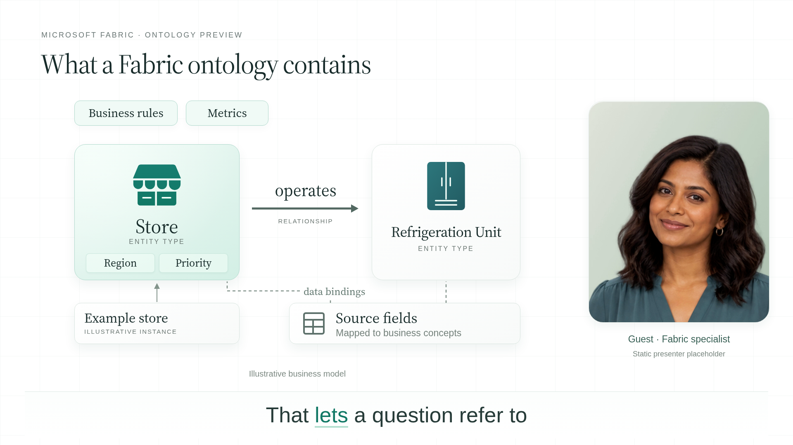
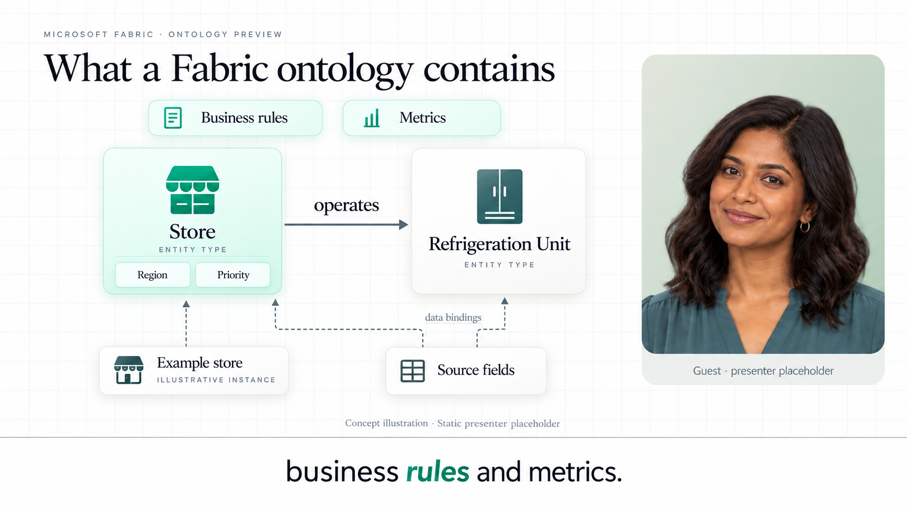

# Fabric ontology — interview-led segment

[**Watch the interview sample (43 seconds)**](https://media.githubusercontent.com/media/TayoAki/ReelFactory/main/interview-segment-fabric/fabric-interview.mp4) · [Exact dialogue](dialogue.json) · [Storyboard](storyboard/) · [Editable scene](scene.html)

This follows the reference's **speaker + supporting graphics + bottom captions** format. Josh asks the question, the guest answers, and the diagram develops as those concepts are spoken. The right-hand portrait switches with the speaking role.

**The people are static fictional placeholders with two synthetic preview voices**, as previously requested. This is a composition/motion prototype, not lip-synced footage of people talking. The graphics animate as separate editable layers; the portraits remain still.

## Script fidelity and scope

The sample uses **the exact opening host question and complete first guest answer in section 3**, from “Define a Fabric ontology in plain language” through “…reconstruct its meaning from table names.” It stops before Josh asks about organizing a larger model. It does not claim to cover the whole interview.

No opening question, ID-matching sentence, or standalone technical rewrite has been substituted. Sentences are split only to generate and align narration. All original words and punctuation are retained in `dialogue.json`; whitespace is normalized across paragraph breaks.

## What appears with the speech

| Spoken concept | Supporting graphic |
|---|---|
| Host question | Question card and host portrait |
| Shared business model | Things / Properties / Connections / Sources summary |
| Store is an entity type | Stable mint Store card |
| Particular store is an instance | Separate illustrative Example store card |
| Region and priority | Property chips inside Store |
| Store operates Refrigeration Unit | Peer unit card and named relationship |
| Data binding / source fields | Separate source-fields panel and dashed mappings |
| Business rules and metrics | Two contextual badges, without implying rule execution |
| Established concept / meaning | Hold the complete model while the guest finishes |

## Image-first evidence

Original reference composition: `../reference-library/frames/full/0001245.jpg` — fixed portrait at right, explanation graphic at left, captions at bottom. This is layout evidence, not Fabric product evidence.

Earlier keyframes derive from the same editable design. The generated master's faint dashed instance connector was corrected to a solid type/instance link; dashed lines are reserved for bindings. Fonts, badge detail and portrait crop remain approximations rather than exact pixel reproduction. The original Databricks orange is replaced by the sourced [Fabric project theme](../content/visual-language/fabric-brand/README.md).

Subject sources: [ontology overview](https://learn.microsoft.com/en-us/fabric/iq/ontology/overview) and [retail tutorial](https://learn.microsoft.com/en-us/fabric/iq/ontology/tutorial-1-create-ontology). Property/instance labels are illustrative script explanations, not invented query results. Rules/metrics are introduced conceptually; execution and metric ownership details belong to later script sections.

## Reproduce and inspect

Serve the repository at port 8765. Run `python interview-segment-fabric/narrate.py`, then `prepare_captions.py`, `build.py`, `render.py`, and `package.py` with the full folder paths. Requires edge-tts, Playwright, Chromium and FFmpeg. Existing generated audio and word timings are saved.

`script-check.json` verifies the dialogue against the supplied script excerpt. `layout-check.json` checks every caption phrase, active speaker roles, intermediate label bounds and caption/diagram separation. `export-check.json` checks the export. None of these establishes user visual approval.
