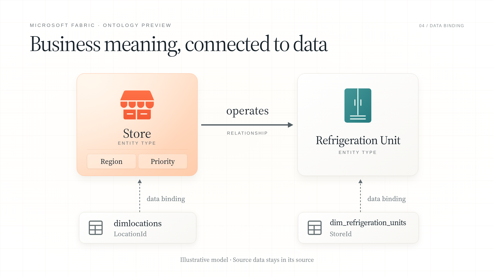
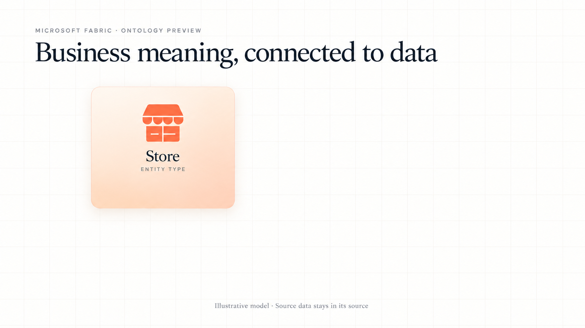
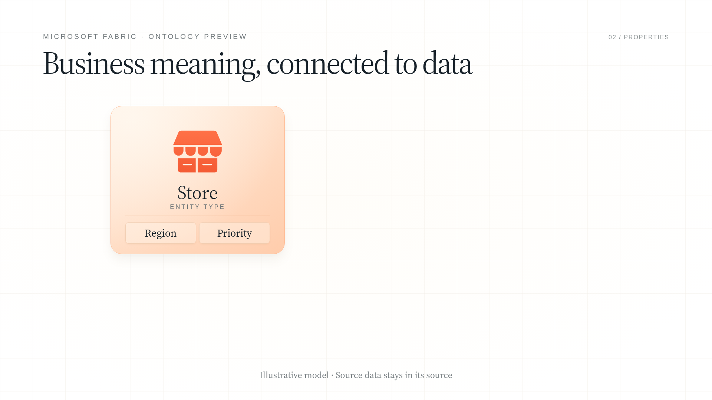
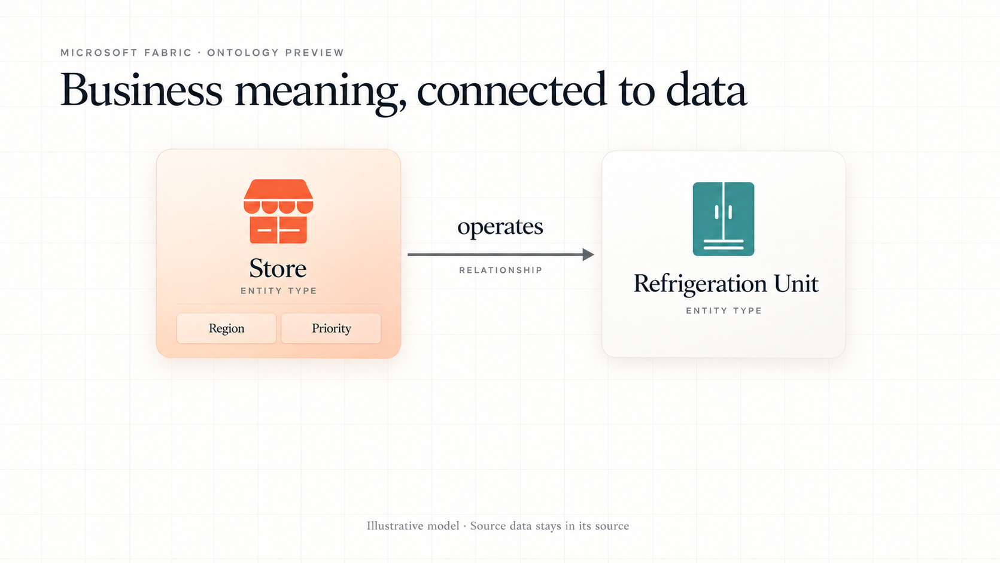
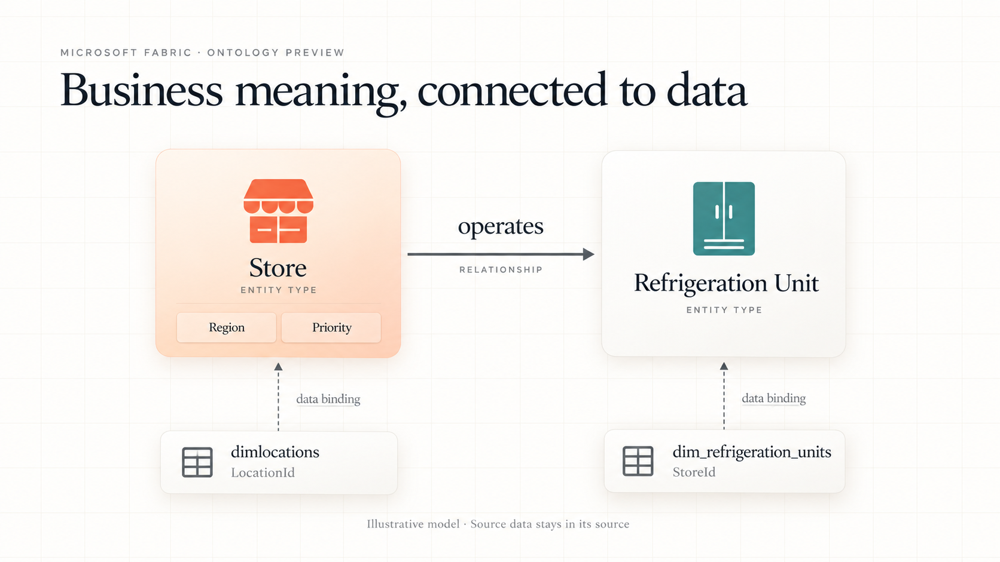
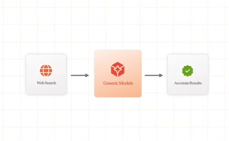

# Fabric ontology — new-transcript image-first test

[**Watch the motion graphic with narration (26 seconds)**](https://media.githubusercontent.com/media/TayoAki/ReelFactory/main/motion-pilot-fabric/fabric-ontology.mp4) · [Motion storyboard and rationale](plan-notes.md) · [Editable scene](scene.html)

This adapts section 3 of the supplied Microsoft Fabric interview. It explains **entity type → properties → named relationship → source binding**, with synthetic preview narration. It is an illustrative concept diagram, not recorded product UI or a query result. Ontology is labelled preview.

## Storyboard before motion

One generated master, then derived earlier image states. Persistent objects keep their positions; the editable SVG/HTML recreation supplies exact text and per-layer animation. The property-only state below is derived from that same editable layout.

| State | Why it appears |
|---|---|
| Store | Define an entity type before introducing its connections. |
| Region / Priority | Show that properties belong inside the entity definition. |
| Store **operates** Refrigeration Unit | Name the business relationship explicitly. |
| Source tables + dashed bindings | Separate business concepts from where their data lives. |

## Source and design comparison

The original provides warm-card art direction, not Fabric product facts or a forced three-step pipeline. This new diagram uses a named horizontal business relationship and dashed vertical source bindings. The alternate dark source-to-hub template was inspected and rejected. [Selection packet](style-packet.json).

The generated and rebuilt designs preserve the same hierarchy, footprints and icon silhouettes. Editable SVGs, font metrics, grid pitch and gradient texture remain approximations. A small phase marker was added to the final scene. This scene's visual approval is pending.

## Technical basis

Microsoft's [ontology overview](https://learn.microsoft.com/en-us/fabric/iq/ontology/overview), [retail tutorial](https://learn.microsoft.com/en-us/fabric/iq/ontology/tutorial-1-create-ontology) and [binding documentation](https://learn.microsoft.com/en-us/fabric/iq/ontology/how-to-bind-data), retrieved October 22, 2026. The tutorial maps Store to `dimlocations` and Refrigeration Unit to `dim_refrigeration_units`; its `operates` relationship matches `LocationId` to `StoreId`. Region and Priority are illustrative property names from the supplied script, not asserted sample columns. No source freshness, graph materialization or successful execution is implied.

## Reproduce

Serve the repository at port 8765. With Python, Playwright, Chromium, edge-tts and FFmpeg installed: run `python motion-pilot-fabric/narrate.py`, `python motion-pilot-fabric/build.py`, `python motion-pilot-fabric/render.py`, then `python motion-pilot-fabric/package.py` from the repository root. The narration generator uses the configured HTTPS proxy when present. Existing recordings and word-boundary metadata are preserved, so regeneration is optional. Export is 1920×1080 at 30fps, H.264/AAC. `storyboard.json` records the method; schema validation and layout/codec checks do not establish human visual approval.
