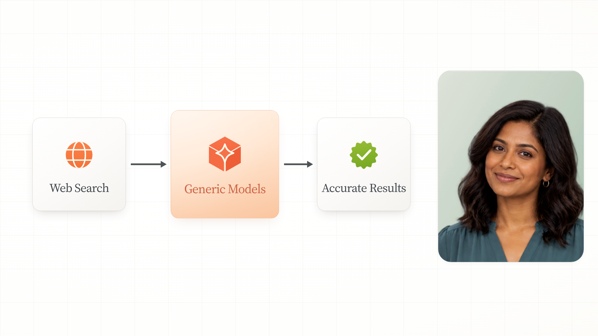
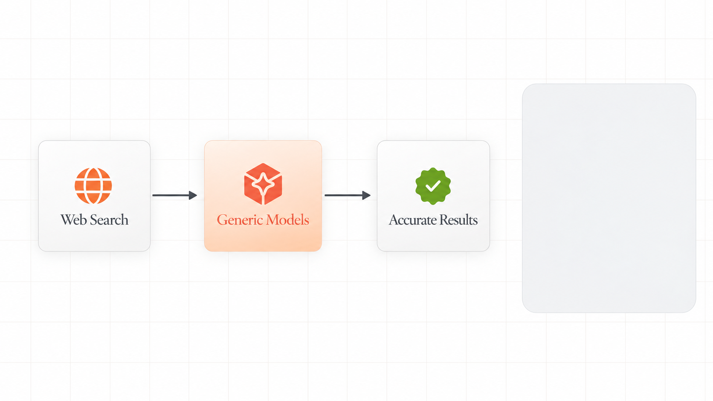

# Image-first motion pilot

[Watch the 9.3-second motion graphic](https://media.githubusercontent.com/media/TayoAki/ReelFactory/main/motion-pilot/web-search.mp4) · [Watch synchronized comparison](https://media.githubusercontent.com/media/TayoAki/ReelFactory/main/motion-pilot/comparison.mp4)

This test reconstructs the reference's explanation of generic models searching a constrained space. It uses the original narration from 01:50.2–01:59.5, a fictional static presenter, and separately editable cards, SVG icons, labels, connectors, shadows and background. “Accurate Results” belongs to that constrained example, not a general accuracy guarantee.

## Image-first evidence

[Source reference and transcript metadata](../reference-library/entries/constrained-web-flow.json) → [multiple storyboard images](../storyboard-first/web-search/) → [editable scene](scene.html?play) → rendered motion.

The model appears first with a scale overshoot. Web Search fades in next, followed by the result; connector strokes reveal between them. Timing follows sampled source frames, rather than assuming the final diagram's left-to-right reading order is its reveal order. The rebuilt model card is 16% larger than its peers, correcting the generated storyboard to follow the source hierarchy. Typography, filled symbols, warm gradient and soft shadows follow the storyboard direction. Layout and portrait differ from the source; this is a reconstruction awaiting visual judgment, not a claim of identical original keyframes.

## Reproduce

Serve the repository on port 8765. Run `python motion-pilot/build.py`, then `python motion-pilot/render.py` with Playwright, Chromium and FFmpeg installed. `plan.json` records timings and provenance. `source-study/` preserves sampled screenshots and approximate automatic word alignment. Source Serif 4 font license is included in `assets/`.

User visual approval: pending. Original and pilot comparison share the same source clock and a single original audio track.
