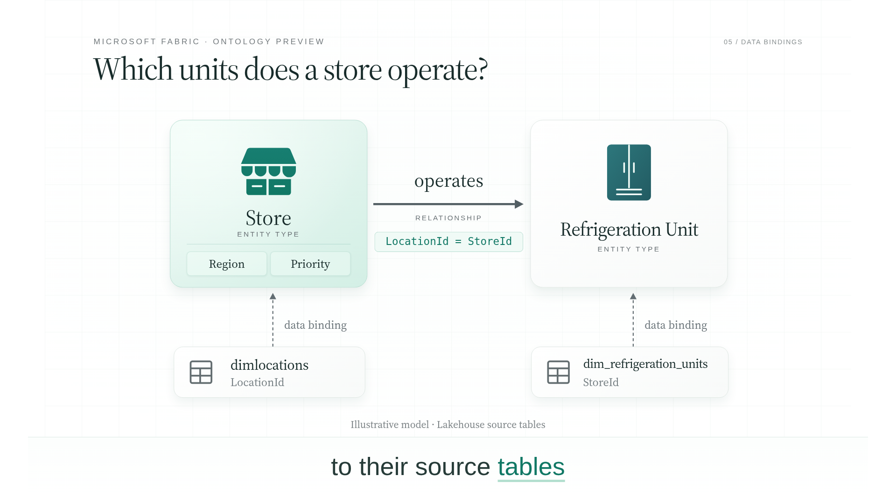
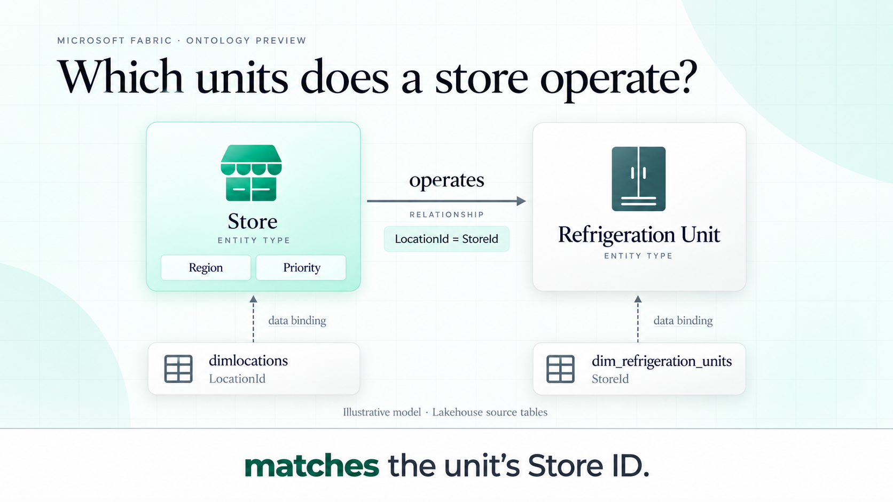
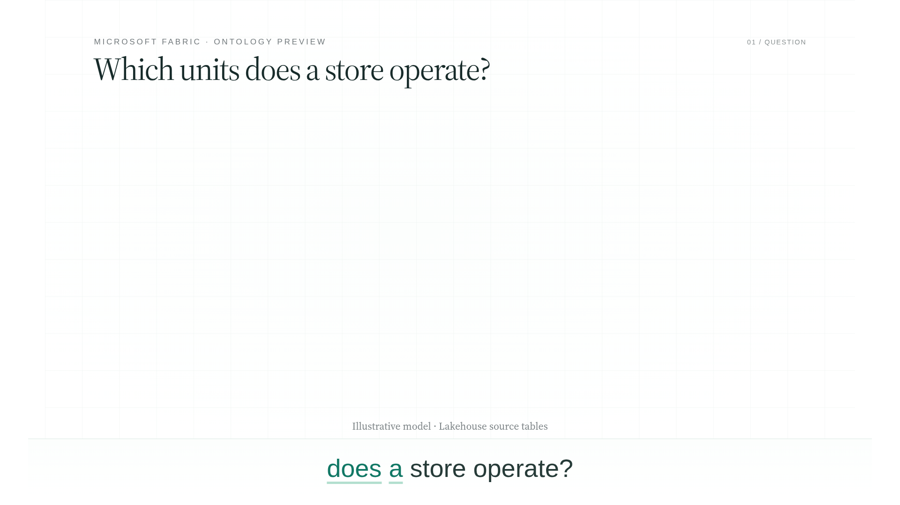
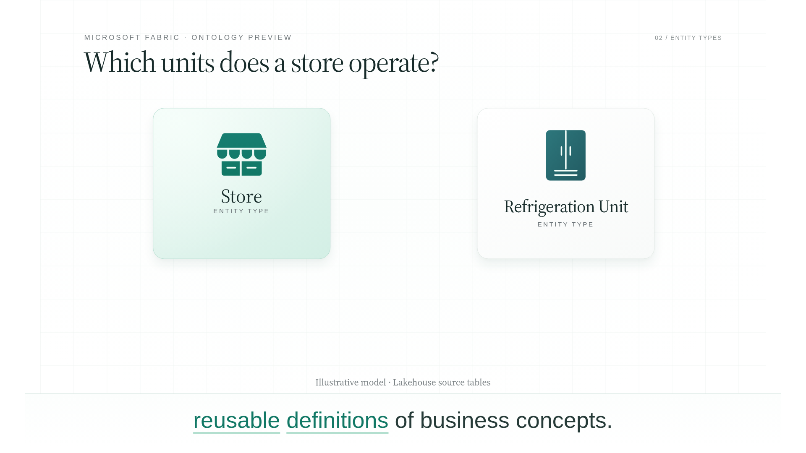
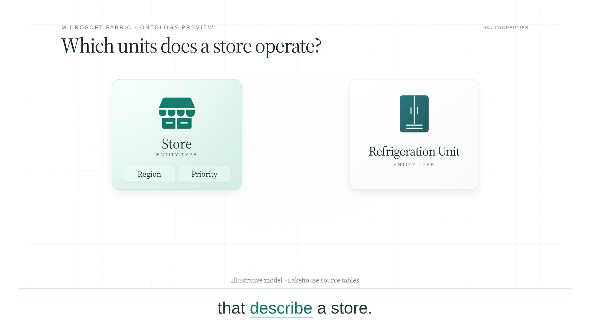

# Fabric ontology — rewritten, narrated and captioned segment

[**Watch the 42-second segment**](https://media.githubusercontent.com/media/TayoAki/ReelFactory/main/motion-segment-fabric/fabric-ontology-captioned.mp4) · [Rewrite and reasoning](rewrite.md) · [Editable scene](scene.html) · [Caption timing](captions.json)

**Question → definitions → relationship mechanism → source mapping → execution boundary.**

The motion graphic uses the Fabric mint/emerald/teal theme, synthetic preview narration and burned-in bottom captions with spoken-word emphasis. This is a technical adaptation of section 3 of the supplied interview. It explains how to model the question; it does not present an executed query or actual unit results.

## Image-first storyboard

The generated master establishes the question heading, existing entity design, explicit ID mapping and dedicated bottom caption band. Earlier images derive from that same editable design, preserving object identity and layout.

The editable implementation retains the approved restrained white grid instead of the generated candidate's decorative corner curves. Caption weight and exact font metrics differ; the generated master caption is a typesetting target, while actual caption text follows the audio at each frame.

## References and limits

Subject evidence: [Microsoft's Store operates Refrigeration Unit tutorial](https://learn.microsoft.com/en-us/fabric/iq/ontology/tutorial-1-create-ontology#store-operates-refrigeration-unit). It explicitly documents the two entity types, named relationship, origin LocationId and target StoreId, and their source tables. The downloaded [official relationship configuration screenshot](references/microsoft-relationship-configuration.png) is evidence, not generated UI. Property names Region/Priority come from the supplied script and are illustrative, not asserted sample fields.

Teaching reference: [the original video's question/answer pattern](../reference-library/entries/question-answer-action.md). This supports question-led explanation, not a claim that the reference teaches Fabric. The generated master used the approved Fabric image, original question graphic and actual Microsoft configuration screenshot as references.

Typography/depth transfer from the reference; branding follows the [Fabric theme evidence](../content/visual-language/fabric-brand/README.md). No borrowed Databricks orange, fabricated query results, copied records or automatic graph-execution claim.

## Timing and reproduction

`narration.json` retains actual generated segment durations and automatic TTS word boundaries. `captions.json` maps 79 spoken words into 19 phrases. Motion follows the newly recorded concepts; caption timing is based on audio events, not a word-count estimate. `captions.vtt` is also provided.

From the repository root, serve HTTP at port 8765. Run `python motion-segment-fabric/narrate.py`, `prepare_captions.py`, `build.py`, `render.py`, then `package.py` using their full folder paths. Existing narration recordings are saved. Requires edge-tts, Playwright, Chromium and FFmpeg. `layout-check.json` covers each caption phrase and intermediate diagram bounds; `export-check.json` covers video properties and decoding. These checks do not establish human visual approval.
