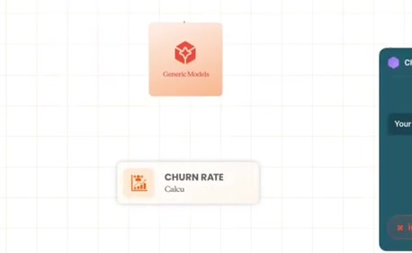
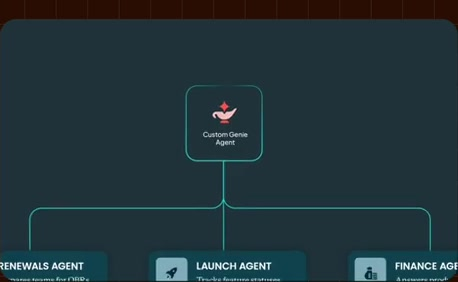

# Original-source graphic reference library

[Open the searchable review](index.html) · [Machine-readable library](library.json) · [Image-generation packet example](packets/constrained-web-flow.json)

58 curated examples, 25 teaching families, 280 curated state samples, and all 206 prior estimated change windows across the 34:28 source. There are 844 unique source-frame times, saved as 1,688 images: full evidence plus graphic-region crops. No failed-reconstruction images are included as references.

The source is 640×360. The graphic crops preserve native resolution and exclude the presenter/caption region. Full frames remain available to inspect context or cropping. Original screenshots/raw transcript are evidence; teaching interpretations, reusable sentence scaffolds and selection rules are editorial. Timing is approximate, not word alignment or original animation keyframes.

## A source finding that changes the process

The web/model/results diagram reads left-to-right, but the **model appears first**. The speaker introduces generic models, then web search. The earlier generated pilot incorrectly inferred reveal order from reading direction. Reference selection now records these separately.

## Choose a reference by the teaching relationship

Read the target narration, identify what the viewer must understand next, shortlist the relevant relationship, then inspect its source states and transcript. Use a different/custom diagram when none fits. The selector is a curated retrieval tool, not a trained semantic classifier or factual verifier.

```bash
python reference-library/select.py --template input-output --instance constrained-web-flow --mode reconstruction --out reference-library/packets/constrained-web-flow.json
```

The output includes `imagegen_request.referenced_image_paths` with original screenshots, a master-image prompt, source observations, sentence scaffolds and selection/misuse rules. View selected original images before using them. After generating the master, derive coherent state images, review their design, reconstruct editable layers, then animate. Do not reuse historical benchmark values or product claims for a new subject.

## Template families

### input-output
**Relationship:** input → mechanism → outcome
**Use when:** Use when the causal route is the lesson and each arrow has a defensible meaning.
**Alternative/misuse:** Use real UI for exact interaction steps; do not use an outcome card as evidence that execution succeeded.
**Sentence scaffold:** `{{input_source}} feeds {{mechanism}}, which produces {{outcome}}.`
[Source example and narration](entries/constrained-web-flow.md)


### converging-sources
**Relationship:** many inputs → shared hub
**Use when:** Use when the distinction among source classes matters and they share a real destination.
**Alternative/misuse:** Use a list for unrelated items; label search/query/tool access rather than implying data ingestion.
**Sentence scaffold:** `{{consumer}} draws on {{source_a}}, {{source_b}} and {{source_c}} to {{job}}.`
[Source example and narration](entries/agent-inputs.md)


### product-definition
**Relationship:** name → role → concrete capability
**Use when:** Use when the viewer needs a definition before a mechanism or example.
**Alternative/misuse:** Do not use a logo reveal to explain an internal architecture.
**Sentence scaffold:** `{{concept}} is {{category}} that {{capability}}.`
[Source example and narration](entries/product-definition.md)


### worked-example
**Relationship:** question → reasoning/result → action
**Use when:** Use after a capability needs a tangible demonstration.
**Alternative/misuse:** Use genuine product footage for actual execution; label invented chat examples as illustrative.
**Sentence scaffold:** `Suppose you ask {{concrete_question}}. {{system}} uses {{evidence}} to {{result}}.`
[Source example and narration](entries/question-answer-action.md)


### governance-boundary
**Relationship:** capability inside a constraint
**Use when:** Use when a boundary constrains an otherwise understandable flow.
**Alternative/misuse:** A shield alone does not explain a permission model; identify the actor, scope and enforcement point.
**Sentence scaffold:** `{{system}} can {{capability}}, but only within {{policy_boundary}}.`
[Source example and narration](entries/governance-enclosure.md)


### product-family
**Relationship:** shared foundation → different roles
**Use when:** Use when the products are peers with shared foundations.
**Alternative/misuse:** Do not turn peer products into an execution pipeline or imply dependency from card depth.
**Sentence scaffold:** `{{family}} shares {{foundation}}, while {{product_a}} serves {{job_a}} and {{product_b}} serves {{job_b}}.`
[Source example and narration](entries/family-peers.md)


### wrong-source
**Relationship:** question → plausible but wrong asset → wrong answer
**Use when:** Use when the failure is asset authority or relevance rather than arithmetic.
**Alternative/misuse:** Use a definition comparison for metric ambiguity; avoid showing a random table when the problem is a formula.
**Sentence scaffold:** `For {{business_question}}, {{system}} may select {{easy_but_wrong_asset}} instead of {{authoritative_asset}}.`
[Source example and narration](entries/wrong-revenue-source.md)


### metric-ambiguity
**Relationship:** same term → missing rule → changed interpretation
**Use when:** Use when scope, exclusions or semantics cause ambiguity.
**Alternative/misuse:** Use a source-authority graphic for choosing among tables; do not imply a definition alone repairs stale data.
**Sentence scaffold:** `When we say {{metric}}, we mean {{definition}}, including {{included_population}} and excluding {{excluded_population}}.`
[Source example and narration](entries/churn-definition.md)


### stale-context
**Relationship:** prior context → change → mismatch
**Use when:** Use when time or organizational change breaks relevance.
**Alternative/misuse:** A stale icon does not prove freshness checks exist; show the changed reference and its consequence.
**Sentence scaffold:** `{{asset_or_rule}} changed, but {{system}} still uses {{old_context}}.`
[Source example and narration](entries/context-drifts.md)


### context-repair
**Relationship:** broken route → missing context → repaired route
**Use when:** Use after a concrete failure has established why the missing context matters.
**Alternative/misuse:** Do not promise that context fixes all data-quality, model or authorization failures.
**Sentence scaffold:** `To answer {{question}} correctly, connect {{data}} with {{definition_or_context}}.`
[Source example and narration](entries/context-repairs-route.md)


### architecture-focus
**Relationship:** system overview → located detail
**Use when:** Use when placement in the larger system is part of the explanation.
**Alternative/misuse:** Use a standalone example when the architecture adds no relevant context.
**Sentence scaffold:** `At a high level, {{system}} contains {{components}}. Let’s focus on {{component}}.`
[Source example and narration](entries/architecture-camera.md)


### governed-hierarchy
**Relationship:** governing parent → peers → logical groups
**Use when:** Use for a real parent, containment or grouping relationship.
**Alternative/misuse:** Use equal peer cards when no parent-child relationship exists; do not invent permission inheritance.
**Sentence scaffold:** `{{governance_parent}} manages {{object_a}} and {{object_b}}; {{group}} organizes them by {{business_scope}}.`
[Source example and narration](entries/modeled-hierarchy.md)


### learned-signals
**Relationship:** work evidence → contextual signals
**Use when:** Use when the lesson is how evidence contributes contextual clues.
**Alternative/misuse:** Do not represent learned signals as certified definitions or guaranteed truth.
**Sentence scaffold:** `When people {{work_action}}, they leave {{signal}} that helps {{system}} infer {{context}}.`
[Source example and narration](entries/learning-actions.md)


### ranked-context
**Relationship:** candidate context → ranking criteria → relevant context
**Use when:** Use when relevance or prioritization is the causal lesson.
**Alternative/misuse:** A generic node graph does not explain ranking; name the criteria and avoid inventing numerical weights.
**Sentence scaffold:** `{{system}} prioritizes {{context}} using {{criterion_a}}, {{criterion_b}} and {{criterion_c}}.`
[Source example and narration](entries/context-ranking.md)


### benchmark
**Relationship:** methods × measures → qualified comparison
**Use when:** Use for comparable measured data with a credible evaluation scope.
**Alternative/misuse:** Do not transfer source benchmark values to another product or imply universal results from one evaluation.
**Sentence scaffold:** `On {{evaluation_scope}}, {{method_a}} achieved {{measure_a}}, compared with {{method_b}} at {{measure_b}}.`
[Source example and narration](entries/accuracy-runtime.md)


### access-paths
**Relationship:** distinct access modes → different jobs
**Use when:** Use when superficially similar access paths have different semantics.
**Alternative/misuse:** A collage of logos cannot distinguish retrieval from execution or ingestion.
**Sentence scaffold:** `Use {{access_mode_a}} for {{job_a}}, and {{access_mode_b}} for {{job_b}}.`
[Source example and narration](entries/document-versus-query.md)


### feature-evidence
**Relationship:** stable capability → supporting product evidence
**Use when:** Use when the actual visible product interaction supports the claim.
**Alternative/misuse:** Do not fabricate UI or infer availability beyond the visible source version.
**Sentence scaffold:** `To {{user_job}}, use {{feature}}: {{specific_interaction}}.`
[Source example and narration](entries/personal-memory.md)


### permissioned-action
**Relationship:** actor → control point → allowed/denied route
**Use when:** Use when the permission boundary or action route matters.
**Alternative/misuse:** Compatibility logos are not proof of authorization or successful execution.
**Sentence scaffold:** `{{actor}} reaches {{tool}} through {{control_point}}, which enforces {{scope}}.`
[Source example and narration](entries/controlled-tool-action.md)


### peer-categories
**Relationship:** equal-rank needs or choices
**Use when:** Use when equal conceptual rank is the lesson.
**Alternative/misuse:** Use a timeline when order matters and a hierarchy when one item contains another.
**Sentence scaffold:** `We need {{need_a}}, {{need_b}} and {{need_c}} for {{goal}}.`
[Source example and narration](entries/governance-needs.md)


### agent-delegation
**Relationship:** parent → specialists → resources
**Use when:** Use when delegation or ownership is a real relationship in the supported system.
**Alternative/misuse:** Use an input map for context sources; do not present source connectors as subordinate agents.
**Sentence scaffold:** `{{parent_agent}} delegates {{job_a}} to {{specialist_a}} and {{job_b}} to {{specialist_b}}.`
[Source example and narration](entries/specialized-agents.md)


### rollout
**Relationship:** ordered milestones → current step → details
**Use when:** Use for a real ordered process with useful current-step context.
**Alternative/misuse:** Use peer cards for unordered considerations; a rail is not a promise about calendar duration.
**Sentence scaffold:** `Start with {{team_and_workflow}}, define {{benchmark}}, measure {{baseline}}, then connect {{sources}} and iterate.`
[Source example and narration](entries/rollout-milestones.md)


### fixed-emphasis
**Relationship:** fixed recommendations → one active item
**Use when:** Use when scanning the whole recommendation set helps orientation.
**Alternative/misuse:** Do not fade inactive text below legibility or replace the list with unrelated slides.
**Sentence scaffold:** `First {{recommendation_a}}. Next {{recommendation_b}}. Finally {{recommendation_c}}.`
[Source example and narration](entries/best-practices.md)


### callout
**Relationship:** spoken concept → concise emphasis
**Use when:** Use for a short framing or recap phrase.
**Alternative/misuse:** Use a diagram when the mechanism needs explanation; a floating word is insufficient.
**Sentence scaffold:** `The key idea is {{concept}}.`
[Source example and narration](entries/outcome-callouts.md)


### chapter
**Relationship:** chapter transition
**Use when:** Use for a real structural transition.
**Alternative/misuse:** A chapter title is navigation, not an explanatory mechanism.
**Sentence scaffold:** `Now let’s look at {{next_section}}.`
[Source example and narration](entries/outcomes-title.md)


### ui-evidence
**Relationship:** actual workflow → visible execution/result
**Use when:** Use when exact interaction or observed execution is central.
**Alternative/misuse:** Illustrative diagrams cannot verify real execution. Keep reference UI separate from generated conceptual graphics.
**Sentence scaffold:** `Here is {{question_or_task}}. We {{interaction}}, then inspect {{result_or_evidence}}.`
[Source example and narration](entries/demo-citations.md)


## All source examples

- [00:08.00–00:17.00 — Sources, ontology and consumer](entries/source-hub.md)
- [00:27.00–00:35.00 — Genie Ontology topic callout](entries/topic-callout.md)
- [00:38.00–00:43.35 — Define the agentic assistant](entries/product-definition.md)
- [00:43.35–00:46.50 — Data and tools feed the assistant](entries/data-tools.md)
- [00:46.50–00:50.80 — Question, answer and suggested action](entries/question-answer-action.md)
- [00:50.80–00:54.80 — Governed capability enclosure](entries/governance-enclosure.md)
- [00:54.80–01:01.50 — Shared foundation with depth](entries/family-stack.md)
- [01:01.50–01:23.70 — Separate product-family roles](entries/family-peers.md)
- [01:50.00–02:05.00 — Web Search → Generic Models → Accurate Results](entries/constrained-web-flow.md)
- [02:05.00–02:18.00 — First revenue table versus trusted Finance source](entries/wrong-revenue-source.md)
- [02:18.00–02:27.00 — Business-specific churn exclusions](entries/churn-definition.md)
- [02:27.00–02:39.30 — Campaign answer based on stale data](entries/stale-campaign-data.md)
- [02:54.20–03:03.00 — Renamed assets and departed people](entries/context-drifts.md)
- [03:03.00–03:29.50 — Add context to the data-to-result route](entries/context-repairs-route.md)
- [03:29.50–03:54.37 — Shared modeled and learned context layer](entries/shared-architecture.md)
- [03:54.37–04:09.00 — Move inside the architecture to modeled context](entries/architecture-camera.md)
- [04:09.00–05:33.50 — Metric Views, Pages, Domains and governing layer](entries/modeled-hierarchy.md)
- [05:33.50–05:53.00 — Context learned from existing work](entries/learned-inputs.md)
- [05:53.00–06:19.00 — Joins, comments, sharing and popular queries](entries/learning-actions.md)
- [06:19.00–06:42.00 — Concrete learned business snippets](entries/learned-snippets.md)
- [06:42.00–07:18.00 — OntoRank and named relevance criteria](entries/context-ranking.md)
- [07:18.00–07:34.00 — Consumers share the context layer](entries/shared-consumers.md)
- [07:34.00–08:32.00 — Source-reported accuracy and runtime comparison](entries/accuracy-runtime.md)
- [08:45.00–09:06.00 — Reuse the benchmark during the follow-up](entries/benchmark-return.md)
- [09:06.00–09:17.00 — Access-mode categories](entries/connector-categories.md)
- [09:17.00–10:04.00 — Existing knowledge versus live-data calculation](entries/document-versus-query.md)
- [10:04.00–11:19.00 — SQL, tools and indexed search routes](entries/connector-network.md)
- [11:19.00–11:54.50 — Personal memory and visible interface](entries/personal-memory.md)
- [12:53.00–12:56.50 — First demo chapter](entries/demo-one-title.md)
- [12:56.50–13:42.00 — Orient in the real Genie interface](entries/demo-orientation.md)
- [13:42.00–14:15.00 — Context-source overlay above the prompt](entries/demo-context-overlay.md)
- [14:15.00–16:30.00 — Question, analysis and source inspection](entries/demo-analysis.md)
- [16:30.00–18:14.00 — Citations and business definitions](entries/demo-citations.md)
- [18:14.00–20:23.00 — Follow-up and continuation](entries/demo-followups.md)
- [20:29.00–20:48.00 — Visibility and business-context callouts](entries/outcome-callouts.md)
- [20:48.00–21:06.00 — From answers to outcomes](entries/outcomes-title.md)
- [21:06.00–21:48.00 — Document collaboration with real product evidence](entries/collaborative-documents.md)
- [21:48.00–21:56.00 — Third-party work tools](entries/tool-palette.md)
- [21:56.00–22:35.00 — Tool route, gateway and access checks](entries/controlled-tool-action.md)
- [22:35.00–22:43.00 — Save a repeatable task as a skill](entries/skills-interface.md)
- [22:43.00–23:00.00 — Skill sharing under a governance layer](entries/skill-governance.md)
- [23:00.00–23:11.00 — Return to the skills interface](entries/skills-return.md)
- [23:43.00–24:24.00 — Baseline skills, workflows and sharing controls](entries/governance-needs.md)
- [24:24.00–24:35.00 — Custom-agent configuration](entries/custom-agent-feature.md)
- [24:35.00–24:44.00 — Sources, instructions, skills and memory](entries/agent-inputs.md)
- [24:44.00–25:03.00 — Renewals, launch and finance agents](entries/specialized-agents.md)
- [25:03.00–25:23.00 — Parent agents, children and connected resources](entries/agent-hierarchy.md)
- [25:23.00–25:53.00 — Scheduling, triggers and monitoring](entries/scheduled-work.md)
- [25:53.00–26:48.00 — Mobile, desktop, chat and MCP surfaces](entries/access-surfaces.md)
- [26:48.00–26:54.00 — Second demo chapter](entries/demo-two-title.md)
- [26:54.00–28:02.00 — Actual action and scheduled-work demo](entries/demo-actions.md)
- [28:02.00–29:48.00 — Actual agent configuration and inspection](entries/demo-agent-inspection.md)
- [29:54.70–29:56.50 — Getting started chapter](entries/getting-started-title.md)
- [29:56.50–30:05.00 — Pick a workflow, ground the data, land and expand](entries/starting-summary.md)
- [30:05.00–30:25.00 — Pick one team and one recurring workflow](entries/team-workflow.md)
- [30:25.00–30:48.00 — Questions, known answers and benchmark](entries/benchmark-questions.md)
- [30:48.00–32:37.00 — Baseline, experts, sources and rollout rail](entries/rollout-milestones.md)
- [32:37.00–34:04.00 — Five fixed recommendations and advancing emphasis](entries/best-practices.md)

## Limits and provenance

Not every sampled frame is a distinct conceptual state; reading holds are evidence too. Prior anchor windows are approximate and may show no obvious change. Some source camera moves deliberately crop objects at the edge; inspect the linked full frame. Original motion is inferred from multiple source screenshots and prior dense evidence, not reconstructed as original keyframes. This library does not certify product availability, accuracy claims, author permissions or the factual truth of a new script.

Primary source: https://www.youtube.com/watch?v=HtR5m5VjaDQ. User-supplied video files; source SHA-256 and deterministic extraction details are recorded in `library.json`.