# Mobile, desktop, chat and MCP surfaces

**Source:** [25:53.00–26:48.00](https://www.youtube.com/watch?v=HtR5m5VjaDQ) · **Template:** feature-evidence · **Type:** explanatory-graphic-or-overlay

**Teaching purpose:** Keep one capability stable while changing the access surface.
**Relationship:** stable capability → supporting product evidence

## Original transcript

> invest in more orchestration features such as sending to larger groups of people, doing dry runs, things like that. And finally, I think none of this is is really all that useful if people have to leave their favorite tools to use it. So, Genie shows up where they already work. For example, there's support for mobile on iOS and Android, so you can ask Genie questions on the go. We also offer a desktop app. It's very popular among users who who tend to do a lot of their work in in desktop-centric tools like email or or document editing. You can also ping Genie in your third-party chat tools. So, we integrate with Slack and Teams and Co-pilot. We also have Sheets and and Excel. And then if your team lives in another agent entirely, you can plug into the Genie 1 MCP, which is again powered by the ontology behind the scenes. And we do support MCP apps, which gives you the nice kind of embedded charts, deep links, and so on that you're actually seeing in in the GIF here.

Rolling transcript, approximate times and original transcription errors preserved.

## Parameterized teaching pattern

- `To {{user_job}}, use {{feature}}: {{specific_interaction}}.`
- `Here {{system}} lets {{actor}} {{action}}, with {{constraint}}.`

**Use when:** Use when the actual visible product interaction supports the claim.
**Choose another approach when:** Do not fabricate UI or infer availability beyond the visible source version.

**Proposed adaptation motion:** Hold the heading; update one supporting point as the real interface demonstrates it.

## Source-specific reveal evidence

```json
{
  "status": "Sequence-level source observations are attached in prior_source_observations. The family motion grammar is a proposed reusable pattern, not a frame-exact claim about this instance."
}
```

## Original source states

### 25:53.30 — earlier observed state

[Full source frame](../frames/full/0046599.jpg)
> going forward, we are continuing to invest in more orchestration features such as sending to larger groups of people, doing dry runs, things like

### 26:08.00 — intermediate observed state
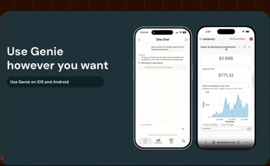
[Full source frame](../frames/full/0047040.jpg)
> leave their favorite tools to use it. So, Genie shows up where they already work. For example, there's support for mobile on iOS and Android, so you can

### 26:17.00 — intermediate observed state
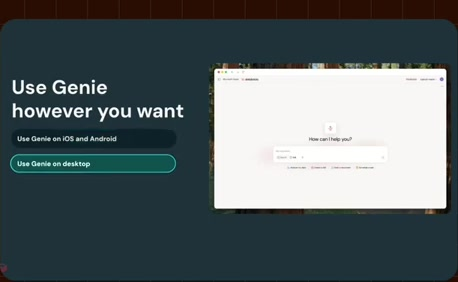
[Full source frame](../frames/full/0047310.jpg)
> ask Genie questions on the go. We also offer a desktop app. It's very popular among users who who tend to do a lot of their work in in desktop-centric tools

### 26:25.00 — intermediate observed state
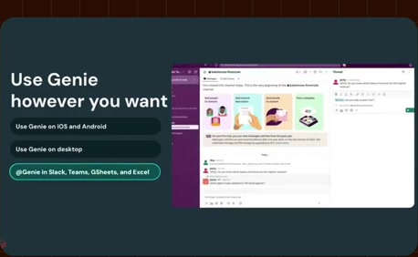
[Full source frame](../frames/full/0047550.jpg)
> like email or or document editing. You can also ping Genie in your third-party chat tools. So, we integrate with Slack and Teams and Co-pilot. We also have

### 26:35.00 — intermediate observed state
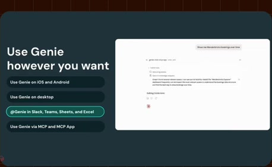
[Full source frame](../frames/full/0047850.jpg)
> And then if your team lives in another agent entirely, you can plug into the Genie 1 MCP, which is again powered by

### 26:46.00 — later observed state
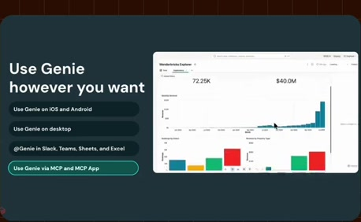
[Full source frame](../frames/full/0048180.jpg)
> nice kind of embedded charts, deep links, and so on that you're actually seeing in in the GIF here.

<details>
<summary>6 original change windows: before / near transition / after</summary>

### Estimated anchor 25:53.00

| Before | Near transition | After |
| --- | --- | --- |
| 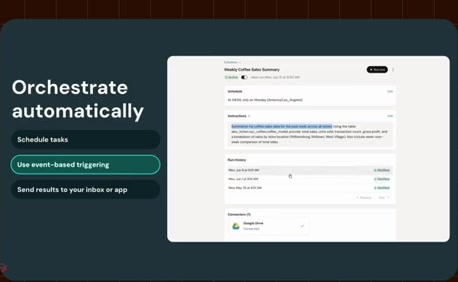 |  |  |

> going forward, we are continuing to invest in more orchestration features such as sending to larger groups of people, doing dry runs, things like

### Estimated anchor 26:07.00

| Before | Near transition | After |
| --- | --- | --- |
|  |  |  |

> leave their favorite tools to use it. So, Genie shows up where they already work. For example, there's support for mobile on iOS and Android, so you can

### Estimated anchor 26:16.00

| Before | Near transition | After |
| --- | --- | --- |
| 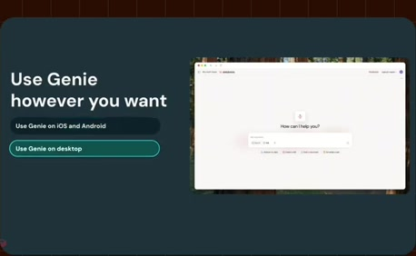 |  |  |

> ask Genie questions on the go. We also offer a desktop app. It's very popular among users who who tend to do a lot of their work in in desktop-centric tools

### Estimated anchor 26:24.00

| Before | Near transition | After |
| --- | --- | --- |
|  | 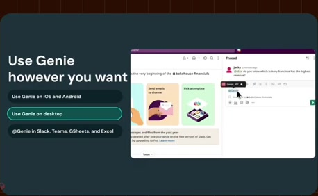 |  |

> their work in in desktop-centric tools like email or or document editing. You can also ping Genie in your third-party chat tools. So, we integrate with Slack

### Estimated anchor 26:34.00

| Before | Near transition | After |
| --- | --- | --- |
| 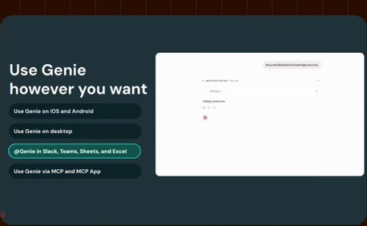 | 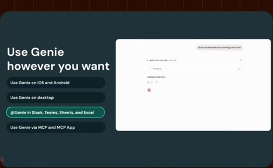 |  |

> Sheets and and Excel. And then if your team lives in another agent entirely, you can plug into the Genie 1 MCP, which is again powered by

### Estimated anchor 26:41.00

| Before | Near transition | After |
| --- | --- | --- |
| 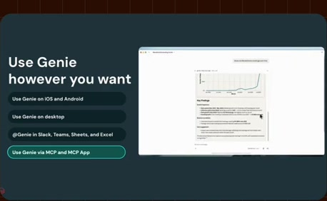 | 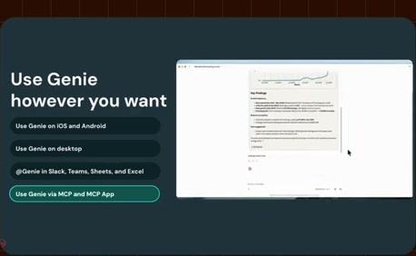 | 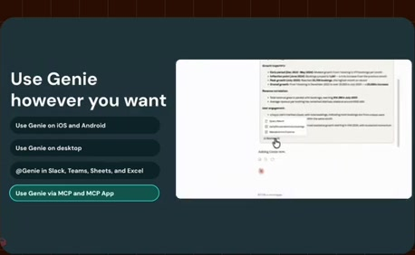 |

> Genie 1 MCP, which is again powered by the ontology behind the scenes. And we do support MCP apps, which gives you the nice kind of embedded charts, deep

</details>
