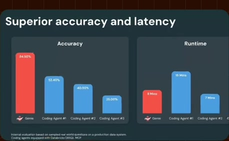
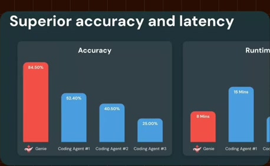
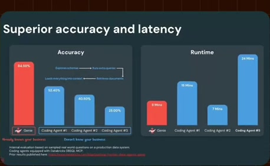
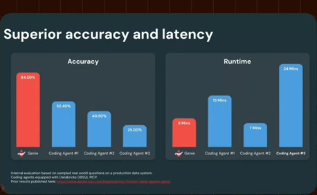
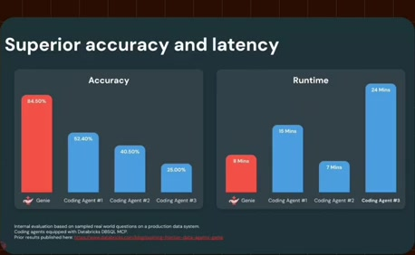
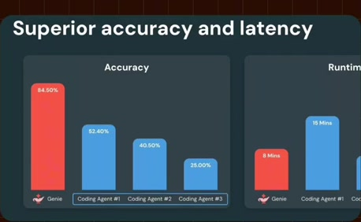
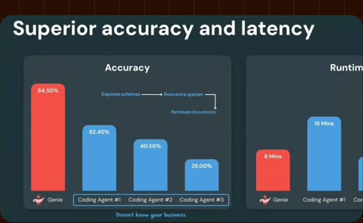
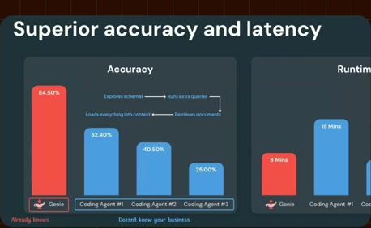

# Source-reported accuracy and runtime comparison

**Source:** [07:34.00–08:32.00](https://www.youtube.com/watch?v=HtR5m5VjaDQ) · **Template:** benchmark · **Type:** explanatory-graphic-or-overlay

**Teaching purpose:** Show two evaluation dimensions and retain their historical/source-reported scope.
**Relationship:** methods × measures → qualified comparison

## Original transcript

> benefit from this semantic layer. And that that benefit is very significant. Uh when we benchmark Genie with the ontology against the the strongest models available, it's consistently the top-performing agent for business questions and there were no trick questions in this benchmark. This is just real business questions with real business data and we saw more than 30 percentage point improvement in accuracy over the next best performing model. And it was also a lot quicker. After all, a generic agent has to make up for the fact that it doesn't know your business. So if it's not going to hallucinate, then it explores, right? It samples a bunch of schemas, it runs a bunch of extra queries, it grabs a bunch of documents and it loads all of that into the model's context in case any of it turns out to matter later. But Genie doesn't have to do as much work because it already knows which sources count and how to use them. And and I'm already really confident that as we continue to tune the onto rank algorithm and expand the depth of the ontology, I think this gap is going to is going to only widen. >> Now, I see accuracy,

Rolling transcript, approximate times and original transcription errors preserved.

## Parameterized teaching pattern

- `On {{evaluation_scope}}, {{method_a}} achieved {{measure_a}}, compared with {{method_b}} at {{measure_b}}.`
- `The trade-off is {{dimension_a}} versus {{dimension_b}}, under {{test_conditions}}.`

**Use when:** Use for comparable measured data with a credible evaluation scope.
**Choose another approach when:** Do not transfer source benchmark values to another product or imply universal results from one evaluation.

**Proposed adaptation motion:** Fix axes and method order, build bars, introduce the interpretation after values, retain the qualification.

## Source-specific reveal evidence

```json
{
  "status": "Sequence-level source observations are attached in prior_source_observations. The family motion grammar is a proposed reusable pattern, not a frame-exact claim about this instance."
}
```

## Original source states

### 07:34.40 — earlier observed state

[Full source frame](../frames/full/0013632.jpg)
> benefit from this semantic layer. And that that benefit is very significant. Uh when we benchmark Genie with the

### 07:36.00 — intermediate observed state

[Full source frame](../frames/full/0013680.jpg)
> benefit from this semantic layer. And that that benefit is very significant. Uh when we benchmark Genie with the ontology against the the strongest

### 07:42.00 — intermediate observed state

[Full source frame](../frames/full/0013860.jpg)
> ontology against the the strongest models available, it's consistently the top-performing agent for business questions and there were no trick

### 07:50.00 — intermediate observed state

[Full source frame](../frames/full/0014100.jpg)
> questions in this benchmark. This is just real business questions with real business data and we saw more than 30 percentage point improvement in accuracy

### 08:10.00 — intermediate observed state

[Full source frame](../frames/full/0014700.jpg)
> then it explores, right? It samples a bunch of schemas, it runs a bunch of extra queries, it grabs a bunch of documents and it loads all of that into

### 08:29.00 — later observed state

[Full source frame](../frames/full/0015270.jpg)
> really confident that as we continue to tune the onto rank algorithm and expand the depth of the ontology, I think this gap is going to is going to only widen.

<details>
<summary>6 original change windows: before / near transition / after</summary>

### Estimated anchor 07:34.50

| Before | Near transition | After |
| --- | --- | --- |
|  |  |  |

> benefit from this semantic layer. And that that benefit is very significant. Uh when we benchmark Genie with the

### Estimated anchor 07:41.00

| Before | Near transition | After |
| --- | --- | --- |
|  |  |  |

> ontology against the the strongest models available, it's consistently the top-performing agent for business

### Estimated anchor 07:49.00

| Before | Near transition | After |
| --- | --- | --- |
|  |  |  |

> questions in this benchmark. This is just real business questions with real business data and we saw more than 30

### Estimated anchor 07:59.00

| Before | Near transition | After |
| --- | --- | --- |
|  |  |  |

> over the next best performing model. And it was also a lot quicker. After all, a generic agent has to make up for the fact that it doesn't know your business.

### Estimated anchor 08:10.00

| Before | Near transition | After |
| --- | --- | --- |
|  |  |  |

> then it explores, right? It samples a bunch of schemas, it runs a bunch of extra queries, it grabs a bunch of documents and it loads all of that into

### Estimated anchor 08:20.00

| Before | Near transition | After |
| --- | --- | --- |
|  |  |  |

> turns out to matter later. But Genie doesn't have to do as much work because it already knows which sources count and how to use them. And and I'm already

</details>
