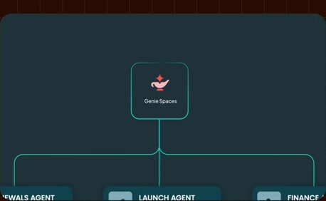
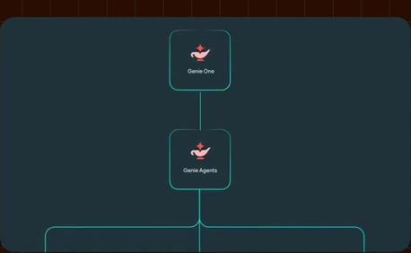
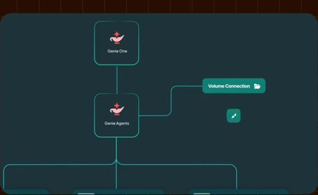
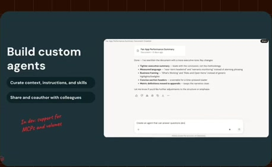
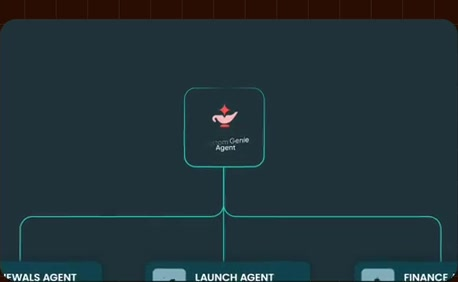
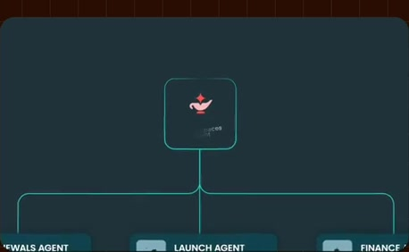
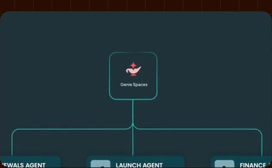
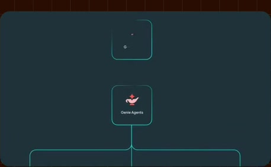
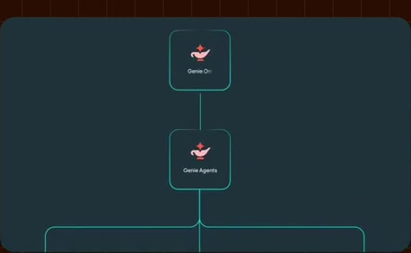
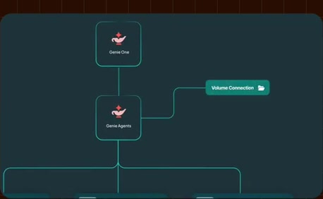

# Parent agents, children and connected resources

**Source:** [25:03.00–25:23.00](https://www.youtube.com/watch?v=HtR5m5VjaDQ) · **Template:** agent-delegation · **Type:** explanatory-graphic-or-overlay

**Teaching purpose:** Distinguish delegation from the separate relationship to resources.
**Relationship:** parent → specialists → resources

## Original transcript

> here. If you've already been using what used to be called Genie Spaces, then you've actually been creating agents because Genie Spaces are now Genie Agents, fully accessible from Genie 1 with a couple bells and whistles. It wasn't just a rebrand. So, for example, we're adding the ability to connect a volume to the agent. We're adding MCP connectors. And we are also adding uh sub-agent support.

Rolling transcript, approximate times and original transcription errors preserved.

## Parameterized teaching pattern

- `{{parent_agent}} delegates {{job_a}} to {{specialist_a}} and {{job_b}} to {{specialist_b}}.`
- `Each {{specialist}} receives {{inputs}} and can use {{resources}} within {{scope}}.`

**Use when:** Use when delegation or ownership is a real relationship in the supported system.
**Choose another approach when:** Use an input map for context sources; do not present source connectors as subordinate agents.

**Proposed adaptation motion:** Establish the parent or inputs, reveal specialists individually, then show each named branch/resource.

## Source-specific reveal evidence

```json
{
  "status": "Sequence-level source observations are attached in prior_source_observations. The family motion grammar is a proposed reusable pattern, not a frame-exact claim about this instance."
}
```

## Original source states

### 25:03.30 — earlier observed state

[Full source frame](../frames/full/0045099.jpg)
> customers are not starting from scratch here. If you've already been using what used to be called Genie Spaces, then you've actually been creating agents

### 25:07.00 — intermediate observed state

[Full source frame](../frames/full/0045210.jpg)
> used to be called Genie Spaces, then you've actually been creating agents because Genie Spaces are now Genie Agents, fully accessible from Genie 1

### 25:11.00 — intermediate observed state

[Full source frame](../frames/full/0045330.jpg)
> because Genie Spaces are now Genie Agents, fully accessible from Genie 1 with a couple bells and whistles. It wasn't just a rebrand. So, for example,

### 25:18.00 — intermediate observed state

[Full source frame](../frames/full/0045540.jpg)
> we're adding the ability to connect a volume to the agent. We're adding MCP connectors. And we are also adding uh

### 25:22.50 — later observed state

[Full source frame](../frames/full/0045675.jpg)
> volume to the agent. We're adding MCP connectors. And we are also adding uh sub-agent support.

<details>
<summary>3 original change windows: before / near transition / after</summary>

### Estimated anchor 25:03.00

| Before | Near transition | After |
| --- | --- | --- |
|  |  |  |

> customers are not starting from scratch here. If you've already been using what used to be called Genie Spaces, then you've actually been creating agents

### Estimated anchor 25:10.00

| Before | Near transition | After |
| --- | --- | --- |
|  |  |  |

> because Genie Spaces are now Genie Agents, fully accessible from Genie 1 with a couple bells and whistles. It wasn't just a rebrand. So, for example,

### Estimated anchor 25:17.00

| Before | Near transition | After |
| --- | --- | --- |
|  |  |  |

> wasn't just a rebrand. So, for example, we're adding the ability to connect a volume to the agent. We're adding MCP connectors. And we are also adding uh

</details>
