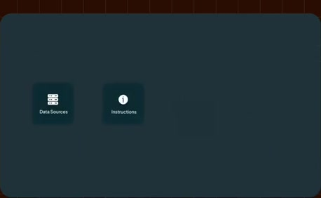
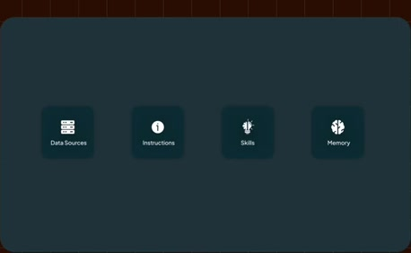
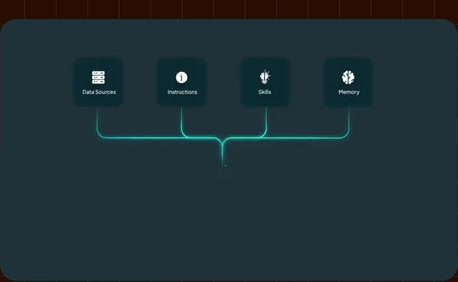
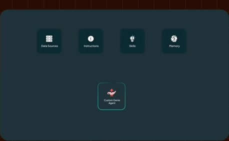
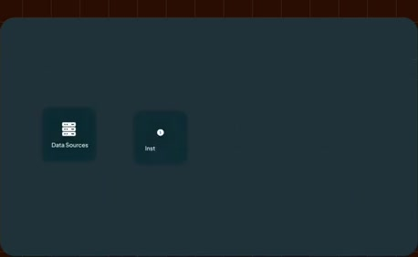
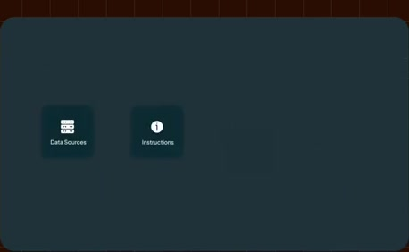
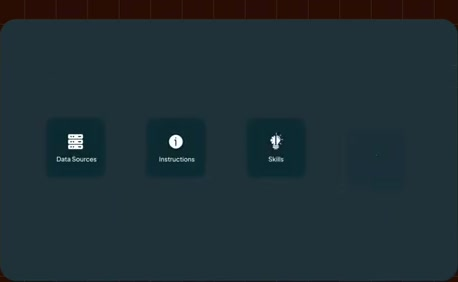
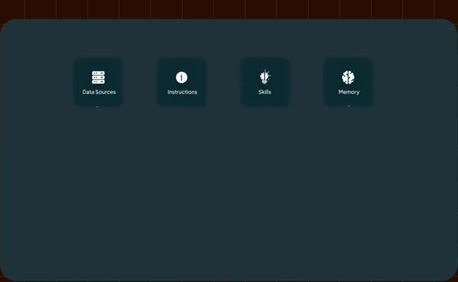
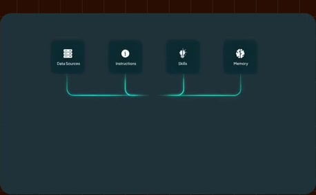
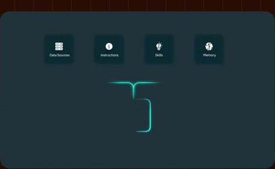

# Sources, instructions, skills and memory

**Source:** [24:35.00–24:44.00](https://www.youtube.com/watch?v=HtR5m5VjaDQ) · **Template:** converging-sources · **Type:** explanatory-graphic-or-overlay

**Teaching purpose:** Identify inputs to a custom agent before showing specialized agents.
**Relationship:** many inputs → shared hub

## Original transcript

> agent bundles data sources, instructions, skills, and memory, and all those come together to create what we might think of as a customized coworker that can answer questions or get work done in a very particular

Rolling transcript, approximate times and original transcription errors preserved.

## Parameterized teaching pattern

- `{{consumer}} draws on {{source_a}}, {{source_b}} and {{source_c}} to {{job}}.`
- `These inputs differ, but they contribute to the same {{shared_layer}}.`

**Use when:** Use when the distinction among source classes matters and they share a real destination.
**Choose another approach when:** Use a list for unrelated items; label search/query/tool access rather than implying data ingestion.

**Proposed adaptation motion:** Add sources individually, retain earlier nodes, draw each path, then activate the hub.

## Source-specific reveal evidence

```json
{
  "status": "Sequence-level source observations are attached in prior_source_observations. The family motion grammar is a proposed reusable pattern, not a frame-exact claim about this instance."
}
```

## Original source states

### 24:35.30 — earlier observed state

[Full source frame](../frames/full/0044259.jpg)
> performs an entire job. So, a Genie agent bundles data sources, instructions, skills, and memory, and all those come together to create what

### 24:37.00 — intermediate observed state

[Full source frame](../frames/full/0044310.jpg)
> agent bundles data sources, instructions, skills, and memory, and all those come together to create what

### 24:39.50 — intermediate observed state

[Full source frame](../frames/full/0044385.jpg)
> instructions, skills, and memory, and all those come together to create what we might think of as a customized coworker that can answer questions or

### 24:43.50 — later observed state

[Full source frame](../frames/full/0044505.jpg)
> we might think of as a customized coworker that can answer questions or get work done in a very particular domain. So, for example, you might have

<details>
<summary>2 original change windows: before / near transition / after</summary>

### Estimated anchor 24:35.00

| Before | Near transition | After |
| --- | --- | --- |
|  |  |  |

> performs an entire job. So, a Genie agent bundles data sources, instructions, skills, and memory, and

### Estimated anchor 24:39.00

| Before | Near transition | After |
| --- | --- | --- |
|  |  |  |

> agent bundles data sources, instructions, skills, and memory, and all those come together to create what we might think of as a customized coworker that can answer questions or

</details>
