# Move inside the architecture to modeled context

**Source:** [03:54.37–04:09.00](https://www.youtube.com/watch?v=HtR5m5VjaDQ) · **Template:** architecture-focus · **Type:** explanatory-graphic-or-overlay

**Teaching purpose:** Preserve the overview while shifting focus to a named component.
**Relationship:** system overview → located detail

## Original transcript

> into play. It's human-curated context that someone certified and and governed. And there are three components that are worth talking about. Uh the first is metric views. They form your your governed reusable KPI layer. So, it's a certified single source of truth definition for your key business metrics stored as open format Unity Catalog

Rolling transcript, approximate times and original transcription errors preserved.

## Parameterized teaching pattern

- `At a high level, {{system}} contains {{components}}. Let’s focus on {{component}}.`
- `{{component}} sits between {{upstream}} and {{downstream}} and is responsible for {{responsibility}}.`

**Use when:** Use when placement in the larger system is part of the explanation.
**Choose another approach when:** Use a standalone example when the architecture adds no relevant context.

**Proposed adaptation motion:** Establish the overview, preserve context, move the inner camera or selectively emphasize the active region.

## Source-specific reveal evidence

```json
{
  "reading_order": [
    "Shared architecture",
    "Modeled context detail"
  ],
  "observed_reveal_order": [
    "Complete architecture established",
    "Inner diagram camera moves toward modeled context",
    "Detailed modeled-context surface replaces the overview focus"
  ],
  "speech_mapping": "Focus follows the named modeled-context component while the presenter stays outside the diagram camera.",
  "confidence": "Prior dense camera samples and source sequence catalog."
}
```

## Original source states

### 03:54.40 — earlier observed state
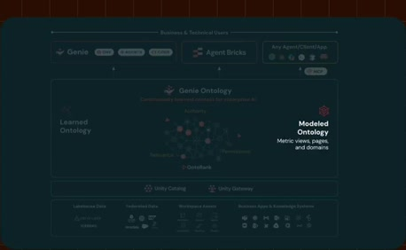
[Full source frame](../frames/full/0007032.jpg)
> into play. It's human-curated context that someone certified and and governed. And there are three components that are worth talking about. Uh the first is

### 03:55.00 — intermediate observed state
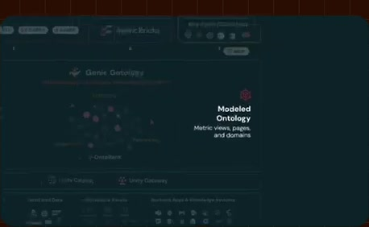
[Full source frame](../frames/full/0007050.jpg)
> into play. It's human-curated context that someone certified and and governed. And there are three components that are worth talking about. Uh the first is

### 03:56.10 — intermediate observed state
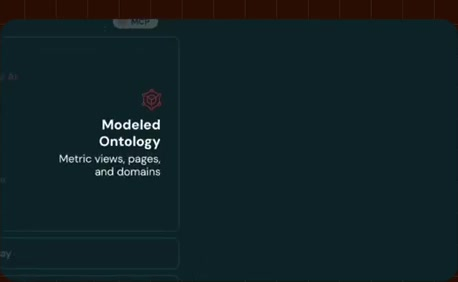
[Full source frame](../frames/full/0007083.jpg)
> into play. It's human-curated context that someone certified and and governed. And there are three components that are worth talking about. Uh the first is metric views. They form your your

### 03:59.00 — intermediate observed state
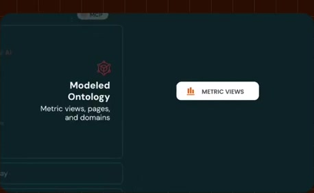
[Full source frame](../frames/full/0007170.jpg)
> And there are three components that are worth talking about. Uh the first is metric views. They form your your governed reusable KPI layer. So, it's a

### 04:04.00 — intermediate observed state
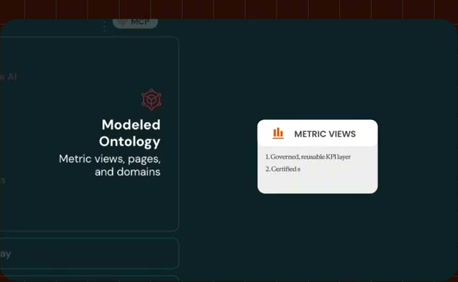
[Full source frame](../frames/full/0007320.jpg)
> metric views. They form your your governed reusable KPI layer. So, it's a certified single source of truth definition for your key business metrics

### 04:08.00 — later observed state

[Full source frame](../frames/full/0007440.jpg)
> certified single source of truth definition for your key business metrics stored as open format Unity Catalog

<details>
<summary>3 original change windows: before / near transition / after</summary>

### Estimated anchor 03:54.37

| Before | Near transition | After |
| --- | --- | --- |
| 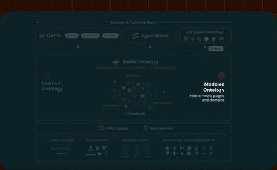 | 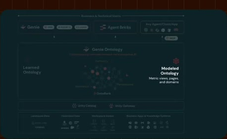 | 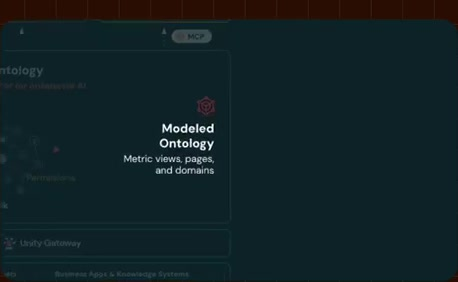 |

> into play. It's human-curated context that someone certified and and governed. And there are three components that are worth talking about. Uh the first is

### Estimated anchor 03:56.10

| Before | Near transition | After |
| --- | --- | --- |
| 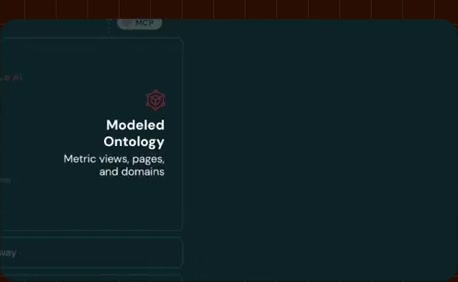 |  |  |

> into play. It's human-curated context that someone certified and and governed. And there are three components that are worth talking about. Uh the first is metric views. They form your your

### Estimated anchor 03:59.00

| Before | Near transition | After |
| --- | --- | --- |
| 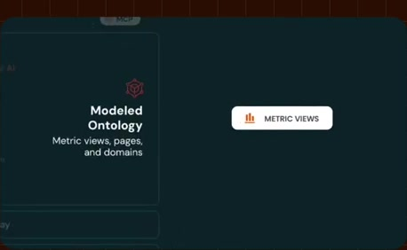 | 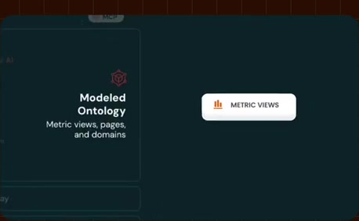 |  |

> And there are three components that are worth talking about. Uh the first is metric views. They form your your governed reusable KPI layer. So, it's a

</details>
