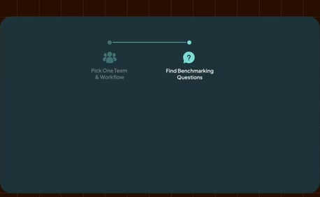
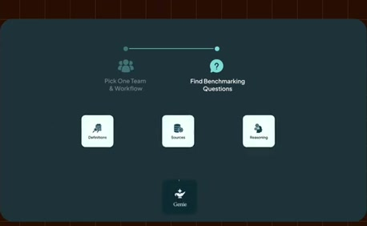
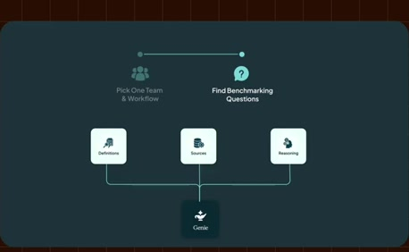
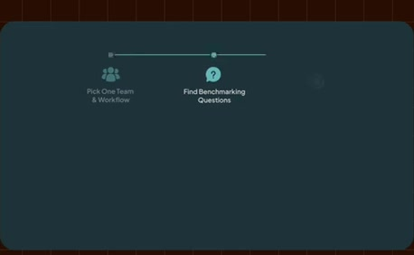
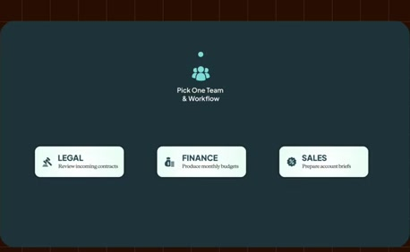
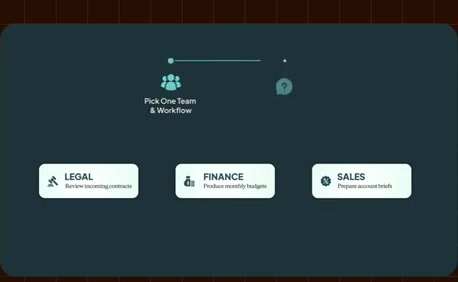
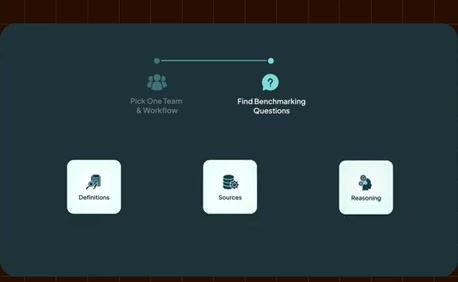
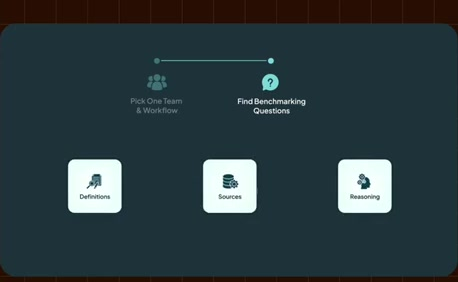

# Questions, known answers and benchmark

**Source:** [30:25.00–30:48.00](https://www.youtube.com/watch?v=HtR5m5VjaDQ) · **Template:** rollout · **Type:** explanatory-graphic-or-overlay

**Teaching purpose:** Define evaluation inputs before measuring or expanding a pilot.
**Relationship:** ordered milestones → current step → details

## Original transcript

> in their experience. And then once you've picked a workflow, I recommend defining benchmarking questions. These are going to be representative questions with with kind of known good answers, including the the definitions, the sources, the reasoning that you expect Genie to use. They give you a concrete way to evaluate accuracy before rollout and to track whether Genie's also getting better over time as you continue to invest in your ontology. Uh you'll also probably want to record today's baseline, you know, pre

Rolling transcript, approximate times and original transcription errors preserved.

## Parameterized teaching pattern

- `Start with {{team_and_workflow}}, define {{benchmark}}, measure {{baseline}}, then connect {{sources}} and iterate.`
- `At {{current_step}}, do {{task}} so that {{next_step}} has {{required_input}}.`

**Use when:** Use for a real ordered process with useful current-step context.
**Choose another approach when:** Use peer cards for unordered considerations; a rail is not a promise about calendar duration.

**Proposed adaptation motion:** Retain earlier milestones, activate the next marker, update details below and pan only when space is exhausted.

## Source-specific reveal evidence

```json
{
  "status": "Sequence-level source observations are attached in prior_source_observations. The family motion grammar is a proposed reusable pattern, not a frame-exact claim about this instance."
}
```

## Original source states

### 30:25.30 — earlier observed state

[Full source frame](../frames/full/0054759.jpg)
> in their experience. And then once you've picked a workflow, I recommend defining benchmarking questions. These are going to be

### 30:30.00 — intermediate observed state

[Full source frame](../frames/full/0054900.jpg)
> questions. These are going to be representative questions with with kind of known good answers, including the the definitions, the sources, the reasoning

### 30:36.00 — intermediate observed state

[Full source frame](../frames/full/0055080.jpg)
> of known good answers, including the the definitions, the sources, the reasoning that you expect Genie to use. They give you a concrete way to evaluate accuracy

### 30:42.00 — intermediate observed state

[Full source frame](../frames/full/0055260.jpg)
> you a concrete way to evaluate accuracy before rollout and to track whether Genie's also getting better over time as you continue to invest in your ontology.

### 30:47.50 — later observed state

[Full source frame](../frames/full/0055425.jpg)
> Genie's also getting better over time as you continue to invest in your ontology. Uh you'll also probably want to record today's baseline, you know, pre pre-Genie. You know, how accurate is the

<details>
<summary>3 original change windows: before / near transition / after</summary>

### Estimated anchor 30:25.00

| Before | Near transition | After |
| --- | --- | --- |
|  |  |  |

> is really going to make a difference in in their experience. And then once you've picked a workflow, I recommend defining benchmarking questions. These are going to be

### Estimated anchor 30:34.00

| Before | Near transition | After |
| --- | --- | --- |
|  |  |  |

> of known good answers, including the the definitions, the sources, the reasoning that you expect Genie to use. They give

### Estimated anchor 30:42.00

| Before | Near transition | After |
| --- | --- | --- |
|  |  |  |

> you a concrete way to evaluate accuracy before rollout and to track whether Genie's also getting better over time as you continue to invest in your ontology.

</details>
