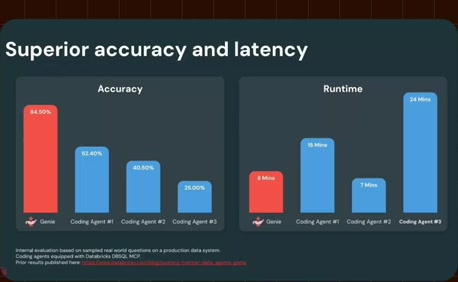

# Reuse the benchmark during the follow-up

**Source:** [08:45.00–09:06.00](https://www.youtube.com/watch?v=HtR5m5VjaDQ) · **Template:** benchmark · **Type:** explanatory-graphic-or-overlay

**Teaching purpose:** Reuse a familiar chart while the host and guest interpret it.
**Relationship:** methods × measures → qualified comparison

## Original transcript

> >> Yeah, the cost component, it's a third version of this slide. Um, it was also favorable if I recall correctly. It ties to the the latency and the token efficiency, which makes sense, right? Genie is doing a lot less trial and error to try to find the assets and to try to make sense of them. So we saw all three all three variables, if you will, um, uh, significantly improved with the ontology. >> Got it. Thank you.

Rolling transcript, approximate times and original transcription errors preserved.

## Parameterized teaching pattern

- `On {{evaluation_scope}}, {{method_a}} achieved {{measure_a}}, compared with {{method_b}} at {{measure_b}}.`
- `The trade-off is {{dimension_a}} versus {{dimension_b}}, under {{test_conditions}}.`

**Use when:** Use for comparable measured data with a credible evaluation scope.
**Choose another approach when:** Do not transfer source benchmark values to another product or imply universal results from one evaluation.

**Proposed adaptation motion:** Fix axes and method order, build bars, introduce the interpretation after values, retain the qualification.

## Source-specific reveal evidence

```json
{
  "status": "Sequence-level source observations are attached in prior_source_observations. The family motion grammar is a proposed reusable pattern, not a frame-exact claim about this instance."
}
```

## Original source states

### 08:45.30 — earlier observed state

[Full source frame](../frames/full/0015759.jpg)
> >> Yeah, the cost component, it's a third version of this slide. Um, it was also favorable if I recall correctly. It ties

### 08:52.00 — intermediate observed state

[Full source frame](../frames/full/0015960.jpg)
> to the the latency and the token efficiency, which makes sense, right? Genie is doing a lot less trial and error to try to find the assets and to

### 08:59.00 — intermediate observed state

[Full source frame](../frames/full/0016170.jpg)
> error to try to find the assets and to try to make sense of them. So we saw all three all three variables, if you will, um,

### 09:05.00 — later observed state

[Full source frame](../frames/full/0016350.jpg)
> all three variables, if you will, um, uh, significantly improved with the ontology. >> Got it. Thank you. >> Um, of course, Genie can only learn from

<details>
<summary>3 original change windows: before / near transition / after</summary>

### Estimated anchor 08:45.00

| Before | Near transition | After |
| --- | --- | --- |
|  |  |  |

> >> Yeah, the cost component, it's a third version of this slide. Um, it was also favorable if I recall correctly. It ties

### Estimated anchor 08:51.00

| Before | Near transition | After |
| --- | --- | --- |
|  |  |  |

> favorable if I recall correctly. It ties to the the latency and the token efficiency, which makes sense, right? Genie is doing a lot less trial and

### Estimated anchor 08:59.00

| Before | Near transition | After |
| --- | --- | --- |
|  |  |  |

> error to try to find the assets and to try to make sense of them. So we saw all three all three variables, if you will, um,

</details>
