# Five fixed recommendations and advancing emphasis

**Source:** [32:37.00–34:04.00](https://www.youtube.com/watch?v=HtR5m5VjaDQ) · **Template:** fixed-emphasis · **Type:** explanatory-graphic-or-overlay

**Teaching purpose:** Preserve the complete recommendation set as the narrator advances focus.
**Relationship:** fixed recommendations → one active item

## Original transcript

> monitoring rolling out as well as ontology monitoring. Now as you expand beyond um beyond your PRC, there are a couple best practices to keep in mind. It's actually going to be very similar to what I just said, but it's it's worth repeating because these are these are quite important. The first again is to build that benchmark set for your broader teams. Again, it's a representative collection of real questions with known good answers. You know, keep Genie accountable. Flag to your account teams if you see anything going off the rails. We investigate every single case that we get and and hopefully you'll find that that Genie's actually very strong in answering your business questions and and taking action. Second is to model those semantics that really matter. We're not saying model the entire business's institutional knowledge. We don't think that's possible. We would recommend leaning on the learned context for that, but we do recommend modeling the core that you want to have shared across the business or within a particular line of business. Third is to certify your gold assets. So, make sure that you've identified the tables, the dashboards, the queries, the notebooks that that every workflow actually requires and make sure that they're certified so that Genie prioritizes them when it's searching. It does respect that tag. And then finally, we recommend validating access to that data from your end user's perspective. So again, Genie always respects the permissions of the person who's asking the question. So of course, an asset isn't useful if your users can't see it. So you want to make sure that your users have access to the certified sources and the snippets that you expect Genie to actually use.

Rolling transcript, approximate times and original transcription errors preserved.

## Parameterized teaching pattern

- `First {{recommendation_a}}. Next {{recommendation_b}}. Finally {{recommendation_c}}.`
- `For {{goal}}, check {{requirement}} because {{reason}}.`

**Use when:** Use when scanning the whole recommendation set helps orientation.
**Choose another approach when:** Do not fade inactive text below legibility or replace the list with unrelated slides.

**Proposed adaptation motion:** Keep rows fixed and advance selective emphasis with the narrated topic; hold each active recommendation.

## Source-specific reveal evidence

```json
{
  "reading_order": [
    "Build a benchmark set",
    "Model critical semantics",
    "Certify gold assets",
    "Connect your sources",
    "Validate access end to end"
  ],
  "observed_reveal_order": [
    "Full recommendation list stays in fixed positions",
    "Selective emphasis advances to the active recommendation",
    "Inactive rows remain as context"
  ],
  "speech_mapping": "Emphasis follows the narrated recommendation; the visible list includes an item that is not separately enumerated in the rolling transcript. Do not invent a new spoken sentence to force a one-to-one list match.",
  "confidence": "Direct inspection of the source list and source frame at 2019 seconds, plus prior dense emphasis evidence."
}
```

## Original source states

### 32:38.00 — earlier observed state
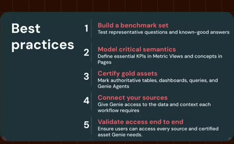
[Full source frame](../frames/full/0058740.jpg)
> monitoring rolling out as well as ontology monitoring. Now as you expand beyond um beyond your PRC, there are a

### 32:45.00 — intermediate observed state

[Full source frame](../frames/full/0058950.jpg)
> couple best practices to keep in mind. It's actually going to be very similar to what I just said, but it's it's worth repeating because these are these are quite important. The first again is to

### 33:09.90 — intermediate observed state

[Full source frame](../frames/full/0059697.jpg)
> business questions and and taking action. Second is to model those semantics that really matter. We're not

### 33:28.00 — intermediate observed state
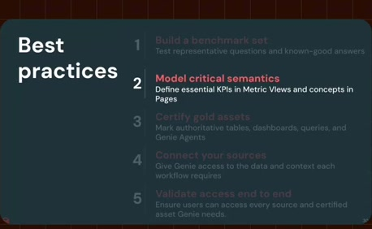
[Full source frame](../frames/full/0060240.jpg)
> business or within a particular line of business. Third is to certify your gold assets. So, make sure that you've identified the

### 33:40.00 — intermediate observed state

[Full source frame](../frames/full/0060600.jpg)
> actually requires and make sure that they're certified so that Genie prioritizes them when it's searching. It does respect that tag.

### 33:51.00 — intermediate observed state

[Full source frame](../frames/full/0060930.jpg)
> validating access to that data from your end user's perspective. So again, Genie always respects the permissions of the person who's asking the question. So of

### 34:01.00 — later observed state
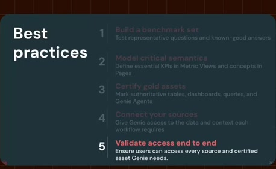
[Full source frame](../frames/full/0061230.jpg)
> sure that your users have access to the certified sources and the snippets that you expect Genie to actually use.

<details>
<summary>6 original change windows: before / near transition / after</summary>

### Estimated anchor 32:37.00

| Before | Near transition | After |
| --- | --- | --- |
| 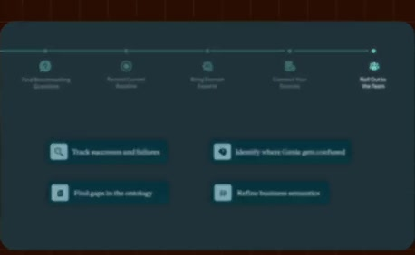 | 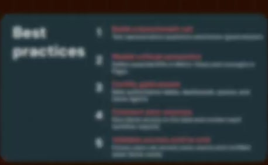 |  |

> to start to see more detailed Genie 1 monitoring rolling out as well as ontology monitoring. Now as you expand beyond um beyond your PRC, there are a

### Estimated anchor 32:43.00

| Before | Near transition | After |
| --- | --- | --- |
| 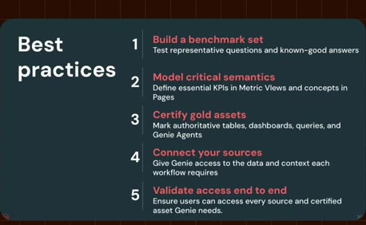 |  | 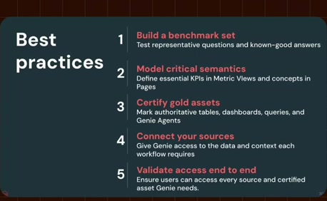 |

> beyond um beyond your PRC, there are a couple best practices to keep in mind. It's actually going to be very similar to what I just said, but it's it's worth

### Estimated anchor 33:09.73

| Before | Near transition | After |
| --- | --- | --- |
| 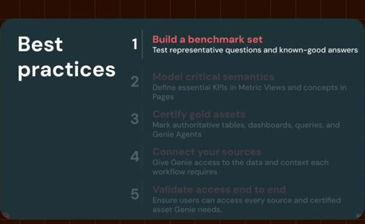 | 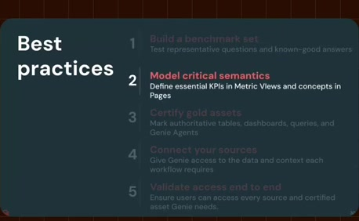 | 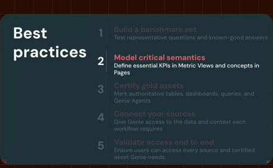 |

> actually very strong in answering your business questions and and taking action. Second is to model those semantics that really matter. We're not

### Estimated anchor 33:26.00

| Before | Near transition | After |
| --- | --- | --- |
| 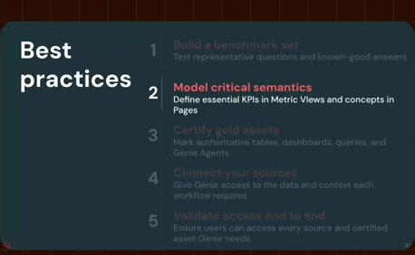 |  | 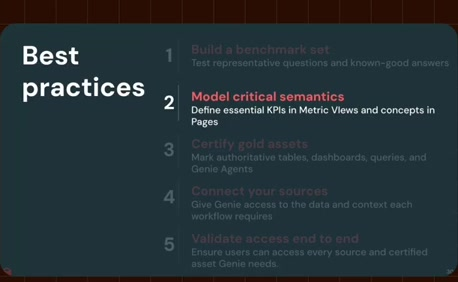 |

> but we do recommend modeling the core that you want to have shared across the business or within a particular line of business. Third is to certify your gold assets.

### Estimated anchor 33:39.00

| Before | Near transition | After |
| --- | --- | --- |
| 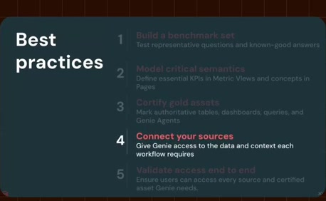 |  |  |

> notebooks that that every workflow actually requires and make sure that they're certified so that Genie prioritizes them when it's searching. It does respect that tag.

### Estimated anchor 33:49.00

| Before | Near transition | After |
| --- | --- | --- |
|  |  |  |

> And then finally, we recommend validating access to that data from your end user's perspective. So again, Genie always respects the permissions of the

</details>
