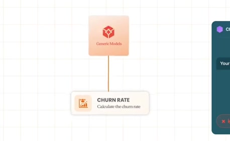
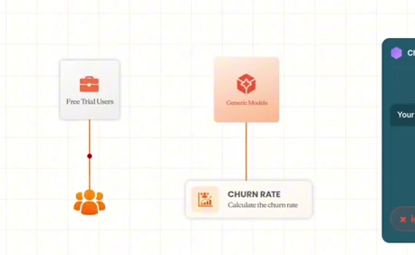
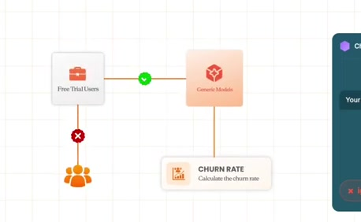
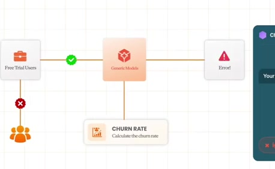
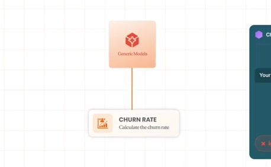
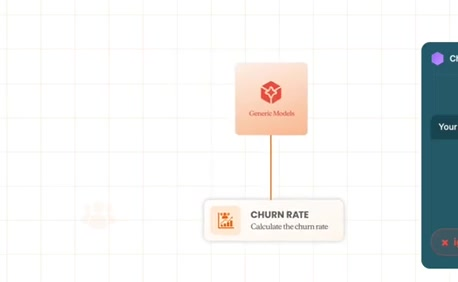
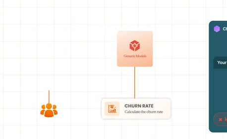
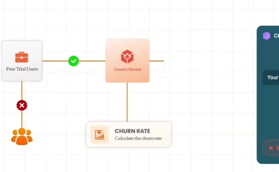
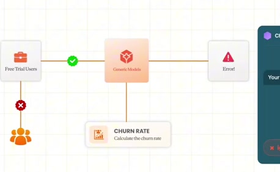

# Business-specific churn exclusions

**Source:** [02:18.00–02:27.00](https://www.youtube.com/watch?v=HtR5m5VjaDQ) · **Template:** metric-ambiguity · **Type:** explanatory-graphic-or-overlay

**Teaching purpose:** Show that the metric name alone does not specify the team’s business definition.
**Relationship:** same term → missing rule → changed interpretation

## Original transcript

> or if you ask for, you know, a churn rate, it might have no idea that your team excludes free metrics from that or even that the concept of a free met uh a free trial exists. Sorry, free trials. Uh or if you ask like, "What campaign is

Rolling transcript, approximate times and original transcription errors preserved.

## Parameterized teaching pattern

- `When we say {{metric}}, we mean {{definition}}, including {{included_population}} and excluding {{excluded_population}}.`
- `Without {{business_rule}}, {{system}} interprets {{term}} differently from {{team}}.`

**Use when:** Use when scope, exclusions or semantics cause ambiguity.
**Choose another approach when:** Use a source-authority graphic for choosing among tables; do not imply a definition alone repairs stale data.

**Proposed adaptation motion:** Keep the question, introduce the missing rule beside the mechanism, and make the interpretation difference visible.

## Source-specific reveal evidence

```json
{
  "status": "Sequence-level source observations are attached in prior_source_observations. The family motion grammar is a proposed reusable pattern, not a frame-exact claim about this instance."
}
```

## Original source states

### 02:18.20 — earlier observed state

[Full source frame](../frames/full/0004146.jpg)
> one that finance actually maintains. Uh or if you ask for, you know, a churn rate, it might have no idea that your team excludes free metrics from that or

### 02:20.00 — intermediate observed state

[Full source frame](../frames/full/0004200.jpg)
> or if you ask for, you know, a churn rate, it might have no idea that your team excludes free metrics from that or even that the concept of a free met uh a

### 02:22.00 — intermediate observed state

[Full source frame](../frames/full/0004260.jpg)
> rate, it might have no idea that your team excludes free metrics from that or even that the concept of a free met uh a free trial exists. Sorry, free trials.

### 02:24.50 — intermediate observed state

[Full source frame](../frames/full/0004335.jpg)
> team excludes free metrics from that or even that the concept of a free met uh a free trial exists. Sorry, free trials. Uh or if you ask like, "What campaign is

### 02:26.50 — later observed state

[Full source frame](../frames/full/0004395.jpg)
> even that the concept of a free met uh a free trial exists. Sorry, free trials. Uh or if you ask like, "What campaign is is performing best?" It might have no

<details>
<summary>2 original change windows: before / near transition / after</summary>

### Estimated anchor 02:18.50

| Before | Near transition | After |
| --- | --- | --- |
|  |  |  |

> one that finance actually maintains. Uh or if you ask for, you know, a churn rate, it might have no idea that your team excludes free metrics from that or

### Estimated anchor 02:23.00

| Before | Near transition | After |
| --- | --- | --- |
|  |  |  |

> team excludes free metrics from that or even that the concept of a free met uh a free trial exists. Sorry, free trials.

</details>
