# Document collaboration with real product evidence

**Source:** [21:06.00–21:48.00](https://www.youtube.com/watch?v=HtR5m5VjaDQ) · **Template:** feature-evidence · **Type:** explanatory-graphic-or-overlay

**Teaching purpose:** Pair a stable teaching heading with authentic product interaction.
**Relationship:** stable capability → supporting product evidence

## Original transcript

> from, but we are also trying to build as much as possible on this co-working side as well. So, starting with documents, a very popular feature, Uh uh Genie can now co-author documents with you. You can have it start from scratch, give it a template, ask you to fill something out. You can also work with Genie to edit it, and then you can send it to your doc. Your doc is an email, a PDF, Slack, Teams. We do offer inline collaboration, which is what you're seeing here in the GIF. And going forward, we are adding additional collaboration features, such as working with Genie to resolve comments. We are also building additional document types, like slides, spreadsheets, dashboards, and so on. I think dashboard is kind of one that everyone's expecting of Databricks, given given the context that's in Databricks, and we are seeing a lot of demand for that, so we are building it.

Rolling transcript, approximate times and original transcription errors preserved.

## Parameterized teaching pattern

- `To {{user_job}}, use {{feature}}: {{specific_interaction}}.`
- `Here {{system}} lets {{actor}} {{action}}, with {{constraint}}.`

**Use when:** Use when the actual visible product interaction supports the claim.
**Choose another approach when:** Do not fabricate UI or infer availability beyond the visible source version.

**Proposed adaptation motion:** Hold the heading; update one supporting point as the real interface demonstrates it.

## Source-specific reveal evidence

```json
{
  "status": "Sequence-level source observations are attached in prior_source_observations. The family motion grammar is a proposed reusable pattern, not a frame-exact claim about this instance."
}
```

## Original source states

### 21:06.30 — earlier observed state

[Full source frame](../frames/full/0037989.jpg)
> that's where the differentiation comes from, but we are also trying to build as much as possible on this co-working side as well. So, starting with documents, a very

### 21:15.00 — intermediate observed state
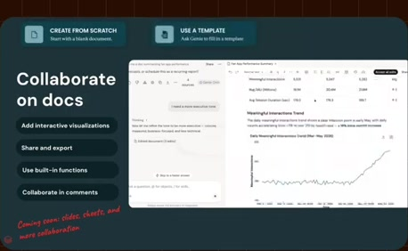
[Full source frame](../frames/full/0038250.jpg)
> co-author documents with you. You can have it start from scratch, give it a template, ask you to fill something out. You can also work with Genie to edit it,

### 21:24.00 — intermediate observed state

[Full source frame](../frames/full/0038520.jpg)
> Your doc is an email, a PDF, Slack, Teams. We do offer inline collaboration, which is what you're seeing here in the GIF. And going forward, we are adding

### 21:35.00 — intermediate observed state
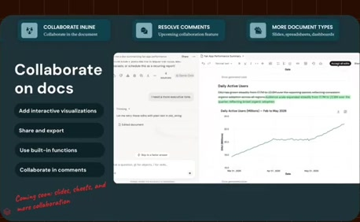
[Full source frame](../frames/full/0038850.jpg)
> as working with Genie to resolve comments. We are also building additional document types, like slides, spreadsheets, dashboards, and so on. I

### 21:46.00 — later observed state
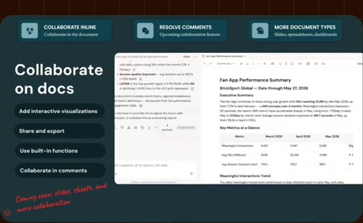
[Full source frame](../frames/full/0039180.jpg)
> of Databricks, given given the context that's in Databricks, and we are seeing a lot of demand for that, so we are building it.

<details>
<summary>5 original change windows: before / near transition / after</summary>

### Estimated anchor 21:06.00

| Before | Near transition | After |
| --- | --- | --- |
| 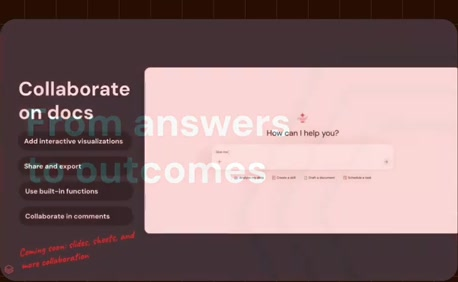 |  | 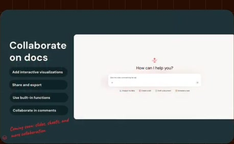 |

> that's where the differentiation comes from, but we are also trying to build as much as possible on this co-working side as well. So, starting with documents, a very

### Estimated anchor 21:15.00

| Before | Near transition | After |
| --- | --- | --- |
| 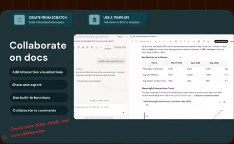 | 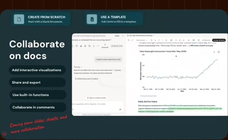 | 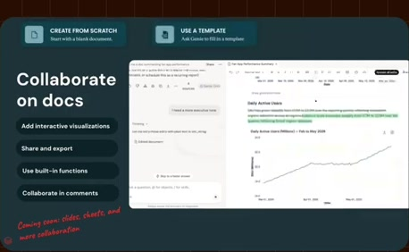 |

> co-author documents with you. You can have it start from scratch, give it a template, ask you to fill something out. You can also work with Genie to edit it,

### Estimated anchor 21:24.00

| Before | Near transition | After |
| --- | --- | --- |
| 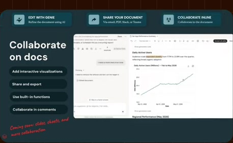 |  |  |

> Your doc is an email, a PDF, Slack, Teams. We do offer inline collaboration, which is what you're seeing here in the GIF. And going forward, we are adding

### Estimated anchor 21:34.00

| Before | Near transition | After |
| --- | --- | --- |
| 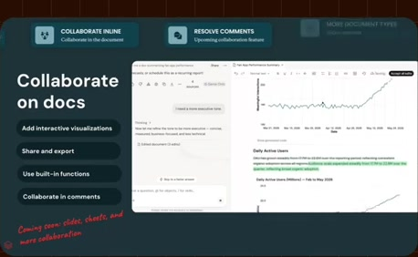 | 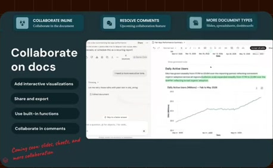 |  |

> as working with Genie to resolve comments. We are also building additional document types, like slides, spreadsheets, dashboards, and so on. I

### Estimated anchor 21:42.00

| Before | Near transition | After |
| --- | --- | --- |
| 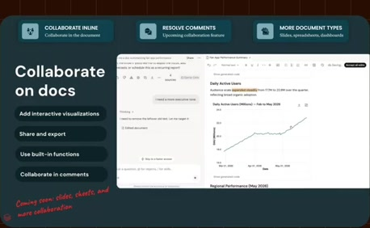 |  | 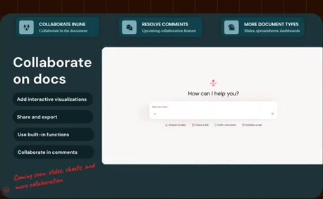 |

> think dashboard is kind of one that everyone's expecting of Databricks, given given the context that's in Databricks, and we are seeing

</details>
