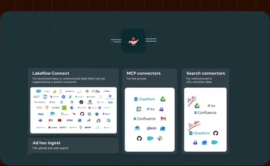
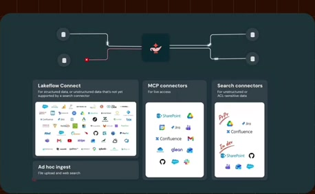
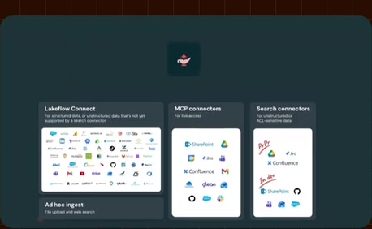
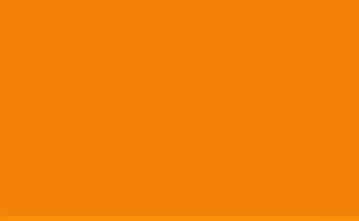

# Access-mode categories

**Source:** [09:06.00–09:17.00](https://www.youtube.com/watch?v=HtR5m5VjaDQ) · **Template:** access-paths · **Type:** explanatory-graphic-or-overlay

**Teaching purpose:** Separate input/access modes before showing their internal routes.
**Relationship:** distinct access modes → different jobs

## Original transcript

> ontology. >> Got it. Thank you. >> Um, of course, Genie can only learn from the data that it can actually reach. So it's important to talk a little bit about how Genie also gets access to this data that it's going to make sense of. Uh, we already have text to SQL, uh,

Rolling transcript, approximate times and original transcription errors preserved.

## Parameterized teaching pattern

- `Use {{access_mode_a}} for {{job_a}}, and {{access_mode_b}} for {{job_b}}.`
- `Finding an existing {{document}} differs from calculating {{answer}} over live {{data}}.`

**Use when:** Use when superficially similar access paths have different semantics.
**Choose another approach when:** A collage of logos cannot distinguish retrieval from execution or ingestion.

**Proposed adaptation motion:** Introduce categories, demonstrate one contrast, then connect the supported paths to a shared consumer.

## Source-specific reveal evidence

```json
{
  "status": "Sequence-level source observations are attached in prior_source_observations. The family motion grammar is a proposed reusable pattern, not a frame-exact claim about this instance."
}
```

## Original source states

### 09:06.30 — earlier observed state

[Full source frame](../frames/full/0016389.jpg)
> ontology. >> Got it. Thank you. >> Um, of course, Genie can only learn from

### 09:09.00 — intermediate observed state

[Full source frame](../frames/full/0016470.jpg)
> >> Got it. Thank you. >> Um, of course, Genie can only learn from the data that it can actually reach. So it's important to talk a little bit

### 09:13.00 — intermediate observed state

[Full source frame](../frames/full/0016590.jpg)
> the data that it can actually reach. So it's important to talk a little bit about how Genie also gets access to this data that it's going to make sense of.

### 09:16.50 — later observed state

[Full source frame](../frames/full/0016695.jpg)
> about how Genie also gets access to this data that it's going to make sense of. Uh, we already have text to SQL, uh,

<details>
<summary>1 original change windows: before / near transition / after</summary>

### Estimated anchor 09:06.00

| Before | Near transition | After |
| --- | --- | --- |
|  |  |  |

> uh, significantly improved with the ontology. >> Got it. Thank you. >> Um, of course, Genie can only learn from

</details>
