# SQL, tools and indexed search routes

**Source:** [10:04.00–11:19.00](https://www.youtube.com/watch?v=HtR5m5VjaDQ) · **Template:** converging-sources · **Type:** explanatory-graphic-or-overlay

**Teaching purpose:** Explain distinct access routes with a shared consumer and explicit source classes.
**Relationship:** many inputs → shared hub

## Original transcript

> into the product. Um for data that lives in in third-party applications, maybe that you want to query live instead of pulling it in and running that text to SQL, we also have uh MCP connectors. Again, they query live. So, you're getting things like the status of a Jira ticket, uh the status of a lead in Salesforce. It's really good for things like that. Uh we have, you know, maybe a dozen a dozen plus um of those MCP connectors. You can hook up a custom connector, and we're planning to to add quite a bit more here. But, when you want to ask a question across a much larger volume of data um or across a lot of sources at once, a bit of a harder question, you need a little bit more horsepower than MCP. Uh and that's what we're building with the search index. It retrieves and ranks everything together instead of leaning on each provider's siloed search capabilities. And it also feeds the ontology. Uh so, we are ensuring that your your tickets and your wikis, whatever it may be, become part of Genie's context. And just as importantly, we enforce the the sources' permissions. So, for example, you're not seeing emails in Genie that you don't actually have access to in your inbox. And that's a big deal because recreating source permissions in Unity Catalog is a is a pretty hard problem.

Rolling transcript, approximate times and original transcription errors preserved.

## Parameterized teaching pattern

- `{{consumer}} draws on {{source_a}}, {{source_b}} and {{source_c}} to {{job}}.`
- `These inputs differ, but they contribute to the same {{shared_layer}}.`

**Use when:** Use when the distinction among source classes matters and they share a real destination.
**Choose another approach when:** Use a list for unrelated items; label search/query/tool access rather than implying data ingestion.

**Proposed adaptation motion:** Add sources individually, retain earlier nodes, draw each path, then activate the hub.

## Source-specific reveal evidence

```json
{
  "status": "Sequence-level source observations are attached in prior_source_observations. The family motion grammar is a proposed reusable pattern, not a frame-exact claim about this instance."
}
```

## Original source states

### 10:04.20 — earlier observed state
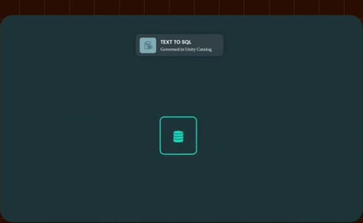
[Full source frame](../frames/full/0018126.jpg)
> for that idea. That That went straight into the product. Um for data that lives in in third-party applications, maybe

### 10:10.00 — intermediate observed state

[Full source frame](../frames/full/0018300.jpg)
> in in third-party applications, maybe that you want to query live instead of pulling it in and running that text to SQL, we also have uh MCP connectors.

### 10:16.00 — intermediate observed state
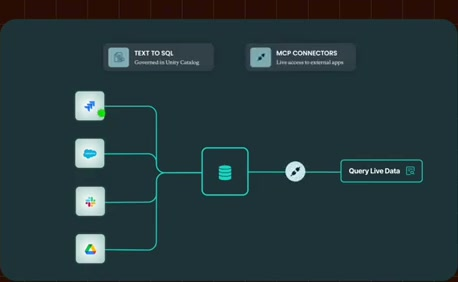
[Full source frame](../frames/full/0018480.jpg)
> SQL, we also have uh MCP connectors. Again, they query live. So, you're getting things like the status of a Jira ticket, uh the status of a lead in

### 10:25.00 — intermediate observed state

[Full source frame](../frames/full/0018750.jpg)
> like that. Uh we have, you know, maybe a dozen a dozen plus um of those MCP connectors. You can hook up a custom

### 10:45.00 — intermediate observed state
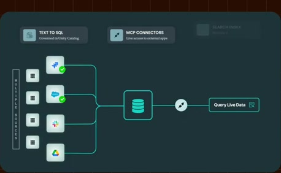
[Full source frame](../frames/full/0019350.jpg)
> bit of a harder question, you need a little bit more horsepower than MCP. Uh and that's what we're building with the search index. It retrieves and ranks

### 10:53.00 — intermediate observed state

[Full source frame](../frames/full/0019590.jpg)
> everything together instead of leaning on each provider's siloed search capabilities. And it also feeds the ontology. Uh so, we are

### 11:14.00 — later observed state

[Full source frame](../frames/full/0020220.jpg)
> seeing emails in Genie that you don't actually have access to in your inbox. And that's a big deal because recreating source permissions in Unity Catalog is a

<details>
<summary>9 original change windows: before / near transition / after</summary>

### Estimated anchor 10:04.00

| Before | Near transition | After |
| --- | --- | --- |
|  | 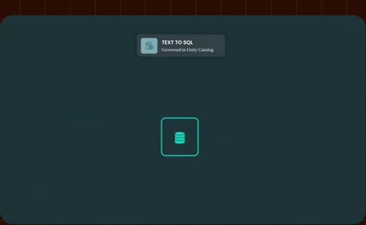 | 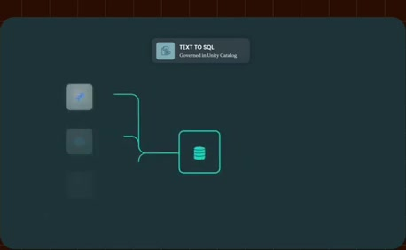 |

> for that idea. That That went straight into the product. Um for data that lives in in third-party applications, maybe

### Estimated anchor 10:10.00

| Before | Near transition | After |
| --- | --- | --- |
|  | 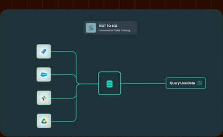 | 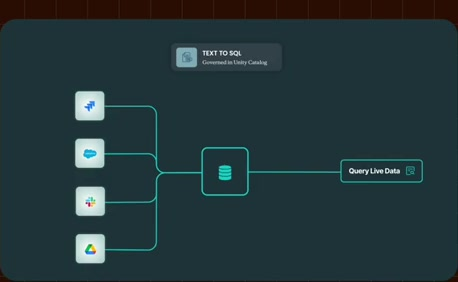 |

> in in third-party applications, maybe that you want to query live instead of pulling it in and running that text to SQL, we also have uh MCP connectors.

### Estimated anchor 10:15.00

| Before | Near transition | After |
| --- | --- | --- |
| 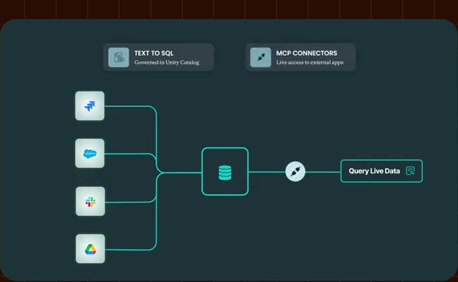 |  |  |

> pulling it in and running that text to SQL, we also have uh MCP connectors. Again, they query live. So, you're getting things like the status of a Jira ticket, uh the status of a lead in

### Estimated anchor 10:24.00

| Before | Near transition | After |
| --- | --- | --- |
|  | 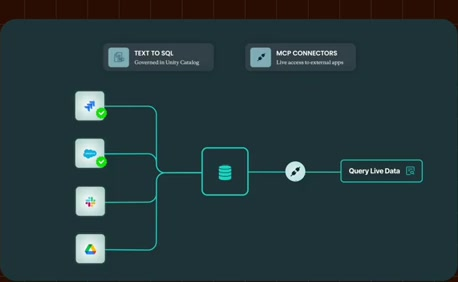 |  |

> Salesforce. It's really good for things like that. Uh we have, you know, maybe a dozen a dozen plus um of those MCP

### Estimated anchor 10:36.00

| Before | Near transition | After |
| --- | --- | --- |
|  | 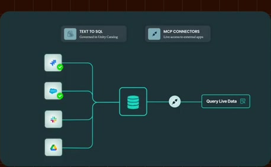 | 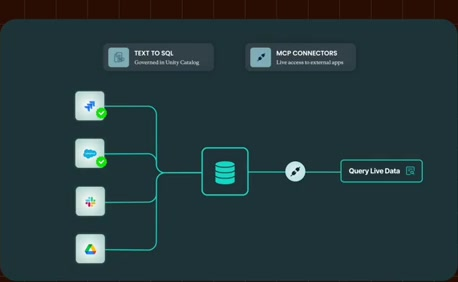 |

> want to ask a question across a much larger volume of data um or across a lot of sources at once, a

### Estimated anchor 10:44.00

| Before | Near transition | After |
| --- | --- | --- |
| 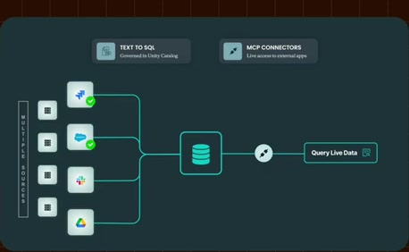 |  |  |

> bit of a harder question, you need a little bit more horsepower than MCP. Uh and that's what we're building with the search index. It retrieves and ranks

### Estimated anchor 10:52.00

| Before | Near transition | After |
| --- | --- | --- |
| 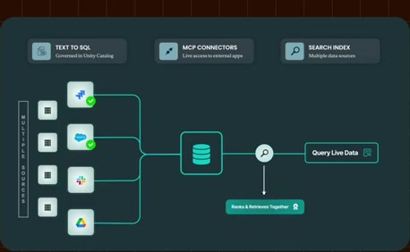 | 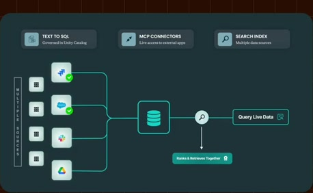 |  |

> everything together instead of leaning on each provider's siloed search capabilities. And it also feeds the ontology. Uh so, we are

### Estimated anchor 11:00.00

| Before | Near transition | After |
| --- | --- | --- |
|  |  |  |

> ontology. Uh so, we are ensuring that your your tickets and your wikis, whatever it may be, become part of Genie's context. And just as

### Estimated anchor 11:10.00

| Before | Near transition | After |
| --- | --- | --- |
| 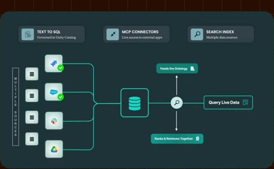 |  |  |

> importantly, we enforce the the sources' permissions. So, for example, you're not seeing emails in Genie that you don't actually have access to in your inbox.

</details>
