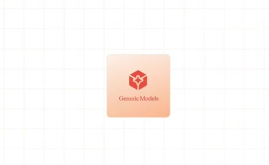
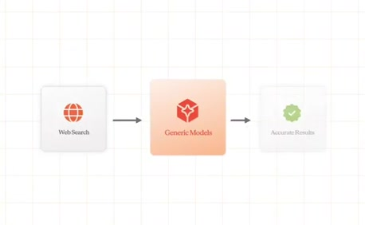
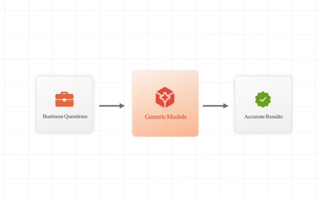
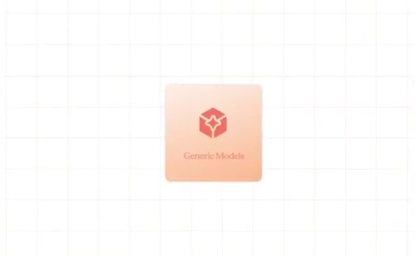
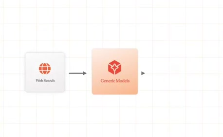
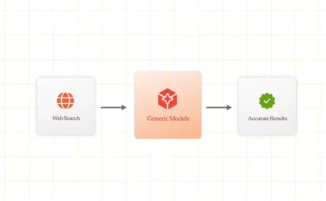
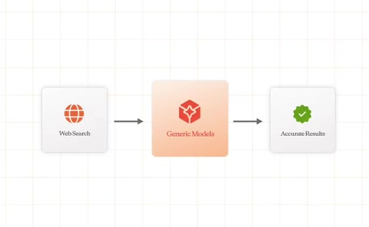

# Web Search → Generic Models → Accurate Results

**Source:** [01:50.00–02:05.00](https://www.youtube.com/watch?v=HtR5m5VjaDQ) · **Template:** input-output · **Type:** explanatory-graphic-or-overlay

**Teaching purpose:** Illustrate the source’s constrained-context baseline before the business-data counterexample.
**Relationship:** input → mechanism → outcome

## Original transcript

> then we'll talk about Databricks' perspective on how to solve it. Generic models are really good at searching the web or a a code base, anything that's got a really constrained space. But when we start to ask questions about our business, we often get quite strange

Rolling transcript, approximate times and original transcription errors preserved.

## Parameterized teaching pattern

- `{{input_source}} feeds {{mechanism}}, which produces {{outcome}}.`
- `For {{bounded_task}}, {{system}} can use {{input_source}} to produce {{qualified_result}}.`

**Use when:** Use when the causal route is the lesson and each arrow has a defensible meaning.
**Choose another approach when:** Use real UI for exact interaction steps; do not use an outcome card as evidence that execution succeeded.

**Proposed adaptation motion:** Introduce the role named first by the narration, then add the remaining input/mechanism/output roles at their spoken cues. Hold the complete relationship. Reading direction does not determine reveal order.

## Source-specific reveal evidence

```json
{
  "reading_order": [
    "Web Search",
    "Generic Models",
    "Accurate Results"
  ],
  "observed_reveal_order": [
    "Peach model surface grows into place",
    "Model icon/label settle; card briefly larger than settled size",
    "Web-search input and its connector appear",
    "Result card and second connector appear",
    "Complete three-card flow holds"
  ],
  "evidence_notes": {
    "110.3": "Only a tiny peach model surface is visible.",
    "111.5": "Model card, icon and label visible at larger transient scale.",
    "113": "Model card settled by itself.",
    "115": "Web card and first arrow visible; result card still faint.",
    "117": "Complete flow is readable.",
    "123": "Completed flow is retained."
  },
  "speech_mapping": "The speaker introduces generic models before describing web search. Finished diagram reading direction is not its reveal order.",
  "confidence": "Direct visual inspection of source crops at 110.3, 111.5, 113, 115 and 117 seconds."
}
```

## Original source states

### 01:50.30 — Only a tiny peach model surface is visible.

[Full source frame](../frames/full/0003309.jpg)
> then we'll talk about Databricks' perspective on how to solve it. Generic models are really good at searching the

### 01:51.50 — Model card, icon and label visible at larger transient scale.

[Full source frame](../frames/full/0003345.jpg)
> then we'll talk about Databricks' perspective on how to solve it. Generic models are really good at searching the

### 01:53.00 — Model card settled by itself.

[Full source frame](../frames/full/0003390.jpg)
> perspective on how to solve it. Generic models are really good at searching the web or a a code base, anything that's

### 01:55.00 — Web card and first arrow visible; result card still faint.

[Full source frame](../frames/full/0003450.jpg)
> perspective on how to solve it. Generic models are really good at searching the web or a a code base, anything that's

### 01:57.00 — Complete flow is readable.

[Full source frame](../frames/full/0003510.jpg)
> models are really good at searching the web or a a code base, anything that's got a really constrained space. But when

### 02:03.00 — Completed flow is retained.

[Full source frame](../frames/full/0003690.jpg)
> got a really constrained space. But when we start to ask questions about our business, we often get quite strange

<details>
<summary>3 original change windows: before / near transition / after</summary>

### Estimated anchor 01:50.50

| Before | Near transition | After |
| --- | --- | --- |
|  |  |  |

> then we'll talk about Databricks' perspective on how to solve it. Generic models are really good at searching the

### Estimated anchor 01:55.00

| Before | Near transition | After |
| --- | --- | --- |
|  |  |  |

> perspective on how to solve it. Generic models are really good at searching the web or a a code base, anything that's

### Estimated anchor 01:58.00

| Before | Near transition | After |
| --- | --- | --- |
|  |  |  |

> models are really good at searching the web or a a code base, anything that's got a really constrained space. But when we start to ask questions about our

</details>
