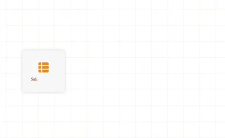
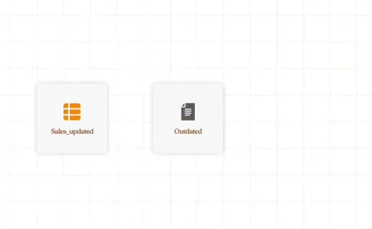
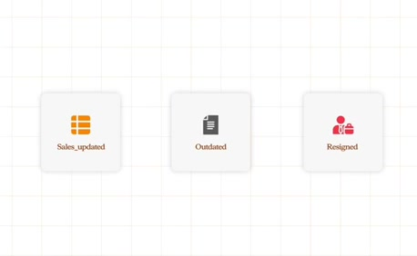
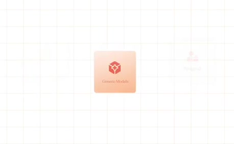
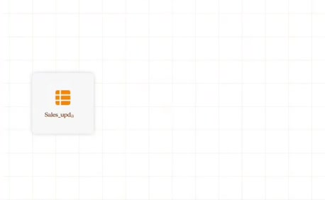
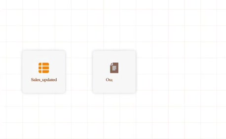
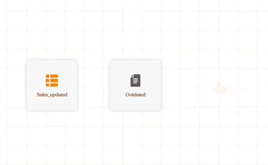
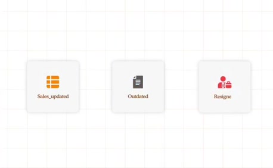
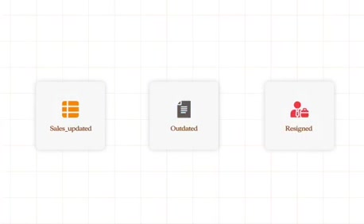

# Renamed assets and departed people

**Source:** [02:54.20–03:03.00](https://www.youtube.com/watch?v=HtR5m5VjaDQ) · **Template:** stale-context · **Type:** explanatory-graphic-or-overlay

**Teaching purpose:** Show concrete ways business references and institutional context change.
**Relationship:** prior context → change → mismatch

## Original transcript

> that knowledge moves, right? Tables get renamed, documents go stale, people leave the company. So, no matter how sophisticated a model is, and these models are really sophisticated. They

Rolling transcript, approximate times and original transcription errors preserved.

## Parameterized teaching pattern

- `{{asset_or_rule}} changed, but {{system}} still uses {{old_context}}.`
- `The {{entity}} was {{change}}, so the previous {{reference}} is now unreliable.`

**Use when:** Use when time or organizational change breaks relevance.
**Choose another approach when:** A stale icon does not prove freshness checks exist; show the changed reference and its consequence.

**Proposed adaptation motion:** Reveal the original reference, mark the concrete change, then show the resulting mismatch.

## Source-specific reveal evidence

```json
{
  "status": "Sequence-level source observations are attached in prior_source_observations. The family motion grammar is a proposed reusable pattern, not a frame-exact claim about this instance."
}
```

## Original source states

### 02:54.50 — earlier observed state

[Full source frame](../frames/full/0005235.jpg)
> heads. And then to make matters worse, that knowledge moves, right? Tables get renamed, documents go stale, people

### 02:56.50 — intermediate observed state

[Full source frame](../frames/full/0005295.jpg)
> that knowledge moves, right? Tables get renamed, documents go stale, people leave the company. So, no matter how

### 02:58.50 — intermediate observed state

[Full source frame](../frames/full/0005355.jpg)
> that knowledge moves, right? Tables get renamed, documents go stale, people leave the company. So, no matter how sophisticated a model is, and these

### 03:01.00 — intermediate observed state

[Full source frame](../frames/full/0005430.jpg)
> renamed, documents go stale, people leave the company. So, no matter how sophisticated a model is, and these models are really sophisticated. They

### 03:02.70 — later observed state

[Full source frame](../frames/full/0005481.jpg)
> leave the company. So, no matter how sophisticated a model is, and these models are really sophisticated. They can do graduate-level math, but they

<details>
<summary>3 original change windows: before / near transition / after</summary>

### Estimated anchor 02:54.50

| Before | Near transition | After |
| --- | --- | --- |
|  |  |  |

> heads. And then to make matters worse, that knowledge moves, right? Tables get renamed, documents go stale, people

### Estimated anchor 02:57.00

| Before | Near transition | After |
| --- | --- | --- |
|  |  |  |

> that knowledge moves, right? Tables get renamed, documents go stale, people leave the company. So, no matter how

### Estimated anchor 03:00.00

| Before | Near transition | After |
| --- | --- | --- |
|  |  |  |

> renamed, documents go stale, people leave the company. So, no matter how sophisticated a model is, and these models are really sophisticated. They

</details>
