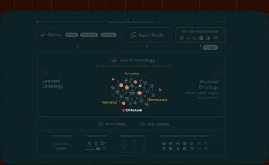
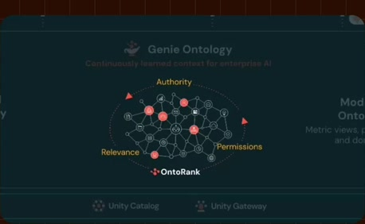
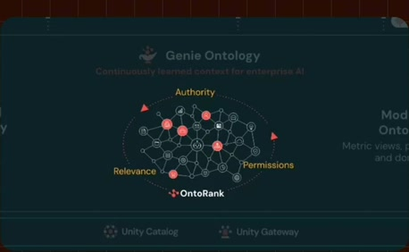
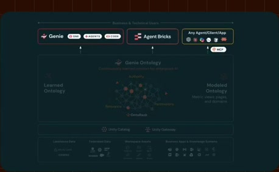
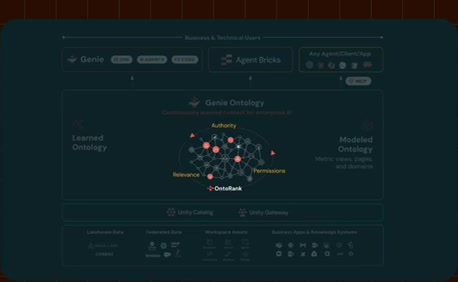
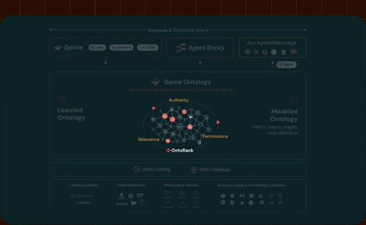
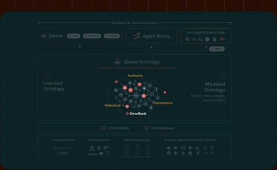
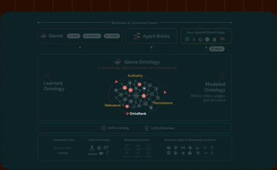
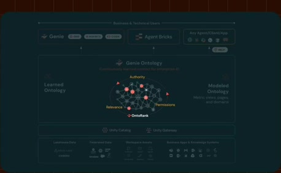

# OntoRank and named relevance criteria

**Source:** [06:42.00–07:18.00](https://www.youtube.com/watch?v=HtR5m5VjaDQ) · **Template:** ranked-context · **Type:** explanatory-graphic-or-overlay

**Teaching purpose:** Explain why context candidates differ in relevance and authority.
**Relationship:** candidate context → ranking criteria → relevant context

## Original transcript

> how might we define churn for our team? And as Genie is amassing all this information, both this modeled and learned knowledge, it's all going into one single ranking algorithm that we call Ontorank. Given a Given a query that someone posts in an agent, what are the assets that are most likely to be helpful in answering that in that question? So, for example, it looks at things like popularity, certification status, authorship to to try to find the most valuable information, to dedupe against across uh conflicting information, and so on. And it's not just questions that you put

Rolling transcript, approximate times and original transcription errors preserved.

## Parameterized teaching pattern

- `{{system}} prioritizes {{context}} using {{criterion_a}}, {{criterion_b}} and {{criterion_c}}.`
- `Not every {{candidate}} is equally useful; {{ranking_rule}} changes which ones matter for {{question}}.`

**Use when:** Use when relevance or prioritization is the causal lesson.
**Choose another approach when:** A generic node graph does not explain ranking; name the criteria and avoid inventing numerical weights.

**Proposed adaptation motion:** Establish candidates, focus the ranking mechanism, expose named criteria and return to consumers.

## Source-specific reveal evidence

```json
{
  "status": "Sequence-level source observations are attached in prior_source_observations. The family motion grammar is a proposed reusable pattern, not a frame-exact claim about this instance."
}
```

## Original source states

### 06:43.00 — earlier observed state

[Full source frame](../frames/full/0012090.jpg)
> metric definition. So, for example, like how might we define churn for our team? And as Genie is amassing all this information, both this modeled and

### 06:50.00 — intermediate observed state

[Full source frame](../frames/full/0012300.jpg)
> information, both this modeled and learned knowledge, it's all going into one single ranking algorithm that we call Ontorank.

### 06:54.00 — intermediate observed state

[Full source frame](../frames/full/0012420.jpg)
> one single ranking algorithm that we call Ontorank. Given a Given a query that someone posts

### 07:00.00 — intermediate observed state

[Full source frame](../frames/full/0012600.jpg)
> Given a Given a query that someone posts in an agent, what are the assets that are most likely to be helpful in answering that in that question? So, for

### 07:09.00 — intermediate observed state

[Full source frame](../frames/full/0012870.jpg)
> example, it looks at things like popularity, certification status, authorship to to try to find the most valuable

### 07:17.00 — later observed state

[Full source frame](../frames/full/0013110.jpg)
> to try to find the most valuable information, to dedupe against across uh conflicting information, and so on. And it's not just questions that you put

<details>
<summary>5 original change windows: before / near transition / after</summary>

### Estimated anchor 06:43.00

| Before | Near transition | After |
| --- | --- | --- |
|  |  |  |

> metric definition. So, for example, like how might we define churn for our team? And as Genie is amassing all this information, both this modeled and

### Estimated anchor 06:49.00

| Before | Near transition | After |
| --- | --- | --- |
|  |  |  |

> And as Genie is amassing all this information, both this modeled and learned knowledge, it's all going into one single ranking algorithm that we

### Estimated anchor 06:53.00

| Before | Near transition | After |
| --- | --- | --- |
|  |  |  |

> learned knowledge, it's all going into one single ranking algorithm that we call Ontorank. Given a Given a query that someone posts

### Estimated anchor 06:59.00

| Before | Near transition | After |
| --- | --- | --- |
|  |  |  |

> Given a Given a query that someone posts in an agent, what are the assets that are most likely to be helpful in answering that in that question? So, for

### Estimated anchor 07:10.00

| Before | Near transition | After |
| --- | --- | --- |
|  |  |  |

> popularity, certification status, authorship to to try to find the most valuable information, to dedupe against across uh

</details>
