# Add context to the data-to-result route

**Source:** [03:03.00–03:29.50](https://www.youtube.com/watch?v=HtR5m5VjaDQ) · **Template:** context-repair · **Type:** explanatory-graphic-or-overlay

**Teaching purpose:** Connect the missing business context to the existing question/result mechanism.
**Relationship:** broken route → missing context → repaired route

## Original transcript

> sophisticated a model is, and these models are really sophisticated. They can do graduate-level math, but they struggle to answer business questions because they're missing that critical context. Uh but Genie was built for exactly those types of questions, and it helps that we've been working on this this context problem for a long time. Uh Genie understands your your data sources, your definitions, even who's most authoritative when it comes to drafting those definitions, and we do that through the Genie ontology.

Rolling transcript, approximate times and original transcription errors preserved.

## Parameterized teaching pattern

- `To answer {{question}} correctly, connect {{data}} with {{definition_or_context}}.`
- `The missing piece is {{business_context}}, which tells {{system}} how to interpret {{asset}}.`

**Use when:** Use after a concrete failure has established why the missing context matters.
**Choose another approach when:** Do not promise that context fixes all data-quality, model or authorization failures.

**Proposed adaptation motion:** Retain the failed route, add the specific missing context, reconnect the relevant paths and hold the repaired relationship.

## Source-specific reveal evidence

```json
{
  "status": "Sequence-level source observations are attached in prior_source_observations. The family motion grammar is a proposed reusable pattern, not a frame-exact claim about this instance."
}
```

## Original source states

### 03:03.30 — earlier observed state

[Full source frame](../frames/full/0005499.jpg)
> sophisticated a model is, and these models are really sophisticated. They can do graduate-level math, but they

### 03:06.00 — intermediate observed state
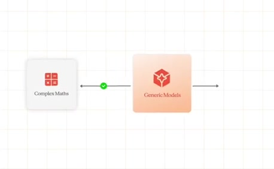
[Full source frame](../frames/full/0005580.jpg)
> models are really sophisticated. They can do graduate-level math, but they struggle to answer business questions because they're missing that critical

### 03:10.00 — intermediate observed state
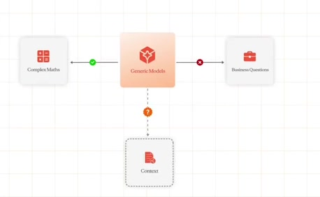
[Full source frame](../frames/full/0005700.jpg)
> struggle to answer business questions because they're missing that critical context. Uh but Genie was built for

### 03:18.00 — intermediate observed state

[Full source frame](../frames/full/0005940.jpg)
> helps that we've been working on this this context problem for a long time. Uh Genie understands your your data

### 03:23.00 — intermediate observed state
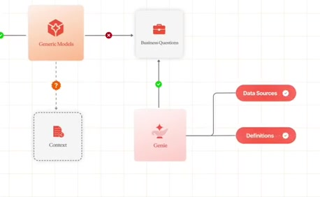
[Full source frame](../frames/full/0006090.jpg)
> Genie understands your your data sources, your definitions, even who's most authoritative when it comes to

### 03:28.00 — later observed state
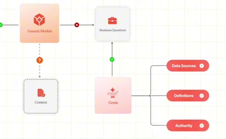
[Full source frame](../frames/full/0006240.jpg)
> most authoritative when it comes to drafting those definitions, and we do that through the Genie ontology. The ontology is a is a unified context

<details>
<summary>5 original change windows: before / near transition / after</summary>

### Estimated anchor 03:04.00

| Before | Near transition | After |
| --- | --- | --- |
| 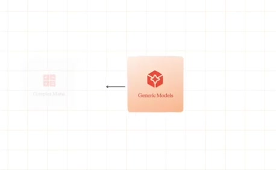 | 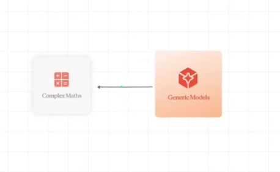 | 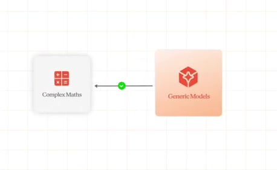 |

> sophisticated a model is, and these models are really sophisticated. They can do graduate-level math, but they struggle to answer business questions

### Estimated anchor 03:09.00

| Before | Near transition | After |
| --- | --- | --- |
| 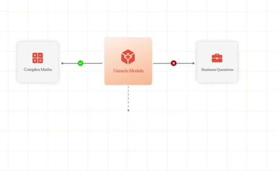 | 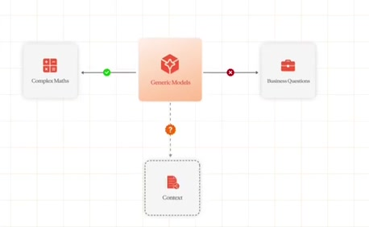 |  |

> can do graduate-level math, but they struggle to answer business questions because they're missing that critical context. Uh but Genie was built for

### Estimated anchor 03:16.00

| Before | Near transition | After |
| --- | --- | --- |
|  | 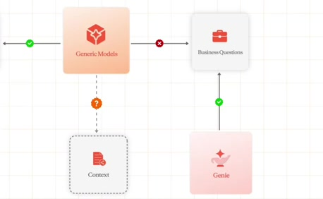 |  |

> context. Uh but Genie was built for exactly those types of questions, and it helps that we've been working on this this context problem for a long time. Uh

### Estimated anchor 03:22.00

| Before | Near transition | After |
| --- | --- | --- |
| 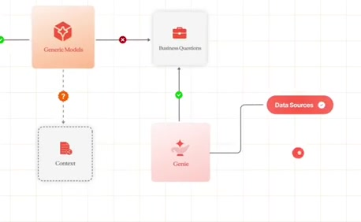 | 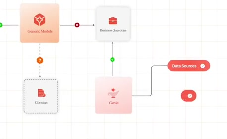 |  |

> this context problem for a long time. Uh Genie understands your your data sources, your definitions, even who's most authoritative when it comes to

### Estimated anchor 03:26.00

| Before | Near transition | After |
| --- | --- | --- |
|  | 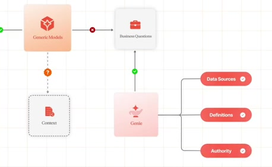 |  |

> sources, your definitions, even who's most authoritative when it comes to drafting those definitions, and we do that through the Genie ontology.

</details>
