# Tool route, gateway and access checks

**Source:** [21:56.00–22:35.00](https://www.youtube.com/watch?v=HtR5m5VjaDQ) · **Template:** permissioned-action · **Type:** explanatory-graphic-or-overlay

**Teaching purpose:** Make the control point and action scope explicit.
**Relationship:** actor → control point → allowed/denied route

## Original transcript

> in data, but of course, you can also use MCPs to write data. The interesting thing here, I think, is that MCPs have been our first integration between Genie and Unity Gateway. So, as an administrator, you can decide, you know, this user gets access to this MCP, that user gets access to that MCP, or even this tool, but not that tool, or even more granularly than that. For example, you can use Genie to post to Slack, but you can't, you know, post to these particular channels, or maybe you can push to this GitHub branch, but not those GitHub branches. So, that becomes a pretty granular control for the administrators, and we've only since then expanded on that as we think about more and more centralized governance of

Rolling transcript, approximate times and original transcription errors preserved.

## Parameterized teaching pattern

- `{{actor}} reaches {{tool}} through {{control_point}}, which enforces {{scope}}.`
- `{{action}} is allowed for {{allowed_scope}} and denied for {{denied_scope}}.`

**Use when:** Use when the permission boundary or action route matters.
**Choose another approach when:** Compatibility logos are not proof of authorization or successful execution.

**Proposed adaptation motion:** Establish actor and destination, add the gateway, draw the route and reveal access distinctions.

## Source-specific reveal evidence

```json
{
  "status": "Sequence-level source observations are attached in prior_source_observations. The family motion grammar is a proposed reusable pattern, not a frame-exact claim about this instance."
}
```

## Original source states

### 21:56.30 — earlier observed state

[Full source frame](../frames/full/0039489.jpg)
> doesn't. So, I talked about MCPs to read in data, but of course, you can also use MCPs to write data. The interesting thing here, I think, is

### 22:02.00 — intermediate observed state

[Full source frame](../frames/full/0039660.jpg)
> The interesting thing here, I think, is that MCPs have been our first integration between Genie and Unity Gateway. So, as an administrator, you

### 22:07.00 — intermediate observed state
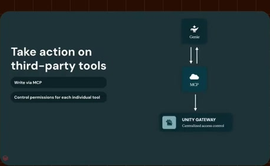
[Full source frame](../frames/full/0039810.jpg)
> integration between Genie and Unity Gateway. So, as an administrator, you can decide, you know, this user gets access to this MCP, that user gets

### 22:13.00 — intermediate observed state
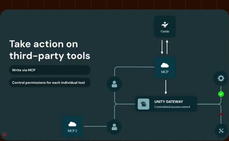
[Full source frame](../frames/full/0039990.jpg)
> access to this MCP, that user gets access to that MCP, or even this tool, but not that tool, or even more granularly than that. For example, you

### 22:20.00 — intermediate observed state
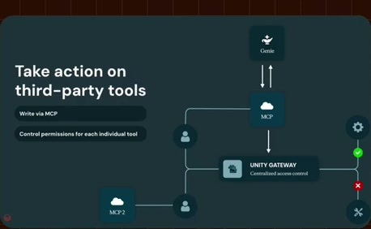
[Full source frame](../frames/full/0040200.jpg)
> granularly than that. For example, you can use Genie to post to Slack, but you can't, you know, post to these particular channels, or maybe you

### 22:33.00 — later observed state
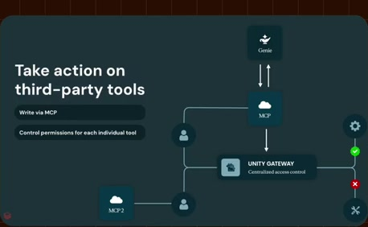
[Full source frame](../frames/full/0040590.jpg)
> a pretty granular control for the administrators, and we've only since then expanded on that as we think about more and more centralized governance of

<details>
<summary>6 original change windows: before / near transition / after</summary>

### Estimated anchor 21:56.00

| Before | Near transition | After |
| --- | --- | --- |
| 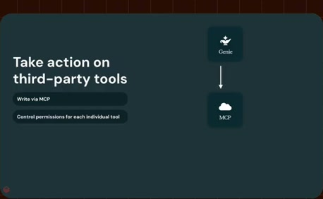 |  | 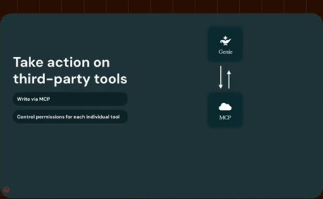 |

> doesn't. So, I talked about MCPs to read in data, but of course, you can also use MCPs to write data. The interesting thing here, I think, is

### Estimated anchor 22:01.00

| Before | Near transition | After |
| --- | --- | --- |
| 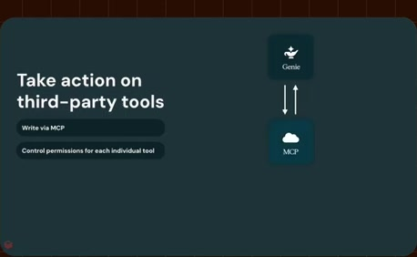 |  |  |

> MCPs to write data. The interesting thing here, I think, is that MCPs have been our first integration between Genie and Unity

### Estimated anchor 22:06.00

| Before | Near transition | After |
| --- | --- | --- |
| 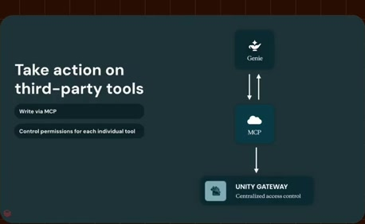 | 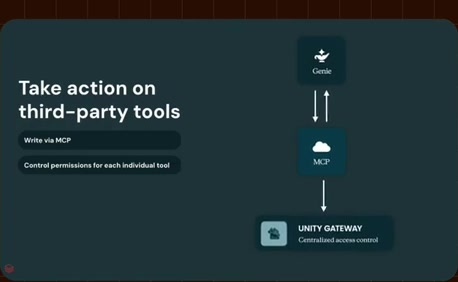 |  |

> integration between Genie and Unity Gateway. So, as an administrator, you can decide, you know, this user gets access to this MCP, that user gets

### Estimated anchor 22:12.00

| Before | Near transition | After |
| --- | --- | --- |
| 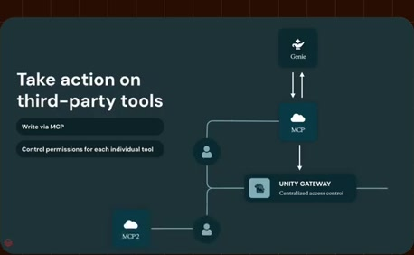 | 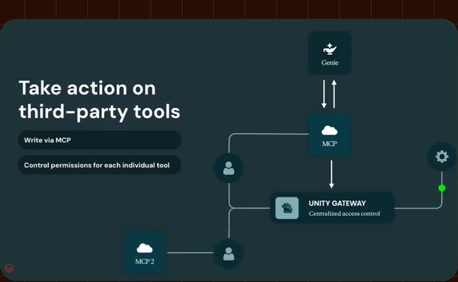 |  |

> access to this MCP, that user gets access to that MCP, or even this tool, but not that tool, or even more

### Estimated anchor 22:18.00

| Before | Near transition | After |
| --- | --- | --- |
|  |  |  |

> but not that tool, or even more granularly than that. For example, you can use Genie to post to Slack, but you can't, you know, post to

### Estimated anchor 22:26.00

| Before | Near transition | After |
| --- | --- | --- |
|  | 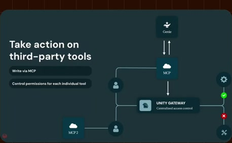 |  |

> these particular channels, or maybe you can push to this GitHub branch, but not those GitHub branches. So, that becomes

</details>
