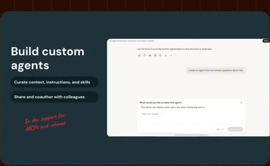
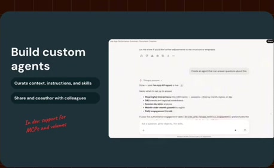
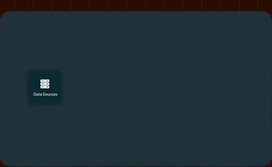
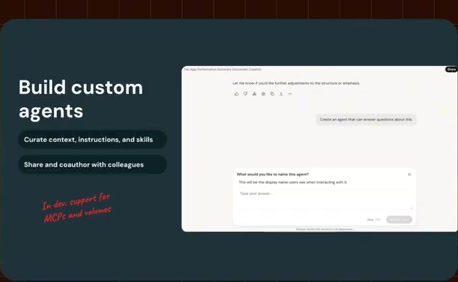
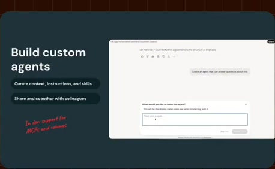
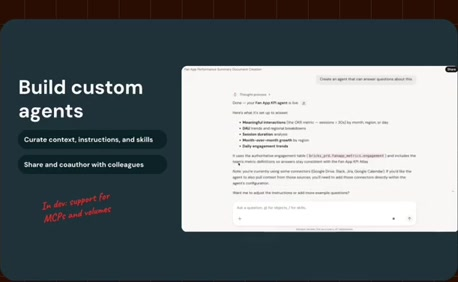
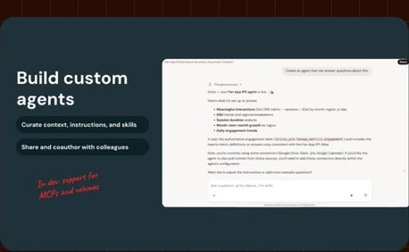
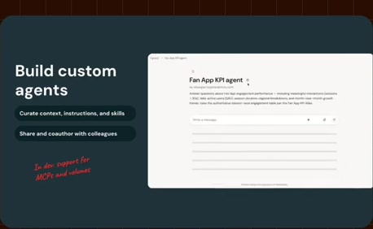

# Custom-agent configuration

**Source:** [24:24.00–24:35.00](https://www.youtube.com/watch?v=HtR5m5VjaDQ) · **Template:** feature-evidence · **Type:** explanatory-graphic-or-overlay

**Teaching purpose:** Introduce the capability using its visible configuration evidence.
**Relationship:** stable capability → supporting product evidence

## Original transcript

> all sorts of governance around skills. All right. Um so, there's also kind of a step up from a skill. You know, if a skill can perform a task, then an agent performs an entire job. So, a Genie agent bundles data sources, instructions, skills, and memory, and

Rolling transcript, approximate times and original transcription errors preserved.

## Parameterized teaching pattern

- `To {{user_job}}, use {{feature}}: {{specific_interaction}}.`
- `Here {{system}} lets {{actor}} {{action}}, with {{constraint}}.`

**Use when:** Use when the actual visible product interaction supports the claim.
**Choose another approach when:** Do not fabricate UI or infer availability beyond the visible source version.

**Proposed adaptation motion:** Hold the heading; update one supporting point as the real interface demonstrates it.

## Source-specific reveal evidence

```json
{
  "status": "Sequence-level source observations are attached in prior_source_observations. The family motion grammar is a proposed reusable pattern, not a frame-exact claim about this instance."
}
```

## Original source states

### 24:24.30 — earlier observed state

[Full source frame](../frames/full/0043929.jpg)
> Um but, we're super open to to any and all sorts of governance around skills. All right. Um so, there's also kind of a step up from a skill. You know, if a

### 24:28.00 — intermediate observed state

[Full source frame](../frames/full/0044040.jpg)
> All right. Um so, there's also kind of a step up from a skill. You know, if a skill can perform a task, then an agent performs an entire job. So, a Genie

### 24:34.50 — later observed state

[Full source frame](../frames/full/0044235.jpg)
> performs an entire job. So, a Genie agent bundles data sources, instructions, skills, and memory, and

<details>
<summary>2 original change windows: before / near transition / after</summary>

### Estimated anchor 24:24.00

| Before | Near transition | After |
| --- | --- | --- |
|  |  |  |

> Um but, we're super open to to any and all sorts of governance around skills. All right. Um so, there's also kind of a step up from a skill. You know, if a

### Estimated anchor 24:30.00

| Before | Near transition | After |
| --- | --- | --- |
|  |  |  |

> step up from a skill. You know, if a skill can perform a task, then an agent performs an entire job. So, a Genie

</details>
