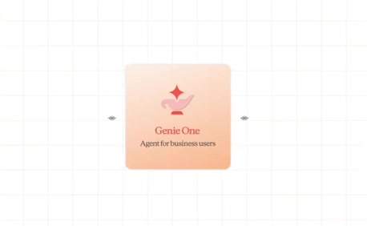
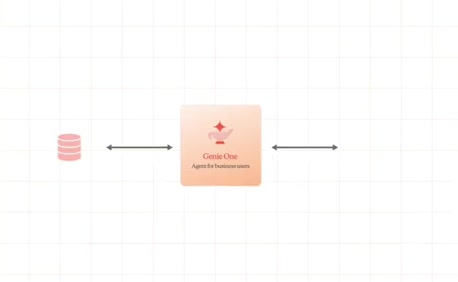
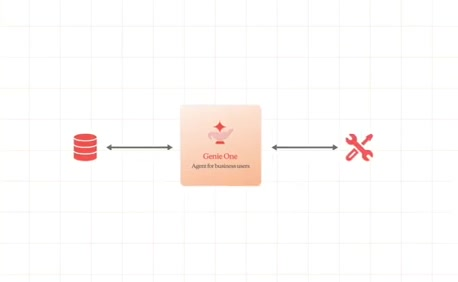
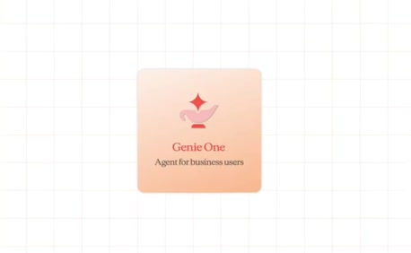
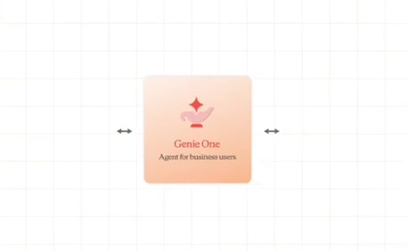
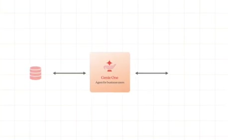
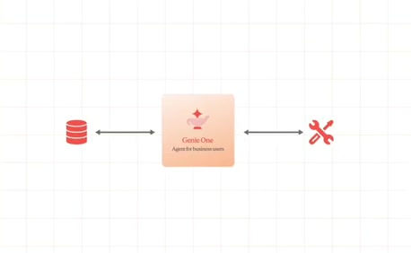
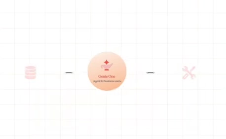
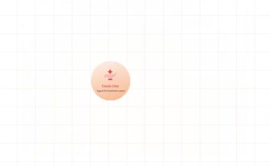

# Data and tools feed the assistant

**Source:** [00:43.35–00:46.50](https://www.youtube.com/watch?v=HtR5m5VjaDQ) · **Template:** converging-sources · **Type:** explanatory-graphic-or-overlay

**Teaching purpose:** Give the definition tangible input classes.
**Relationship:** many inputs → shared hub

## Original transcript

> Genie 1 world. Genie 1 is our AI co-worker for business users. It It connects to your data and tools. It answers questions about your business.

Rolling transcript, approximate times and original transcription errors preserved.

## Parameterized teaching pattern

- `{{consumer}} draws on {{source_a}}, {{source_b}} and {{source_c}} to {{job}}.`
- `These inputs differ, but they contribute to the same {{shared_layer}}.`

**Use when:** Use when the distinction among source classes matters and they share a real destination.
**Choose another approach when:** Use a list for unrelated items; label search/query/tool access rather than implying data ingestion.

**Proposed adaptation motion:** Add sources individually, retain earlier nodes, draw each path, then activate the hub.

## Source-specific reveal evidence

```json
{
  "status": "Sequence-level source observations are attached in prior_source_observations. The family motion grammar is a proposed reusable pattern, not a frame-exact claim about this instance."
}
```

## Original source states

### 00:43.50 — earlier observed state

[Full source frame](../frames/full/0001305.jpg)
> Genie 1 world. Genie 1 is our AI co-worker for business users. It It connects to your data and tools. It

### 00:44.30 — intermediate observed state

[Full source frame](../frames/full/0001329.jpg)
> Genie 1 world. Genie 1 is our AI co-worker for business users. It It connects to your data and tools. It answers questions about your business.

### 00:45.20 — intermediate observed state

[Full source frame](../frames/full/0001356.jpg)
> Genie 1 world. Genie 1 is our AI co-worker for business users. It It connects to your data and tools. It answers questions about your business.

### 00:46.30 — later observed state

[Full source frame](../frames/full/0001389.jpg)
> co-worker for business users. It It connects to your data and tools. It answers questions about your business. It acts on the answers that it gives

<details>
<summary>2 original change windows: before / near transition / after</summary>

### Estimated anchor 00:43.35

| Before | Near transition | After |
| --- | --- | --- |
|  |  |  |

> Genie 1 world. Genie 1 is our AI co-worker for business users. It It connects to your data and tools. It

### Estimated anchor 00:46.00

| Before | Near transition | After |
| --- | --- | --- |
|  |  |  |

> co-worker for business users. It It connects to your data and tools. It answers questions about your business.

</details>
