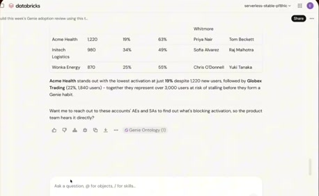
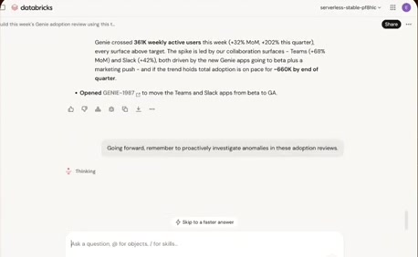
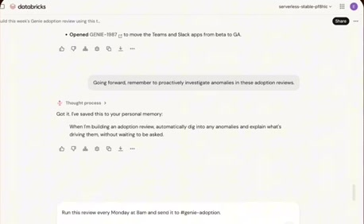
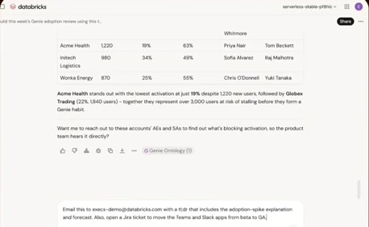
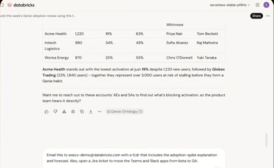
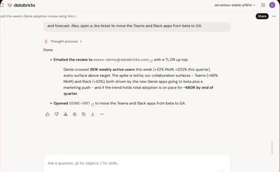
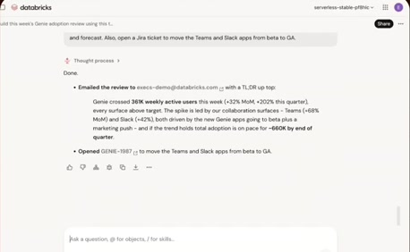
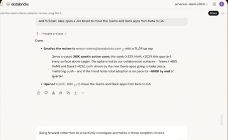

# Actual action and scheduled-work demo

**Source:** [26:54.00–28:02.00](https://www.youtube.com/watch?v=HtR5m5VjaDQ) · **Template:** ui-evidence · **Type:** authentic-ui-evidence

**Teaching purpose:** Show observed execution and resulting interface states.
**Relationship:** actual workflow → visible execution/result

## Original transcript

> show a couple more things uh in in our demo. So, going back to my my other screen. So, I've I've Remember I've I've created my my document. I think I'm I'm ready to actually send this to our executive team. And I'm going to include some of those follow-up analyses that that Genie gave Sorry, Genie gave me. So, when it does this, Genie is is writing to Gmail and Jira as me with my credentials. And then behind the scenes, again, this is all governed through Unity Gateway. So, an admin has decided to leave me access to send email with Genie, um but they could certainly have blocked that if they if they chose. Or they could even uh block this execs@demodatabricks.com, which is not a real email uh or for public purposes. Um Now, I don't want to have to ask for these these follow-up analyses every week. So, maybe I'll also ask Genie to always investigate anomalies proactively when I'm doing this kind of review. Again, it goes back to that idea of of personal memory. So, I can save that. And then maybe I don't want to have to remember to run this at all every week. So, maybe I want this analysis to run when I'm out of office. So, I can also, again, put this on a schedule. I can

Rolling transcript, approximate times and original transcription errors preserved.

## Parameterized teaching pattern

- `Here is {{question_or_task}}. We {{interaction}}, then inspect {{result_or_evidence}}.`
- `To verify {{claim}}, look at {{visible_evidence}} in the product.`

**Use when:** Use when exact interaction or observed execution is central.
**Choose another approach when:** Illustrative diagrams cannot verify real execution. Keep reference UI separate from generated conceptual graphics.

**Proposed adaptation motion:** Retain real viewport changes and source timing; focus on the evidence the narrator discusses.

## Source-specific reveal evidence

```json
{
  "status": "Sequence-level source observations are attached in prior_source_observations. The family motion grammar is a proposed reusable pattern, not a frame-exact claim about this instance."
}
```

## Original source states

### 26:56.00 — earlier observed state

[Full source frame](../frames/full/0048480.jpg)
> show a couple more things uh in in our demo. So, going back to my my other screen. So, I've I've Remember I've I've created

### 27:23.00 — intermediate observed state

[Full source frame](../frames/full/0049290.jpg)
> Unity Gateway. So, an admin has decided to leave me access to send email with Genie, um but they could certainly have

### 27:49.00 — intermediate observed state

[Full source frame](../frames/full/0050070.jpg)
> this kind of review. Again, it goes back to that idea of of personal memory. So, I can save that.

### 28:00.00 — later observed state

[Full source frame](../frames/full/0050400.jpg)
> remember to run this at all every week. So, maybe I want this analysis to run when I'm out of office. So, I can also, again, put this on a schedule. I can

<details>
<summary>3 original change windows: before / near transition / after</summary>

### Estimated anchor 27:03.00

| Before | Near transition | After |
| --- | --- | --- |
|  |  |  |

> my my document. I think I'm I'm ready to actually send this to our executive team. And I'm going to include some of those follow-up analyses that that Genie

### Estimated anchor 27:22.00

| Before | Near transition | After |
| --- | --- | --- |
|  |  |  |

> again, this is all governed through Unity Gateway. So, an admin has decided to leave me access to send email with Genie, um but they could certainly have

### Estimated anchor 27:48.00

| Before | Near transition | After |
| --- | --- | --- |
|  |  |  |

> anomalies proactively when I'm doing this kind of review. Again, it goes back to that idea of of personal memory. So,

</details>
