# Actual agent configuration and inspection

**Source:** [28:02.00–29:48.00](https://www.youtube.com/watch?v=HtR5m5VjaDQ) · **Template:** ui-evidence · **Type:** authentic-ui-evidence

**Teaching purpose:** Inspect actual configuration, evidence and settings.
**Relationship:** actual workflow → visible execution/result

## Original transcript

> when I'm out of office. So, I can also, again, put this on a schedule. I can send it to to the Slack channel when I'm out, and it'll still run with my credentials. Great. Of course, now this adoption review isn't the only time people actually ask me about Genie adoption. So, I can also turn this conversation into an agent that can answer questions about it using the context from not only, again, this conversation, but maybe also the other conversations that I've had with Genie uh about this topic. So, I can ask it to actually save as an agent. I can name the agent. And as it's creating, what it's basically creating, again, is that expert coworker that people can use to ask questions and take action related to Genie's performance, Genie's OKRs. And unlike an OKR doc that's going to go stale pretty quickly, the agent remains up-to-date and can compute answers live. To that end, maybe I want to share this with some of the other the other PMs at at Databricks. And I can actually click into this agent, and here I'm going to see that I'm able to chat directly with this agent. So here, I'm in Genie 1, but now I'm talking directly to this very specialized agent. And if we click into the agent's details, we can see uh that has actually been quite customized to the sources that we talked about um in in that in that prior conversations. So it's using the right kinds of data. And more broadly, you can probably imagine the types of teams that might use something like this. I mean, think of any team uh that needs to do the same kinds of workflows over and over, uh answer the same kind of questions over and over. Now, you know, they can create this customized coworker in one single place, and they can certify it, they can do all sorts of things to really elevate it, not only in the onto rank algorithm, but also just in the in the Genie 1 experience for all of their coworkers.

Rolling transcript, approximate times and original transcription errors preserved.

## Parameterized teaching pattern

- `Here is {{question_or_task}}. We {{interaction}}, then inspect {{result_or_evidence}}.`
- `To verify {{claim}}, look at {{visible_evidence}} in the product.`

**Use when:** Use when exact interaction or observed execution is central.
**Choose another approach when:** Illustrative diagrams cannot verify real execution. Keep reference UI separate from generated conceptual graphics.

**Proposed adaptation motion:** Retain real viewport changes and source timing; focus on the evidence the narrator discusses.

## Source-specific reveal evidence

```json
{
  "status": "Sequence-level source observations are attached in prior_source_observations. The family motion grammar is a proposed reusable pattern, not a frame-exact claim about this instance."
}
```

## Original source states

### 28:04.00 — earlier observed state
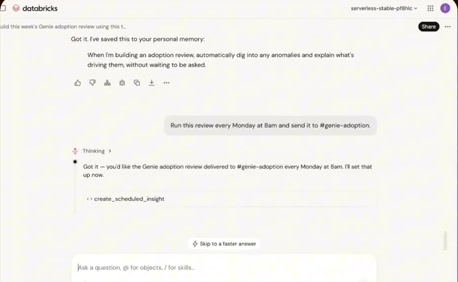
[Full source frame](../frames/full/0050520.jpg)
> when I'm out of office. So, I can also, again, put this on a schedule. I can send it to to the Slack channel when I'm out, and it'll still run with my

### 28:20.00 — intermediate observed state
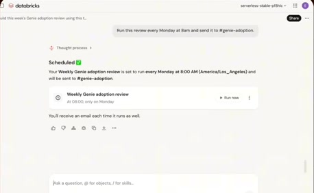
[Full source frame](../frames/full/0051000.jpg)
> So, I can also turn this conversation into an agent that can answer questions about it using the context from not only, again, this conversation, but

### 28:49.00 — intermediate observed state

[Full source frame](../frames/full/0051870.jpg)
> ask questions and take action related to Genie's performance, Genie's OKRs. And unlike an OKR doc that's going to go stale pretty quickly, the agent remains

### 29:10.00 — intermediate observed state
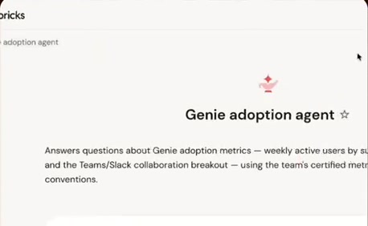
[Full source frame](../frames/full/0052500.jpg)
> see that I'm able to chat directly with this agent. So here, I'm in Genie 1, but now I'm talking directly to this very specialized agent. And if we click into

### 29:36.00 — intermediate observed state
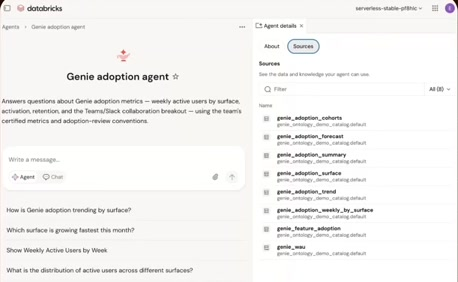
[Full source frame](../frames/full/0053280.jpg)
> answer the same kind of questions over and over. Now, you know, they can create this customized coworker in one single place, and they can certify it, they can

### 29:46.00 — later observed state
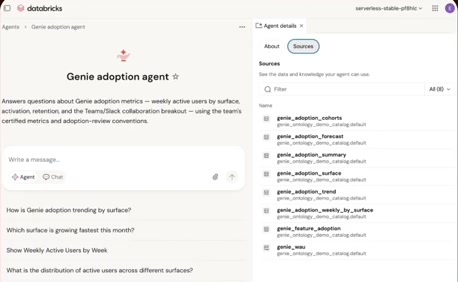
[Full source frame](../frames/full/0053580.jpg)
> it, not only in the onto rank algorithm, but also just in the in the Genie 1 experience for all of their coworkers.

<details>
<summary>5 original change windows: before / near transition / after</summary>

### Estimated anchor 28:17.00

| Before | Near transition | After |
| --- | --- | --- |
| 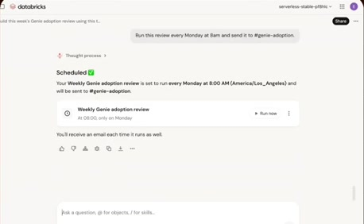 |  |  |

> actually ask me about Genie adoption. So, I can also turn this conversation into an agent that can answer questions

### Estimated anchor 28:47.00

| Before | Near transition | After |
| --- | --- | --- |
|  | 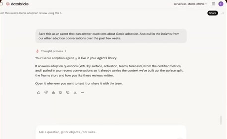 |  |

> ask questions and take action related to Genie's performance, Genie's OKRs. And unlike an OKR doc that's going to go

### Estimated anchor 29:07.00

| Before | Near transition | After |
| --- | --- | --- |
|  | 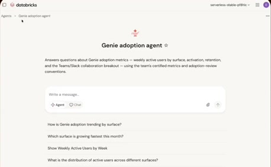 | 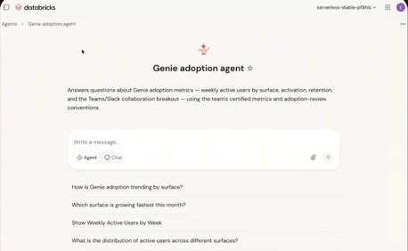 |

> into this agent, and here I'm going to see that I'm able to chat directly with this agent. So here, I'm in Genie 1, but now I'm talking directly to this very

### Estimated anchor 29:20.00

| Before | Near transition | After |
| --- | --- | --- |
| 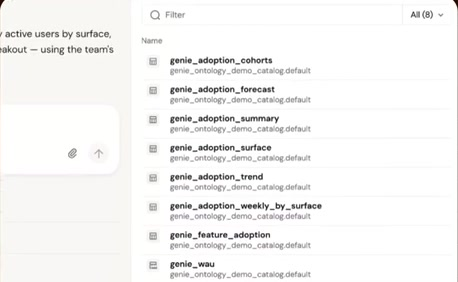 | 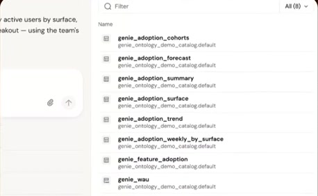 | 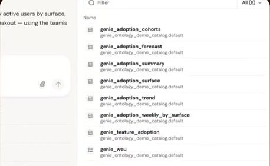 |

> has actually been quite customized to the sources that we talked about um in in that in that prior conversations. So it's using the right kinds of data. And

### Estimated anchor 29:34.00

| Before | Near transition | After |
| --- | --- | --- |
|  |  |  |

> kinds of workflows over and over, uh answer the same kind of questions over and over. Now, you know, they can create this customized coworker in one single

</details>
