# Question, analysis and source inspection

**Source:** [14:15.00–16:30.00](https://www.youtube.com/watch?v=HtR5m5VjaDQ) · **Template:** ui-evidence · **Type:** authentic-ui-evidence

**Teaching purpose:** Ground the explanation in the actual question and inspection workflow.
**Relationship:** actual workflow → visible execution/result

## Original transcript

> consolidate that in a way that it aligns with the way that I like to write these these write-ups. So, I'm going to get it started. Uh, and then as Genie is running, again, we can we can click into see what it's thinking. Now, you'll notice that was actually a very simple prompt in spite of all the complexity we've been talking about, and that's because I think Genie's going to be able to navigate our data pretty well because we have this ontology, uh, turned on. And we can actually see it, again, in practice. So, uh, it looks like Genie actually started by going straight to our our data sources. It found some potentially relevant tables here. Uh, and then it did go straight into the ontology. So, we've got pages, again, those wiki pages in Unity Catalog. It may end up using some of these in the actual answer. Again, this is just potentially relevant stuff. And then we have knowledge snippets. So, we have those facts about the business that Genie has learned from all sorts of different sources. And you can see there's business terms, metric definitions, something about data quality, another business term. There's even one, this is kind of a preview of some of the stuff that we're playing around with, but one that reaches into GitHub, uh, to get information because it's also a very semantically rich data source. But the key thing is that we're combining this human curated context with this more learned knowledge because again, it's really difficult to try to curate everything for the entire org. Uh I think I also found the thinking trace before we talk about the document. Uh we also looked at Google Drive, we looked at Jira, and then ran a bunch of those SQL queries. Again, very important uh that we are able to query on live operational data and not just not just reading documents. And then like the again, the data is demo, so what it actually produces is not super interesting. Um but we see a bunch of visualizations. It's able to do things like more advanced like cohort retention analyses. It can do things like forecasts. Maybe I can show you that actually. Um it's able to again pull from those third-party sources. So for example, it's pulling from Jira. It's able to do those recommendations. And a really critical thing to mention is that all of the stuff that you see here is data that I actually have access to. So again, Genie isn't creating any sort of special Genie specific permissions. It's simply enforcing our source permissions through Unity Catalog. And that applies also to the ontology uh that that is derived from any assets that are used here. And we can actually see, you know, what was

Rolling transcript, approximate times and original transcription errors preserved.

## Parameterized teaching pattern

- `Here is {{question_or_task}}. We {{interaction}}, then inspect {{result_or_evidence}}.`
- `To verify {{claim}}, look at {{visible_evidence}} in the product.`

**Use when:** Use when exact interaction or observed execution is central.
**Choose another approach when:** Illustrative diagrams cannot verify real execution. Keep reference UI separate from generated conceptual graphics.

**Proposed adaptation motion:** Retain real viewport changes and source timing; focus on the evidence the narrator discusses.

## Source-specific reveal evidence

```json
{
  "status": "Sequence-level source observations are attached in prior_source_observations. The family motion grammar is a proposed reusable pattern, not a frame-exact claim about this instance."
}
```

## Original source states

### 14:22.00 — earlier observed state
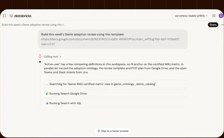
[Full source frame](../frames/full/0025860.jpg)
> I'm going to get it started. Uh, and then as Genie is running, again, we can we can click into see what it's thinking. Now, you'll notice that was

### 14:41.00 — intermediate observed state
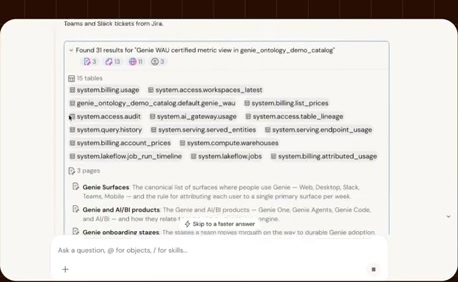
[Full source frame](../frames/full/0026430.jpg)
> actually see it, again, in practice. So, uh, it looks like Genie actually started by going straight to our our data sources. It found some potentially

### 15:10.00 — intermediate observed state
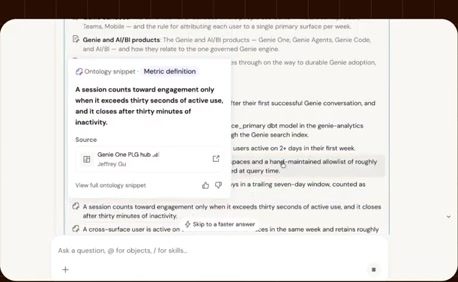
[Full source frame](../frames/full/0027300.jpg)
> there's business terms, metric definitions, something about data quality, another business term. There's even one, this is kind of a preview of some of the

### 15:45.00 — intermediate observed state
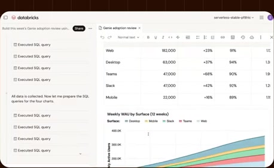
[Full source frame](../frames/full/0028350.jpg)
> that we are able to query on live operational data and not just not just reading documents. And then like the again, the data is

### 16:25.00 — later observed state
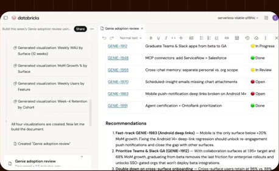
[Full source frame](../frames/full/0029550.jpg)
> permissions. It's simply enforcing our source permissions through Unity Catalog. And that applies also to the ontology uh that that is derived from

<details>
<summary>3 original change windows: before / near transition / after</summary>

### Estimated anchor 14:39.00

| Before | Near transition | After |
| --- | --- | --- |
| 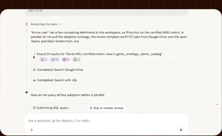 | 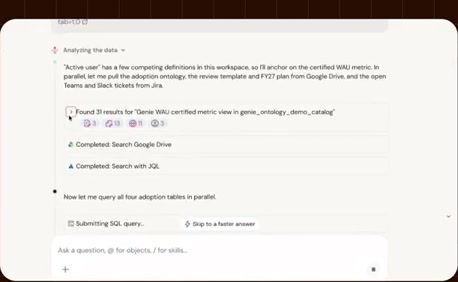 | 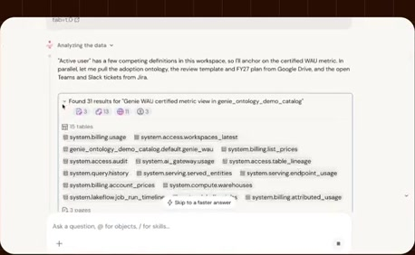 |

> ontology, uh, turned on. And we can actually see it, again, in practice. So, uh, it looks like Genie actually started by going straight to our our data

### Estimated anchor 15:08.00

| Before | Near transition | After |
| --- | --- | --- |
| 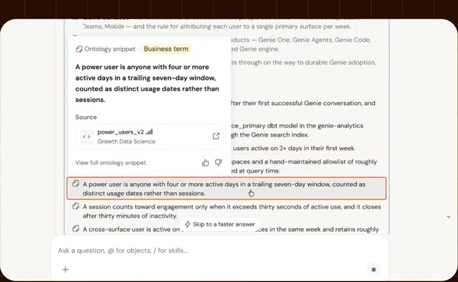 |  | 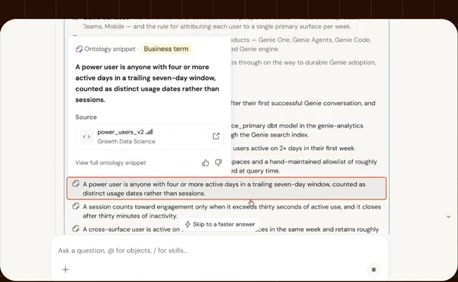 |

> different sources. And you can see there's business terms, metric definitions, something about data quality, another business term. There's even one,

### Estimated anchor 15:41.00

| Before | Near transition | After |
| --- | --- | --- |
| 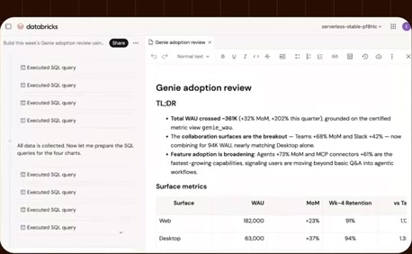 | 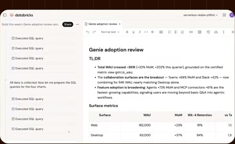 | 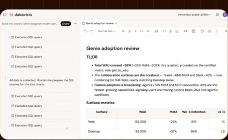 |

> at Jira, and then ran a bunch of those SQL queries. Again, very important uh that we are able to query on live operational data and not just not just

</details>
