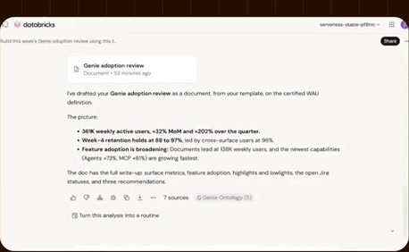
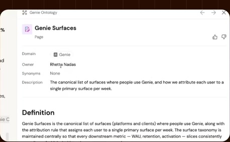
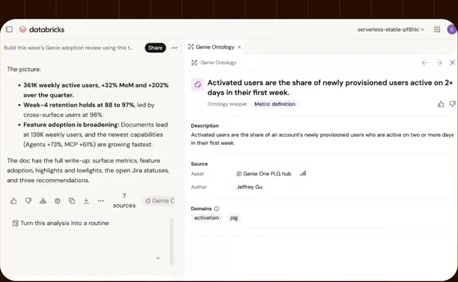
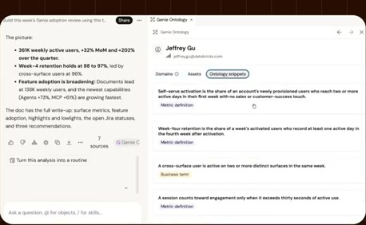
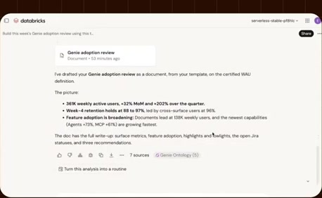
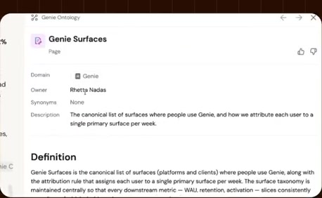
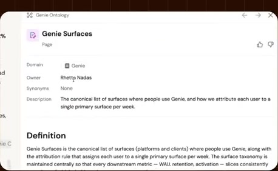
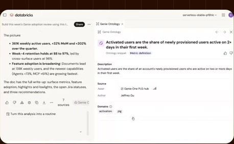
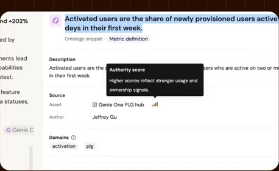

# Citations and business definitions

**Source:** [16:30.00–18:14.00](https://www.youtube.com/watch?v=HtR5m5VjaDQ) · **Template:** ui-evidence · **Type:** authentic-ui-evidence

**Teaching purpose:** Inspect supporting evidence rather than treating fluent output as proof.
**Relationship:** actual workflow → visible execution/result

## Original transcript

> any assets that are used here. And we can actually see, you know, what was used to answer this question by popping down here into the citations. So this is everything that Genie ended up pulling from the thinking trace to actually compile that document. So again, we see tables, maybe a couple relevant links from looks like Jira as well as Google Drive. Um this is that personal memory actually. This is how I prefer to write these docs. And then it did end up using some things from the ontology. So if we click in, we can see like my colleague Retta, she's also on the Genie team, she put together this wiki page around the different Genie surfaces, which is highly relevant when we're asking questions about Genie's adoption. So it makes sense that it that it used this. It also makes sense that it that it kind of started from from this kind of information because Genie likes human curated content. We extra trust human curated content, especially because this one has been certified. But, it probably needed to, again, look at those anthology snippets to round out its information. So, if we click in here, we can actually see that snippet in practice. We can get feedback on it. We can see the full definition that Genie learned. We can see that it grabs some information from this particular dashboard, which happens to be authored by our colleague Jeffrey, who is the data scientist working on Genie 1 growth. So, it's not surprising that it has, for example, a super high authority score. Genie is recognizing that Jeffrey does a lot of good work, and Jeffrey's work is often very popular. So, even before he's gone and codified something as a Unity Catalog semantic, we can benefit from this work. And we can even click into his profile if we want to like double-check his his creds on this topic, and we can see he's he's done a lot of kind of work in this space in this growth space. And Genie has also extracted a lot of snippets from the

Rolling transcript, approximate times and original transcription errors preserved.

## Parameterized teaching pattern

- `Here is {{question_or_task}}. We {{interaction}}, then inspect {{result_or_evidence}}.`
- `To verify {{claim}}, look at {{visible_evidence}} in the product.`

**Use when:** Use when exact interaction or observed execution is central.
**Choose another approach when:** Illustrative diagrams cannot verify real execution. Keep reference UI separate from generated conceptual graphics.

**Proposed adaptation motion:** Retain real viewport changes and source timing; focus on the evidence the narrator discusses.

## Source-specific reveal evidence

```json
{
  "status": "Sequence-level source observations are attached in prior_source_observations. The family motion grammar is a proposed reusable pattern, not a frame-exact claim about this instance."
}
```

## Original source states

### 16:31.00 — earlier observed state

[Full source frame](../frames/full/0029730.jpg)
> ontology uh that that is derived from any assets that are used here. And we can actually see, you know, what was used to answer this question by popping

### 16:59.00 — intermediate observed state

[Full source frame](../frames/full/0030570.jpg)
> some things from the ontology. So if we click in, we can see like my colleague Retta, she's also on the Genie team, she put together this wiki page around the

### 17:27.00 — intermediate observed state

[Full source frame](../frames/full/0031410.jpg)
> needed to, again, look at those anthology snippets to round out its information. So, if we click in here, we can actually see that snippet in

### 17:54.00 — intermediate observed state

[Full source frame](../frames/full/0032220.jpg)
> score. Genie is recognizing that Jeffrey does a lot of good work, and Jeffrey's work is often very popular. So, even before he's gone and codified something

### 18:11.00 — later observed state

[Full source frame](../frames/full/0032730.jpg)
> topic, and we can see he's he's done a lot of kind of work in this space in this growth space. And Genie has also extracted a lot of snippets from the

<details>
<summary>4 original change windows: before / near transition / after</summary>

### Estimated anchor 16:30.00

| Before | Near transition | After |
| --- | --- | --- |
|  |  |  |

> ontology uh that that is derived from any assets that are used here. And we can actually see, you know, what was used to answer this question by popping

### Estimated anchor 16:58.00

| Before | Near transition | After |
| --- | --- | --- |
|  |  |  |

> some things from the ontology. So if we click in, we can see like my colleague Retta, she's also on the Genie team, she put together this wiki page around the

### Estimated anchor 17:26.00

| Before | Near transition | After |
| --- | --- | --- |
|  |  |  |

> needed to, again, look at those anthology snippets to round out its information. So, if we click in here, we can actually see that snippet in

### Estimated anchor 17:52.00

| Before | Near transition | After |
| --- | --- | --- |
|  |  |  |

> has, for example, a super high authority score. Genie is recognizing that Jeffrey does a lot of good work, and Jeffrey's work is often very popular. So, even

</details>
