# Context-source overlay above the prompt

**Source:** [13:42.00–14:15.00](https://www.youtube.com/watch?v=HtR5m5VjaDQ) · **Template:** converging-sources · **Type:** explanatory-graphic-or-overlay

**Teaching purpose:** Add a conceptual source explanation without pretending the illustration is executed UI.
**Relationship:** many inputs → shared hub

## Original transcript

> really simple question, but it's actually not, right? Users move between web and mobile and Slack and Teams, and Genie needs to know that. Uh, we also have a bunch of out-of-date dashboards that are just floating around. I don't want Genie to pick those up. And of course, I don't just care about Genie adoption. I also care about individual feature adoption, things like MCPs and skills and and Genie needs to know what those features are. So, to answer this, Genie needs to kind of understand our product, understand our metrics. It's going to probably need to pull from a bunch of not only first-party but also third-party data, uh, and then it's going to need to, um, consolidate that in a way that it aligns with the way that I like to write these

Rolling transcript, approximate times and original transcription errors preserved.

## Parameterized teaching pattern

- `{{consumer}} draws on {{source_a}}, {{source_b}} and {{source_c}} to {{job}}.`
- `These inputs differ, but they contribute to the same {{shared_layer}}.`

**Use when:** Use when the distinction among source classes matters and they share a real destination.
**Choose another approach when:** Use a list for unrelated items; label search/query/tool access rather than implying data ingestion.

**Proposed adaptation motion:** Add sources individually, retain earlier nodes, draw each path, then activate the hub.

## Source-specific reveal evidence

```json
{
  "status": "Sequence-level source observations are attached in prior_source_observations. The family motion grammar is a proposed reusable pattern, not a frame-exact claim about this instance."
}
```

## Original source states

### 13:42.30 — earlier observed state
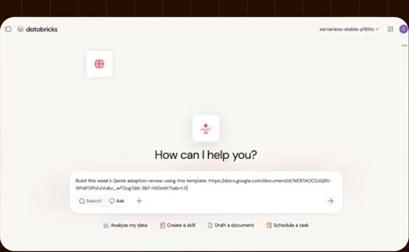
[Full source frame](../frames/full/0024669.jpg)
> really simple question, but it's actually not, right? Users move between web and mobile and Slack and Teams, and

### 13:48.00 — intermediate observed state
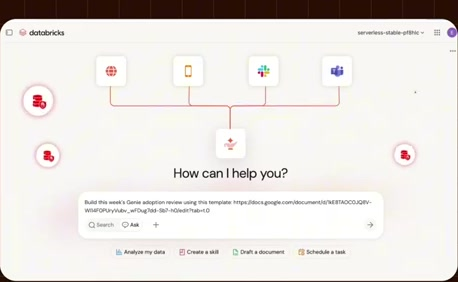
[Full source frame](../frames/full/0024840.jpg)
> web and mobile and Slack and Teams, and Genie needs to know that. Uh, we also have a bunch of out-of-date dashboards that are just floating around. I don't

### 13:55.00 — intermediate observed state

[Full source frame](../frames/full/0025050.jpg)
> want Genie to pick those up. And of course, I don't just care about Genie adoption. I also care about individual feature adoption, things like MCPs and

### 14:03.00 — intermediate observed state

[Full source frame](../frames/full/0025290.jpg)
> skills and and Genie needs to know what those features are. So, to answer this, Genie needs to kind of understand our product, understand our metrics. It's

### 14:12.00 — later observed state
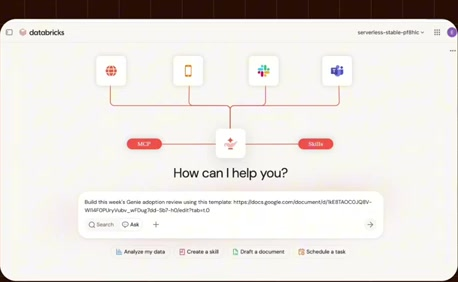
[Full source frame](../frames/full/0025560.jpg)
> third-party data, uh, and then it's going to need to, um, consolidate that in a way that it aligns

<details>
<summary>5 original change windows: before / near transition / after</summary>

### Estimated anchor 13:42.00

| Before | Near transition | After |
| --- | --- | --- |
|  |  |  |

> really simple question, but it's actually not, right? Users move between web and mobile and Slack and Teams, and

### Estimated anchor 13:48.00

| Before | Near transition | After |
| --- | --- | --- |
| 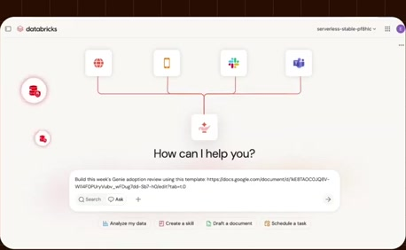 |  | 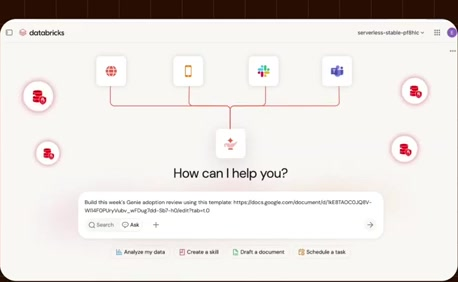 |

> web and mobile and Slack and Teams, and Genie needs to know that. Uh, we also have a bunch of out-of-date dashboards that are just floating around. I don't

### Estimated anchor 13:55.00

| Before | Near transition | After |
| --- | --- | --- |
| 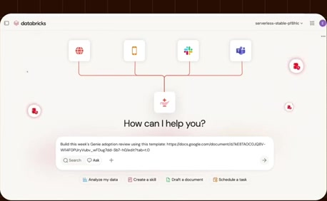 | 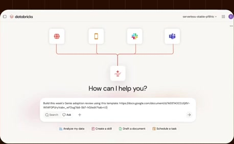 | 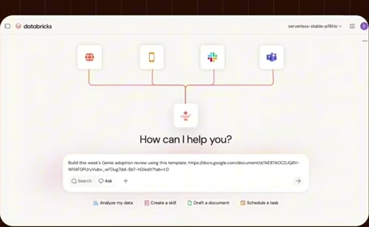 |

> want Genie to pick those up. And of course, I don't just care about Genie adoption. I also care about individual feature adoption, things like MCPs and

### Estimated anchor 14:03.00

| Before | Near transition | After |
| --- | --- | --- |
|  | 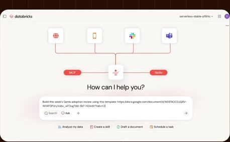 | 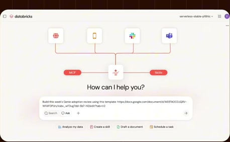 |

> skills and and Genie needs to know what those features are. So, to answer this, Genie needs to kind of understand our product, understand our metrics. It's

### Estimated anchor 14:10.00

| Before | Near transition | After |
| --- | --- | --- |
| 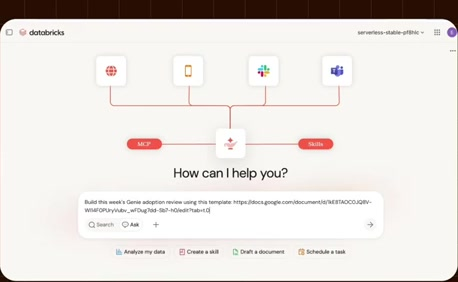 |  | 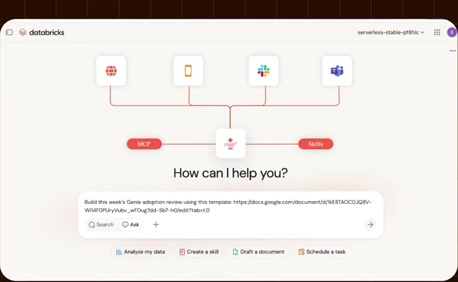 |

> going to probably need to pull from a bunch of not only first-party but also third-party data, uh, and then it's going to need to, um,

</details>
