# Follow-up and continuation

**Source:** [18:14.00–20:23.00](https://www.youtube.com/watch?v=HtR5m5VjaDQ) · **Template:** ui-evidence · **Type:** authentic-ui-evidence

**Teaching purpose:** Show continuity of the actual interface workflow.
**Relationship:** actual workflow → visible execution/result

## Original transcript

> this growth space. And Genie has also extracted a lot of snippets from the assets that he has created. But, you know, we don't need to necessarily just take Genie at its word for this this first answer. Maybe we want to ask a question like, you know, adoption seems to be spiking. What is what is the cause of this? And this type of work, again, is really only possible because Genie is computing these results based on our live operational data. So, we're not just, again, reciting information that already lives in a document. So, let's see if it's able to execute this. Great. We have an answer. Um Looks like the growth is real. It's attributing it to the Teams and the Slack apps. And for context, we we opened up Genie to Teams and to Slack and meeting users where they like to do their work. And every time an organization adopts Slack or adopts Teams, you tend to see a pretty wide increase in adoption because you tend to see folks adopting it and across entire channels or even the entire organization. So, it makes sense that this is attributed to to some of the growth. Now, if that adoption is real, I want to know where it's going. So, I'm also going to ask Genie to do a quick forecast. And that forecast is is a more advanced advanced piece of work, right? It would take me a bit of time to actually model this by hand, but Genie is able to do things like forecasting, like root cause analysis, like anomaly detection. So, I just have to ask it to to to perform that task. Uh but what about maybe an analysis that is totally custom to our team? Uh for example, maybe we build a standardized launch scorecards. Every time a new feature launches, we grade it, you know, against the adoption curve of some of our prior features. And for something like that, we could build a skill. A skill is going to run the same workflow repeatedly. And if once I've created a skill, I can also, you know, share it with my teammates so that they can take advantage. And of course, a shared chill is simply going to be governed through Unity Gateway, always going back to that that centralized governance framework. Um so, with that, I think it might be interesting to go back to our slides. Maybe I'll show you a bit more after, but we'll talk through some additional features. >> That's great from a

Rolling transcript, approximate times and original transcription errors preserved.

## Parameterized teaching pattern

- `Here is {{question_or_task}}. We {{interaction}}, then inspect {{result_or_evidence}}.`
- `To verify {{claim}}, look at {{visible_evidence}} in the product.`

**Use when:** Use when exact interaction or observed execution is central.
**Choose another approach when:** Illustrative diagrams cannot verify real execution. Keep reference UI separate from generated conceptual graphics.

**Proposed adaptation motion:** Retain real viewport changes and source timing; focus on the evidence the narrator discusses.

## Source-specific reveal evidence

```json
{
  "status": "Sequence-level source observations are attached in prior_source_observations. The family motion grammar is a proposed reusable pattern, not a frame-exact claim about this instance."
}
```

## Original source states

### 18:16.00 — earlier observed state
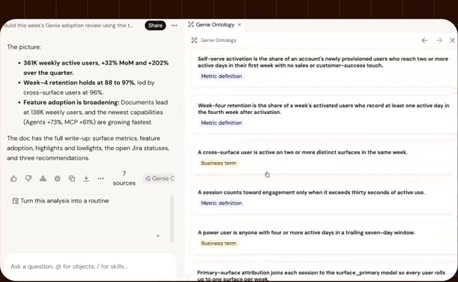
[Full source frame](../frames/full/0032880.jpg)
> this growth space. And Genie has also extracted a lot of snippets from the assets that he has created. But, you know, we don't need to necessarily just

### 18:30.00 — intermediate observed state
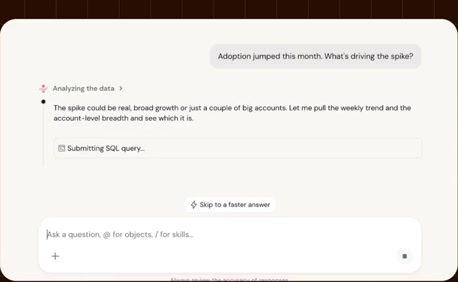
[Full source frame](../frames/full/0033300.jpg)
> you know, adoption seems to be spiking. What is what is the cause of this? And this type of work, again, is really only possible because Genie is computing

### 19:10.00 — intermediate observed state
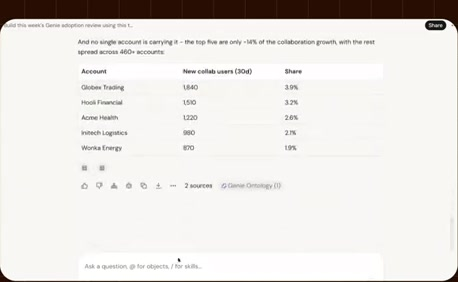
[Full source frame](../frames/full/0034500.jpg)
> increase in adoption because you tend to see folks adopting it and across entire channels or even the entire organization. So, it makes sense that this is attributed to to some of the

### 19:45.00 — intermediate observed state
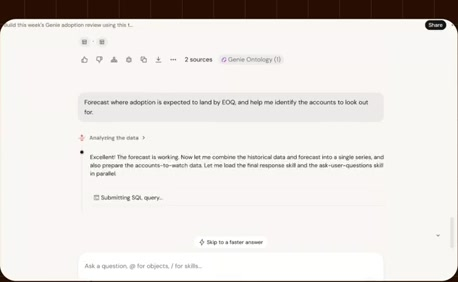
[Full source frame](../frames/full/0035550.jpg)
> that task. Uh but what about maybe an analysis that is totally custom to our team? Uh for example, maybe we build a standardized launch scorecards. Every

### 20:18.00 — later observed state
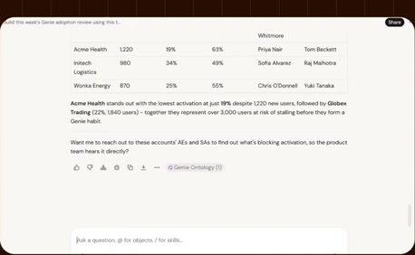
[Full source frame](../frames/full/0036540.jpg)
> governance framework. Um so, with that, I think it might be interesting to go back to our slides. Maybe I'll show you a bit more after, but we'll talk through some additional features.

<details>
<summary>4 original change windows: before / near transition / after</summary>

### Estimated anchor 18:25.00

| Before | Near transition | After |
| --- | --- | --- |
| 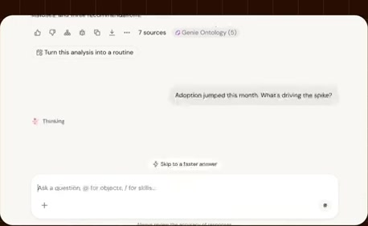 | 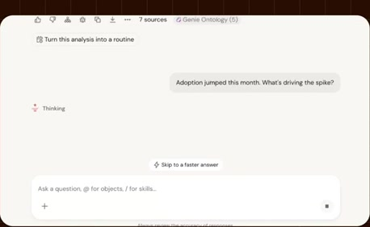 | 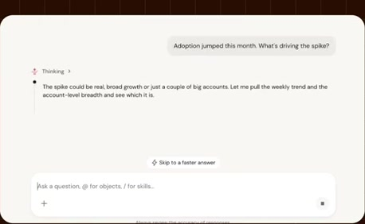 |

> first answer. Maybe we want to ask a question like, you know, adoption seems to be spiking. What is what is the cause of this? And

### Estimated anchor 19:08.00

| Before | Near transition | After |
| --- | --- | --- |
| 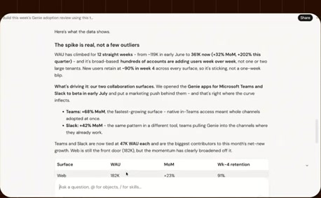 | 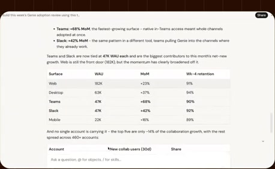 | 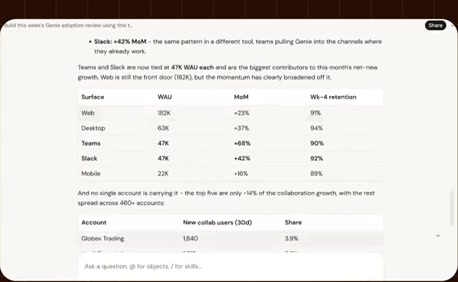 |

> Teams, you tend to see a pretty wide increase in adoption because you tend to see folks adopting it and across entire channels or even the entire organization. So, it makes sense that

### Estimated anchor 19:40.00

| Before | Near transition | After |
| --- | --- | --- |
| 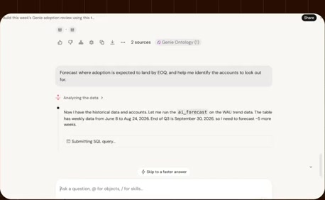 |  | 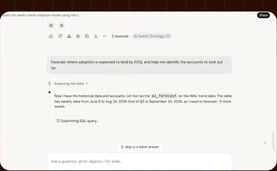 |

> analysis, like anomaly detection. So, I just have to ask it to to to perform that task. Uh but what about maybe an analysis that is totally custom to our

### Estimated anchor 20:03.00

| Before | Near transition | After |
| --- | --- | --- |
| 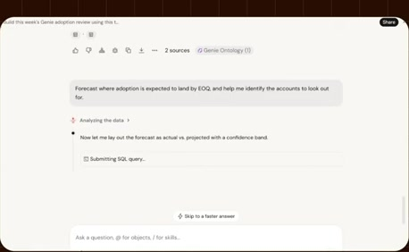 | 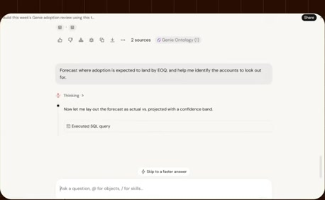 | 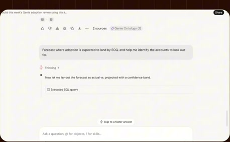 |

> workflow repeatedly. And if once I've created a skill, I can also, you know, share it with my teammates so that they can take advantage. And of course, a

</details>
