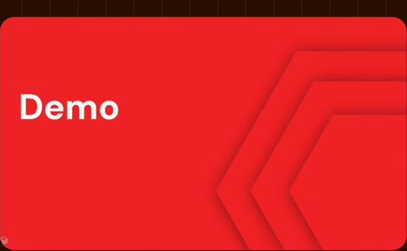
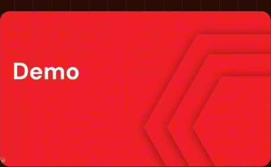
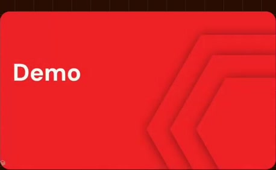

# First demo chapter

**Source:** [12:53.00–12:56.50](https://www.youtube.com/watch?v=HtR5m5VjaDQ) · **Template:** chapter · **Type:** chapter-navigation

**Teaching purpose:** Provide navigation into the first live product demonstration.
**Relationship:** chapter transition

## Original transcript

> >> Awesome. Um so, let's show this in in the product. Let's see how the ontology actually shows up because it's not It's

Rolling transcript, approximate times and original transcription errors preserved.

## Parameterized teaching pattern

- `Now let’s look at {{next_section}}.`
- `We have covered {{previous_topic}}; next is {{next_topic}}.`

**Use when:** Use for a real structural transition.
**Choose another approach when:** A chapter title is navigation, not an explanatory mechanism.

**Proposed adaptation motion:** Brief clear title hold, then transition to the next teaching surface.

## Source-specific reveal evidence

```json
{
  "status": "Sequence-level source observations are attached in prior_source_observations. The family motion grammar is a proposed reusable pattern, not a frame-exact claim about this instance."
}
```

## Original source states

### 12:53.30 — earlier observed state

[Full source frame](../frames/full/0023199.jpg)
> with fine-tuning certain preferences, too. So. >> Awesome. Um so, let's show this in in the product. Let's see how the ontology

### 12:54.50 — intermediate observed state

[Full source frame](../frames/full/0023235.jpg)
> too. So. >> Awesome. Um so, let's show this in in the product. Let's see how the ontology actually shows up because it's not It's

### 12:56.00 — later observed state

[Full source frame](../frames/full/0023280.jpg)
> >> Awesome. Um so, let's show this in in the product. Let's see how the ontology actually shows up because it's not It's

<details>
<summary>1 original change windows: before / near transition / after</summary>

### Estimated anchor 12:53.00

| Before | Near transition | After |
| --- | --- | --- |
|  |  |  |

> with fine-tuning certain preferences, too. So. >> Awesome. Um so, let's show this in in the product. Let's see how the ontology

</details>
