# Orient in the real Genie interface

**Source:** [12:56.50–13:42.00](https://www.youtube.com/watch?v=HtR5m5VjaDQ) · **Template:** ui-evidence · **Type:** authentic-ui-evidence

**Teaching purpose:** Show the real entry surface before the interaction.
**Relationship:** actual workflow → visible execution/result

## Original transcript

> product. Let's see how the ontology actually shows up because it's not It's not a black box. You can actually see the ontology as Genie is thinking. Uh okay, so I'm in a demo workspace here. Of course, every number is is completely made up for the purposes of of the demo, but this is really how we do a lot of our product work uh here at Databricks. So, what I'm showing you here is the Genie 1 web app. And I As you can see, it's a It's a pretty simple interface. I have my chat here, maybe a few suggested actions. I have my my past chats, agents, all the assets that that available to me. Maybe I'll show a bit of that, um, a bit of that later. I could also just as easily be in our desktop or our mobile app. Uh, but I'm going to start by asking Genie about, uh, adoption. And that sounds like a really simple question, but it's actually not, right? Users move between

Rolling transcript, approximate times and original transcription errors preserved.

## Parameterized teaching pattern

- `Here is {{question_or_task}}. We {{interaction}}, then inspect {{result_or_evidence}}.`
- `To verify {{claim}}, look at {{visible_evidence}} in the product.`

**Use when:** Use when exact interaction or observed execution is central.
**Choose another approach when:** Illustrative diagrams cannot verify real execution. Keep reference UI separate from generated conceptual graphics.

**Proposed adaptation motion:** Retain real viewport changes and source timing; focus on the evidence the narrator discusses.

## Source-specific reveal evidence

```json
{
  "status": "Sequence-level source observations are attached in prior_source_observations. The family motion grammar is a proposed reusable pattern, not a frame-exact claim about this instance."
}
```

## Original source states

### 12:58.00 — earlier observed state
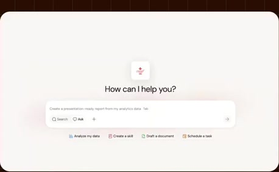
[Full source frame](../frames/full/0023340.jpg)
> Um so, let's show this in in the product. Let's see how the ontology actually shows up because it's not It's not a black box. You can actually see the ontology as Genie is thinking. Uh

### 13:10.00 — intermediate observed state
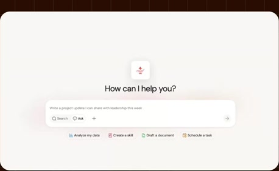
[Full source frame](../frames/full/0023700.jpg)
> Of course, every number is is completely made up for the purposes of of the demo, but this is really how we do a lot of our product work uh here at Databricks.

### 13:28.00 — intermediate observed state
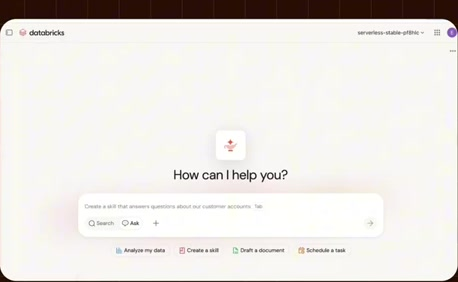
[Full source frame](../frames/full/0024240.jpg)
> agents, all the assets that that available to me. Maybe I'll show a bit of that, um, a bit of that later. I could also just as easily be in our

### 13:40.00 — later observed state
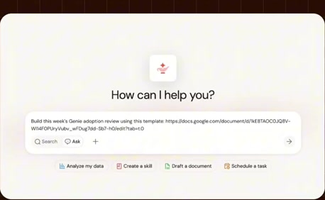
[Full source frame](../frames/full/0024600.jpg)
> uh, adoption. And that sounds like a really simple question, but it's actually not, right? Users move between

<details>
<summary>3 original change windows: before / near transition / after</summary>

### Estimated anchor 13:09.00

| Before | Near transition | After |
| --- | --- | --- |
| 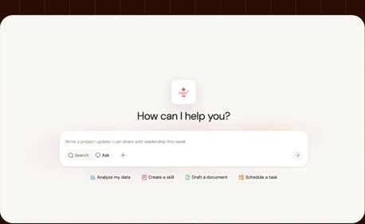 | 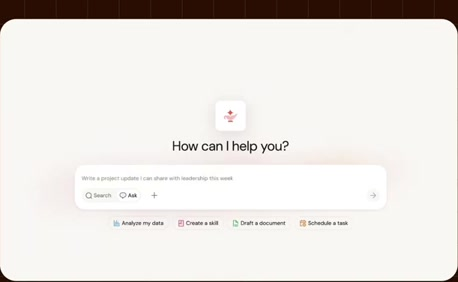 |  |

> Of course, every number is is completely made up for the purposes of of the demo, but this is really how we do a lot of our product work uh here at Databricks.

### Estimated anchor 13:28.00

| Before | Near transition | After |
| --- | --- | --- |
|  | 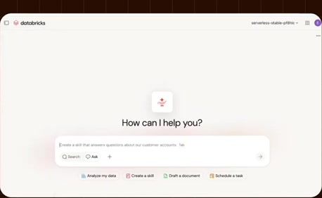 | 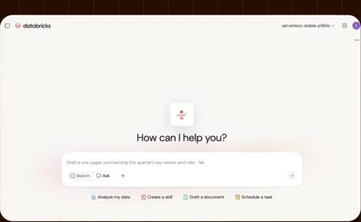 |

> agents, all the assets that that available to me. Maybe I'll show a bit of that, um, a bit of that later. I could also just as easily be in our

### Estimated anchor 13:37.00

| Before | Near transition | After |
| --- | --- | --- |
| 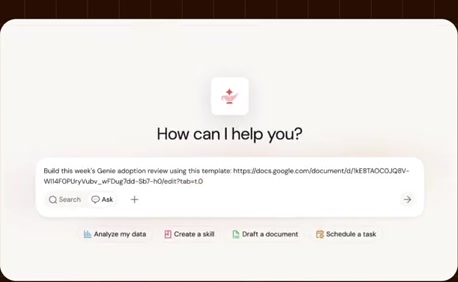 | 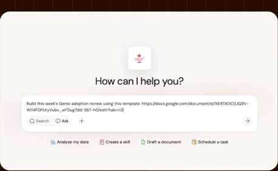 | 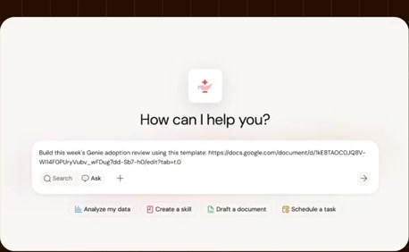 |

> desktop or our mobile app. Uh, but I'm going to start by asking Genie about, uh, adoption. And that sounds like a really simple question, but it's

</details>
