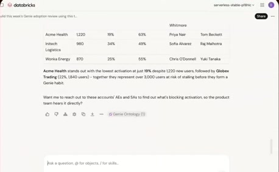
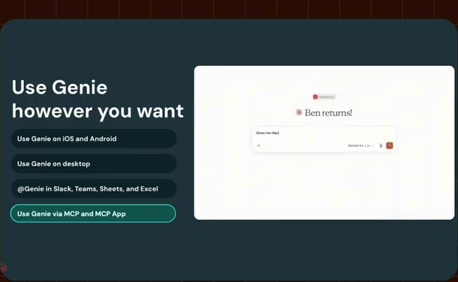
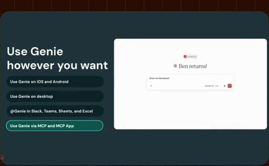

# Second demo chapter

**Source:** [26:48.00–26:54.00](https://www.youtube.com/watch?v=HtR5m5VjaDQ) · **Template:** chapter · **Type:** chapter-navigation

**Teaching purpose:** Provide navigation into the second live demonstration.
**Relationship:** chapter transition

## Original transcript

> links, and so on that you're actually seeing in in the GIF here. So, that sounds interesting. I I maybe show a couple more things uh in in our demo.

Rolling transcript, approximate times and original transcription errors preserved.

## Parameterized teaching pattern

- `Now let’s look at {{next_section}}.`
- `We have covered {{previous_topic}}; next is {{next_topic}}.`

**Use when:** Use for a real structural transition.
**Choose another approach when:** A chapter title is navigation, not an explanatory mechanism.

**Proposed adaptation motion:** Brief clear title hold, then transition to the next teaching surface.

## Source-specific reveal evidence

```json
{
  "status": "Sequence-level source observations are attached in prior_source_observations. The family motion grammar is a proposed reusable pattern, not a frame-exact claim about this instance."
}
```

## Original source states

### 26:48.30 — earlier observed state

[Full source frame](../frames/full/0048249.jpg)
> links, and so on that you're actually seeing in in the GIF here. So, that sounds interesting. I I maybe show a couple more things uh in in our

### 26:51.00 — intermediate observed state

[Full source frame](../frames/full/0048330.jpg)
> So, that sounds interesting. I I maybe show a couple more things uh in in our demo.

### 26:53.50 — later observed state

[Full source frame](../frames/full/0048405.jpg)
> So, that sounds interesting. I I maybe show a couple more things uh in in our demo. So, going back to my my other screen.

<details>
<summary>1 original change windows: before / near transition / after</summary>

### Estimated anchor 26:48.00

| Before | Near transition | After |
| --- | --- | --- |
|  |  |  |

> links, and so on that you're actually seeing in in the GIF here. So, that sounds interesting. I I maybe

</details>
