# Existing knowledge versus live-data calculation

**Source:** [09:17.00–10:04.00](https://www.youtube.com/watch?v=HtR5m5VjaDQ) · **Template:** access-paths · **Type:** explanatory-graphic-or-overlay

**Teaching purpose:** Contrast finding a documented answer with calculating a new answer over data.
**Relationship:** distinct access modes → different jobs

## Original transcript

> data that it's going to make sense of. Uh, we already have text to SQL, uh, which covers structured data that's governed in Unity Catalog. And I don't want to underestimate how much that matters. You know, a lot of agents are just reciting information that lives in a document. But when you're asking questions about your business, there often already isn't already a document that can answer those questions. That's why you're That's why you're asking. So, Genie is not only doing search, but also querying based on your live operational data. And we have dozens of connectors for that. Plus, actually Josh inspired uh a product that we call custom connectors um that allow the community connectors, sorry. Uh that allows you to create a connector to any generic uh application. So, thank you Josh actually for that idea. That That went straight into the product. Um for data that lives

Rolling transcript, approximate times and original transcription errors preserved.

## Parameterized teaching pattern

- `Use {{access_mode_a}} for {{job_a}}, and {{access_mode_b}} for {{job_b}}.`
- `Finding an existing {{document}} differs from calculating {{answer}} over live {{data}}.`

**Use when:** Use when superficially similar access paths have different semantics.
**Choose another approach when:** A collage of logos cannot distinguish retrieval from execution or ingestion.

**Proposed adaptation motion:** Introduce categories, demonstrate one contrast, then connect the supported paths to a shared consumer.

## Source-specific reveal evidence

```json
{
  "status": "Sequence-level source observations are attached in prior_source_observations. The family motion grammar is a proposed reusable pattern, not a frame-exact claim about this instance."
}
```

## Original source states

### 09:17.30 — earlier observed state
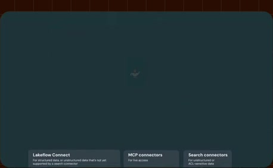
[Full source frame](../frames/full/0016719.jpg)
> about how Genie also gets access to this data that it's going to make sense of. Uh, we already have text to SQL, uh, which covers structured data that's

### 09:27.00 — intermediate observed state

[Full source frame](../frames/full/0017010.jpg)
> want to underestimate how much that matters. You know, a lot of agents are just reciting information that lives in

### 09:37.00 — intermediate observed state

[Full source frame](../frames/full/0017310.jpg)
> often already isn't already a document that can answer those questions. That's why you're That's why you're asking. So, Genie is not only doing search, but also

### 09:42.00 — intermediate observed state
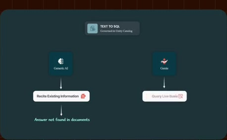
[Full source frame](../frames/full/0017460.jpg)
> why you're That's why you're asking. So, Genie is not only doing search, but also querying based on your live operational data. And we have dozens of connectors

### 09:48.00 — intermediate observed state
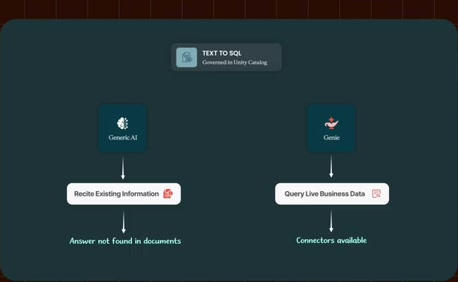
[Full source frame](../frames/full/0017640.jpg)
> querying based on your live operational data. And we have dozens of connectors for that. Plus, actually Josh inspired uh a product that we call custom

### 10:01.00 — later observed state
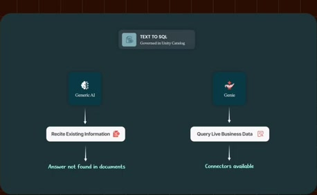
[Full source frame](../frames/full/0018030.jpg)
> create a connector to any generic uh application. So, thank you Josh actually for that idea. That That went straight into the product. Um for data that lives

<details>
<summary>5 original change windows: before / near transition / after</summary>

### Estimated anchor 09:17.00

| Before | Near transition | After |
| --- | --- | --- |
|  | 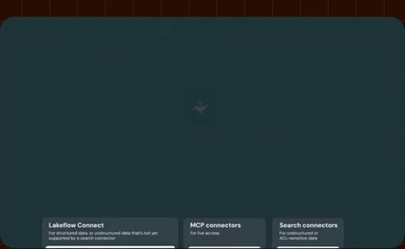 | 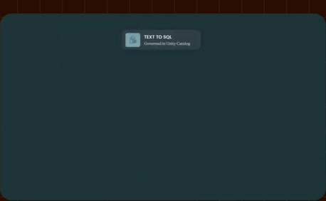 |

> about how Genie also gets access to this data that it's going to make sense of. Uh, we already have text to SQL, uh, which covers structured data that's

### Estimated anchor 09:27.00

| Before | Near transition | After |
| --- | --- | --- |
| 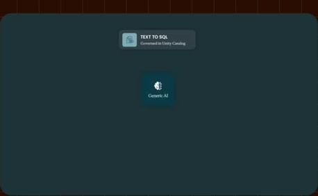 | 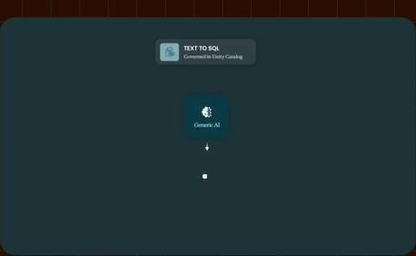 | 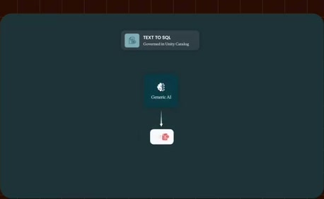 |

> want to underestimate how much that matters. You know, a lot of agents are just reciting information that lives in

### Estimated anchor 09:37.00

| Before | Near transition | After |
| --- | --- | --- |
| 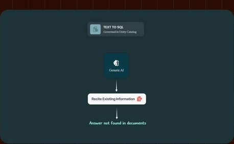 | 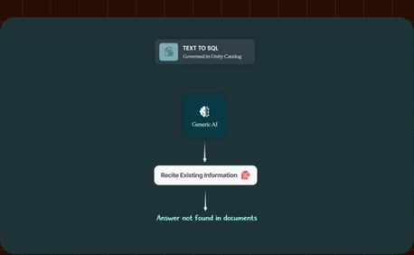 | 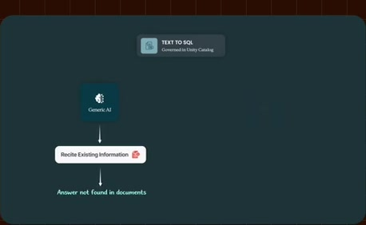 |

> often already isn't already a document that can answer those questions. That's why you're That's why you're asking. So, Genie is not only doing search, but also

### Estimated anchor 09:47.00

| Before | Near transition | After |
| --- | --- | --- |
|  | 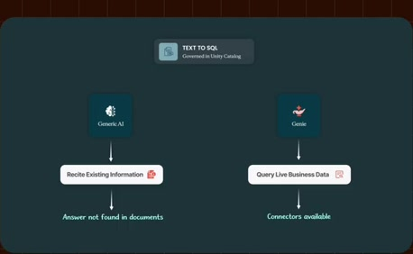 |  |

> querying based on your live operational data. And we have dozens of connectors for that. Plus, actually Josh inspired

### Estimated anchor 10:00.00

| Before | Near transition | After |
| --- | --- | --- |
| 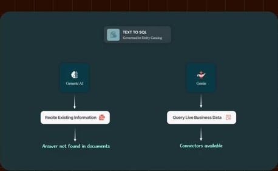 |  |  |

> connectors, sorry. Uh that allows you to create a connector to any generic uh application. So, thank you Josh actually for that idea. That That went straight into the product. Um for data that lives

</details>
