# Separate product-family roles

**Source:** [01:01.50–01:23.70](https://www.youtube.com/watch?v=HtR5m5VjaDQ) · **Template:** product-family · **Type:** explanatory-graphic-or-overlay

**Teaching purpose:** Separate roles while retaining family identity and readable card planes.
**Relationship:** shared foundation → different roles

## Original transcript

> and other AI tools on Databricks. So, if for example, if Genie 1 is our agent for business users, Genie code is our agent for technical users. It helps them write code and and do other work within the lakehouse. We also have Genie agents, which can be accessed by both types of users, and they're really focused on domain-specific work. They're They're essentially domain experts, and I can actually cover that in more depth if we want to. And then, if all those

Rolling transcript, approximate times and original transcription errors preserved.

## Parameterized teaching pattern

- `{{family}} shares {{foundation}}, while {{product_a}} serves {{job_a}} and {{product_b}} serves {{job_b}}.`
- `These are different ways to use {{shared_capability}}, depending on {{user_job}}.`

**Use when:** Use when the products are peers with shared foundations.
**Choose another approach when:** Do not turn peer products into an execution pipeline or imply dependency from card depth.

**Proposed adaptation motion:** Show a shared stack, then spread peer cards while preserving the front card and each readable plane.

## Source-specific reveal evidence

```json
{
  "reading_order": [
    "Named peer products and their roles"
  ],
  "observed_reveal_order": [
    "Peers leave the shared stack",
    "Cards settle into separate readable planes",
    "Focus changes among named roles"
  ],
  "speech_mapping": "The narration distinguishes roles while retaining a shared product-family identity.",
  "confidence": "Prior eight-sample source sequence and refined passage evidence."
}
```

## Original source states

### 01:01.60 — earlier observed state

[Full source frame](../frames/full/0001848.jpg)
> in a larger stack of of AI co-workers and other AI tools on Databricks. So, if for example, if Genie 1 is our agent for business users, Genie code is our agent

### 01:03.60 — intermediate observed state

[Full source frame](../frames/full/0001908.jpg)
> and other AI tools on Databricks. So, if for example, if Genie 1 is our agent for business users, Genie code is our agent

### 01:05.00 — intermediate observed state
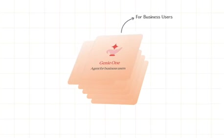
[Full source frame](../frames/full/0001950.jpg)
> and other AI tools on Databricks. So, if for example, if Genie 1 is our agent for business users, Genie code is our agent for technical users. It helps them write

### 01:09.00 — intermediate observed state
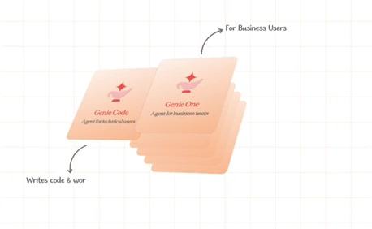
[Full source frame](../frames/full/0002070.jpg)
> business users, Genie code is our agent for technical users. It helps them write code and and do other work within the lakehouse. We also have Genie agents,

### 01:14.00 — intermediate observed state

[Full source frame](../frames/full/0002220.jpg)
> code and and do other work within the lakehouse. We also have Genie agents, which can be accessed by both types of users, and they're really focused on

### 01:21.60 — later observed state

[Full source frame](../frames/full/0002448.jpg)
> domain-specific work. They're They're essentially domain experts, and I can actually cover that in more depth if we want to. And then, if all those

<details>
<summary>6 original change windows: before / near transition / after</summary>

### Estimated anchor 01:03.52

| Before | Near transition | After |
| --- | --- | --- |
| 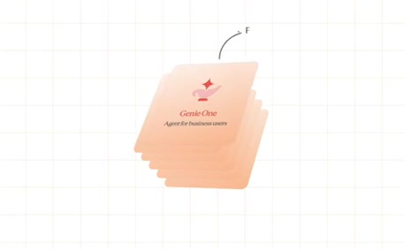 | 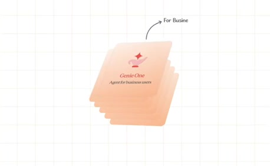 |  |

> and other AI tools on Databricks. So, if for example, if Genie 1 is our agent for business users, Genie code is our agent

### Estimated anchor 01:04.65

| Before | Near transition | After |
| --- | --- | --- |
| 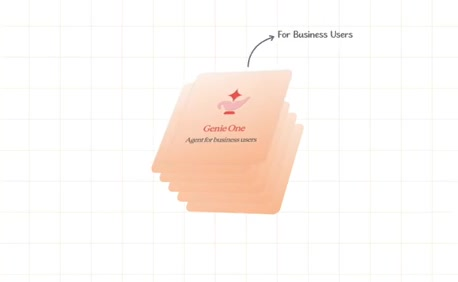 | 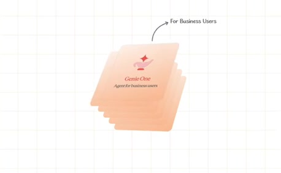 | 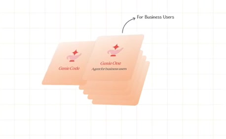 |

> and other AI tools on Databricks. So, if for example, if Genie 1 is our agent for business users, Genie code is our agent for technical users. It helps them write

### Estimated anchor 01:08.56

| Before | Near transition | After |
| --- | --- | --- |
| 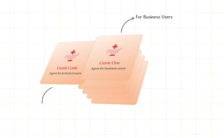 | 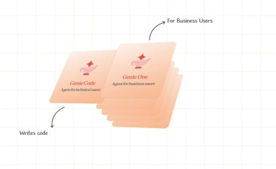 | 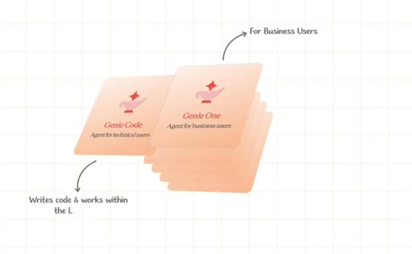 |

> business users, Genie code is our agent for technical users. It helps them write code and and do other work within the

### Estimated anchor 01:12.45

| Before | Near transition | After |
| --- | --- | --- |
| 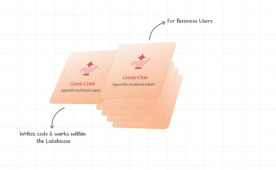 | 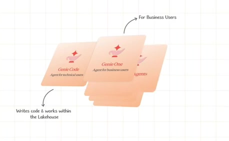 | 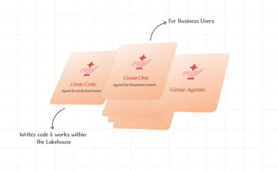 |

> for technical users. It helps them write code and and do other work within the lakehouse. We also have Genie agents, which can be accessed by both types of

### Estimated anchor 01:17.35

| Before | Near transition | After |
| --- | --- | --- |
| 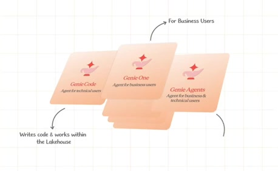 | 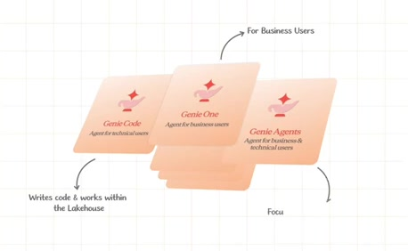 | 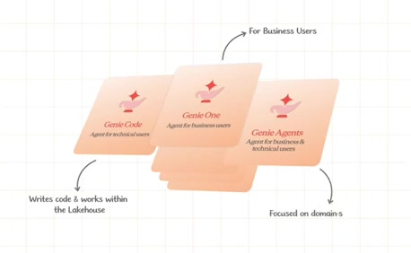 |

> lakehouse. We also have Genie agents, which can be accessed by both types of users, and they're really focused on domain-specific work. They're They're

### Estimated anchor 01:21.53

| Before | Near transition | After |
| --- | --- | --- |
| 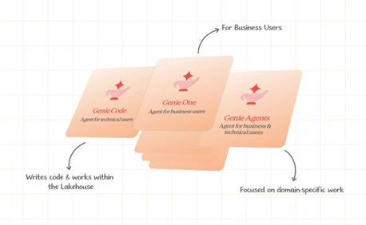 |  |  |

> users, and they're really focused on domain-specific work. They're They're essentially domain experts, and I can actually cover that in more depth if we want to. And then, if all those

</details>
