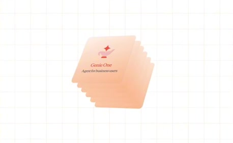
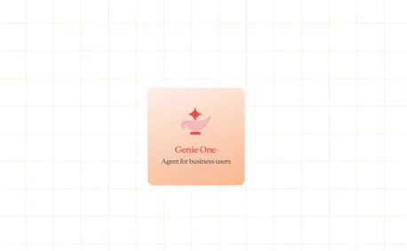
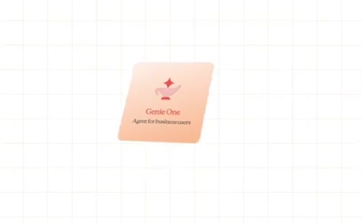
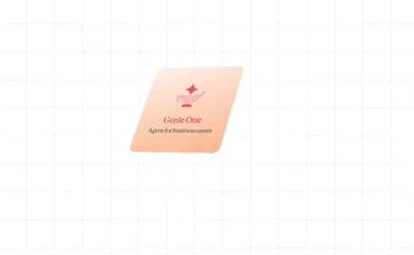
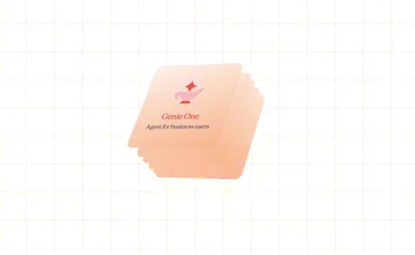
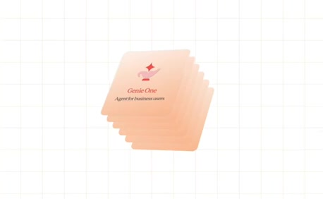

# Shared foundation with depth

**Source:** [00:54.80–01:01.50](https://www.youtube.com/watch?v=HtR5m5VjaDQ) · **Template:** product-family · **Type:** explanatory-graphic-or-overlay

**Teaching purpose:** Establish shared family context before peers separate.
**Relationship:** shared foundation → different roles

## Original transcript

> that you already have. But, Genie 1 sits in a larger stack of of AI co-workers and other AI tools on Databricks. So, if for example, if Genie 1 is our agent for

Rolling transcript, approximate times and original transcription errors preserved.

## Parameterized teaching pattern

- `{{family}} shares {{foundation}}, while {{product_a}} serves {{job_a}} and {{product_b}} serves {{job_b}}.`
- `These are different ways to use {{shared_capability}}, depending on {{user_job}}.`

**Use when:** Use when the products are peers with shared foundations.
**Choose another approach when:** Do not turn peer products into an execution pipeline or imply dependency from card depth.

**Proposed adaptation motion:** Show a shared stack, then spread peer cards while preserving the front card and each readable plane.

## Source-specific reveal evidence

```json
{
  "reading_order": [
    "Shared family before peer roles"
  ],
  "observed_reveal_order": [
    "Front card at a tilted plane",
    "Additional layers visible behind the front card",
    "Hold the shared stack before peer spread"
  ],
  "speech_mapping": "The narration places Genie One in a larger family of AI coworkers.",
  "confidence": "Prior dense stack samples and source sequence catalog."
}
```

## Original source states

### 00:54.90 — earlier observed state

[Full source frame](../frames/full/0001647.jpg)
> you, all within the governance framework that you already have. But, Genie 1 sits in a larger stack of of AI co-workers

### 00:55.20 — intermediate observed state

[Full source frame](../frames/full/0001656.jpg)
> you, all within the governance framework that you already have. But, Genie 1 sits in a larger stack of of AI co-workers

### 00:55.80 — intermediate observed state

[Full source frame](../frames/full/0001674.jpg)
> you, all within the governance framework that you already have. But, Genie 1 sits in a larger stack of of AI co-workers

### 00:57.00 — intermediate observed state

[Full source frame](../frames/full/0001710.jpg)
> that you already have. But, Genie 1 sits in a larger stack of of AI co-workers and other AI tools on Databricks. So, if

### 00:59.50 — intermediate observed state

[Full source frame](../frames/full/0001785.jpg)
> that you already have. But, Genie 1 sits in a larger stack of of AI co-workers and other AI tools on Databricks. So, if for example, if Genie 1 is our agent for

### 01:01.20 — later observed state

[Full source frame](../frames/full/0001836.jpg)
> in a larger stack of of AI co-workers and other AI tools on Databricks. So, if for example, if Genie 1 is our agent for

<details>
<summary>3 original change windows: before / near transition / after</summary>

### Estimated anchor 00:55.17

| Before | Near transition | After |
| --- | --- | --- |
|  |  |  |

> you, all within the governance framework that you already have. But, Genie 1 sits in a larger stack of of AI co-workers

### Estimated anchor 00:55.83

| Before | Near transition | After |
| --- | --- | --- |
|  |  |  |

> you, all within the governance framework that you already have. But, Genie 1 sits in a larger stack of of AI co-workers

### Estimated anchor 01:01.00

| Before | Near transition | After |
| --- | --- | --- |
|  |  |  |

> in a larger stack of of AI co-workers and other AI tools on Databricks. So, if for example, if Genie 1 is our agent for

</details>
