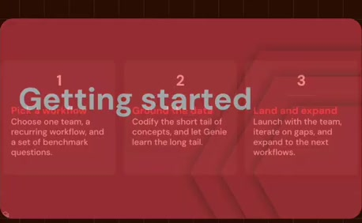
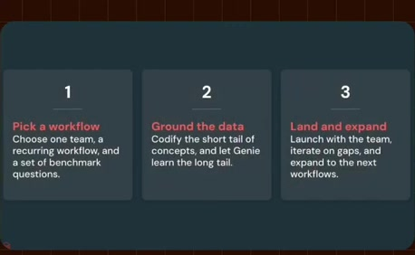
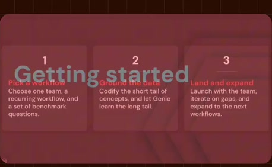

# Getting started chapter

**Source:** [29:54.70–29:56.50](https://www.youtube.com/watch?v=HtR5m5VjaDQ) · **Template:** chapter · **Type:** chapter-navigation

**Teaching purpose:** Reset attention for implementation guidance.
**Relationship:** chapter transition

## Original transcript

> how how do people get started to make the most out of Genie? >> Yeah, my favorite question.

Rolling transcript, approximate times and original transcription errors preserved.

## Parameterized teaching pattern

- `Now let’s look at {{next_section}}.`
- `We have covered {{previous_topic}}; next is {{next_topic}}.`

**Use when:** Use for a real structural transition.
**Choose another approach when:** A chapter title is navigation, not an explanatory mechanism.

**Proposed adaptation motion:** Brief clear title hold, then transition to the next teaching surface.

## Source-specific reveal evidence

```json
{
  "status": "Sequence-level source observations are attached in prior_source_observations. The family motion grammar is a proposed reusable pattern, not a frame-exact claim about this instance."
}
```

## Original source states

### 29:54.90 — earlier observed state

[Full source frame](../frames/full/0053847.jpg)
> >> I I I'm on Databricks all the time, but how how do people get started to make the most out of Genie? >> Yeah, my favorite question.

### 29:55.60 — intermediate observed state

[Full source frame](../frames/full/0053868.jpg)
> how how do people get started to make the most out of Genie? >> Yeah, my favorite question. Um so for an initial proof of concept, I

### 29:56.30 — later observed state

[Full source frame](../frames/full/0053889.jpg)
> how how do people get started to make the most out of Genie? >> Yeah, my favorite question. Um so for an initial proof of concept, I

<details>
<summary>1 original change windows: before / near transition / after</summary>

### Estimated anchor 29:54.70

| Before | Near transition | After |
| --- | --- | --- |
|  |  |  |

> >> I I I'm on Databricks all the time, but how how do people get started to make the most out of Genie? >> Yeah, my favorite question.

</details>
