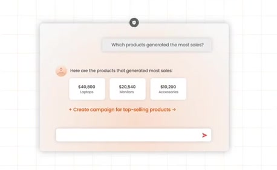
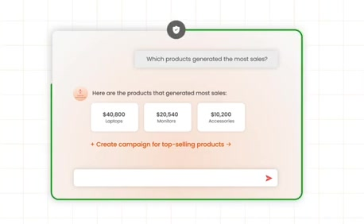
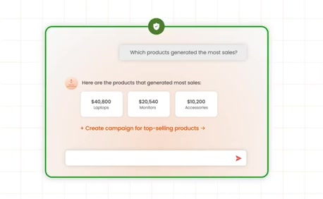
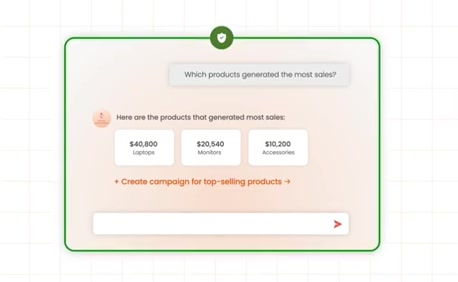
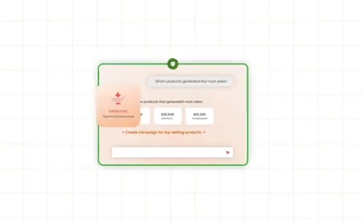
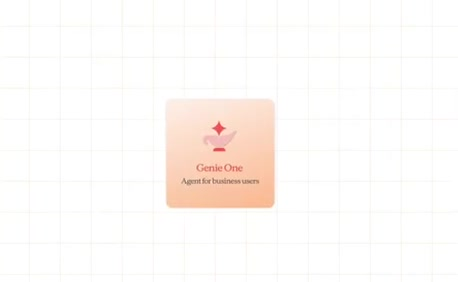

# Governed capability enclosure

**Source:** [00:50.80–00:54.80](https://www.youtube.com/watch?v=HtR5m5VjaDQ) · **Template:** governance-boundary · **Type:** explanatory-graphic-or-overlay

**Teaching purpose:** Constrain the capability rather than suggesting unrestricted action.
**Relationship:** capability inside a constraint

## Original transcript

> It acts on the answers that it gives you, all within the governance framework that you already have. But, Genie 1 sits in a larger stack of of AI co-workers

Rolling transcript, approximate times and original transcription errors preserved.

## Parameterized teaching pattern

- `{{system}} can {{capability}}, but only within {{policy_boundary}}.`
- `{{governance_layer}} controls which {{assets_or_actions}} {{actor}} may use.`

**Use when:** Use when a boundary constrains an otherwise understandable flow.
**Choose another approach when:** A shield alone does not explain a permission model; identify the actor, scope and enforcement point.

**Proposed adaptation motion:** Keep the workflow and add an enclosure or labeled control point; reveal permitted and denied routes.

## Source-specific reveal evidence

```json
{
  "status": "Sequence-level source observations are attached in prior_source_observations. The family motion grammar is a proposed reusable pattern, not a frame-exact claim about this instance."
}
```

## Original source states

### 00:50.90 — earlier observed state

[Full source frame](../frames/full/0001527.jpg)
> answers questions about your business. It acts on the answers that it gives you, all within the governance framework that you already have. But, Genie 1 sits

### 00:51.60 — intermediate observed state

[Full source frame](../frames/full/0001548.jpg)
> answers questions about your business. It acts on the answers that it gives you, all within the governance framework that you already have. But, Genie 1 sits

### 00:53.00 — intermediate observed state

[Full source frame](../frames/full/0001590.jpg)
> It acts on the answers that it gives you, all within the governance framework that you already have. But, Genie 1 sits in a larger stack of of AI co-workers

### 00:54.50 — later observed state

[Full source frame](../frames/full/0001635.jpg)
> you, all within the governance framework that you already have. But, Genie 1 sits in a larger stack of of AI co-workers

<details>
<summary>1 original change windows: before / near transition / after</summary>

### Estimated anchor 00:53.80

| Before | Near transition | After |
| --- | --- | --- |
|  |  |  |

> you, all within the governance framework that you already have. But, Genie 1 sits in a larger stack of of AI co-workers

</details>
