# Baseline skills, workflows and sharing controls

**Source:** [23:43.00–24:24.00](https://www.youtube.com/watch?v=HtR5m5VjaDQ) · **Template:** peer-categories · **Type:** explanatory-graphic-or-overlay

**Teaching purpose:** Compare three equal-rank governance concerns using matched cards.
**Relationship:** equal-rank needs or choices

## Original transcript

> bit as to why this is very relevant? >> Yeah, I think we see demand for for a couple things. Um first is, you know, you want everyone to start with a baseline level of skills or everyone within a group to start with a baseline level of skills. Administrators who are ultimately responsible for people having a good experience with Genie want to ensure that they're set up for success. And part of that includes, if you've got, you know, company-specific workflows, making sure that Genie is set up with those workflows. We also see some demand for, you know, limiting or or controlling how people can share skills. So, for that, uh we'd welcome feedback from customers as they continue to see these roll outs. Um but, we're super open to to any and all sorts of governance around skills. All right. Um so, there's also kind of a

Rolling transcript, approximate times and original transcription errors preserved.

## Parameterized teaching pattern

- `We need {{need_a}}, {{need_b}} and {{need_c}} for {{goal}}.`
- `There are three distinct concerns: {{concern_a}}, {{concern_b}} and {{concern_c}}.`

**Use when:** Use when equal conceptual rank is the lesson.
**Choose another approach when:** Use a timeline when order matters and a hierarchy when one item contains another.

**Proposed adaptation motion:** Settle one card, make room coherently, then introduce equal peers on a shared baseline.

## Source-specific reveal evidence

```json
{
  "reading_order": [
    "Baseline Skills",
    "Custom Workflows",
    "Skill-Sharing Controls"
  ],
  "observed_reveal_order": [
    "Heading near the center",
    "Heading moves upward",
    "First card turns/expands into its readable plane",
    "Equal peer cards appear to its right"
  ],
  "speech_mapping": "The speaker enumerates baseline skills, company-specific workflows and control of skill sharing.",
  "confidence": "Prior dense source samples and sequence catalog; anchors remain estimated."
}
```

## Original source states

### 23:43.30 — earlier observed state

[Full source frame](../frames/full/0042699.jpg)
> decision-makers, just explain a little bit as to why this is very relevant? >> Yeah, I think we see demand for for a couple things. Um first is,

### 23:49.40 — intermediate observed state
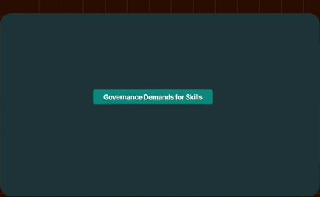
[Full source frame](../frames/full/0042882.jpg)
> >> Yeah, I think we see demand for for a couple things. Um first is, you know, you want everyone to start with a baseline level of skills or

### 23:50.80 — intermediate observed state

[Full source frame](../frames/full/0042924.jpg)
> for a couple things. Um first is, you know, you want everyone to start with a baseline level of skills or everyone within a group to start with a

### 23:52.00 — intermediate observed state

[Full source frame](../frames/full/0042960.jpg)
> for a couple things. Um first is, you know, you want everyone to start with a baseline level of skills or everyone within a group to start with a baseline level of skills. Administrators

### 24:05.00 — intermediate observed state
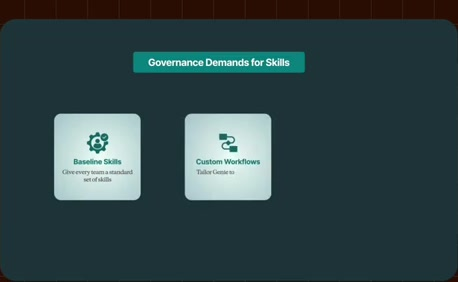
[Full source frame](../frames/full/0043350.jpg)
> for success. And part of that includes, if you've got, you know, company-specific workflows, making sure that Genie is set up with those

### 24:14.00 — intermediate observed state
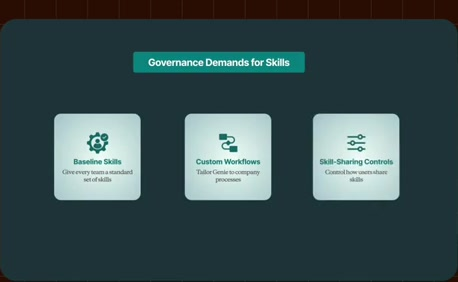
[Full source frame](../frames/full/0043620.jpg)
> workflows. We also see some demand for, you know, limiting or or controlling how people can share skills. So, for that, uh we'd welcome feedback from customers

### 24:22.00 — later observed state
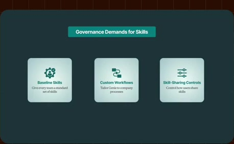
[Full source frame](../frames/full/0043860.jpg)
> as they continue to see these roll outs. Um but, we're super open to to any and all sorts of governance around skills. All right. Um so, there's also kind of a

<details>
<summary>6 original change windows: before / near transition / after</summary>

### Estimated anchor 23:43.00

| Before | Near transition | After |
| --- | --- | --- |
| 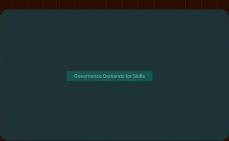 | 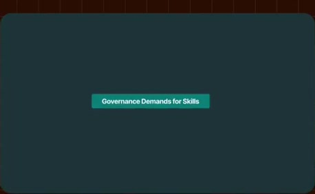 | 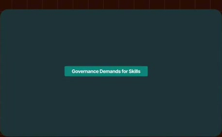 |

> decision-makers, just explain a little bit as to why this is very relevant? >> Yeah, I think we see demand for for a couple things. Um first is,

### Estimated anchor 23:49.23

| Before | Near transition | After |
| --- | --- | --- |
| 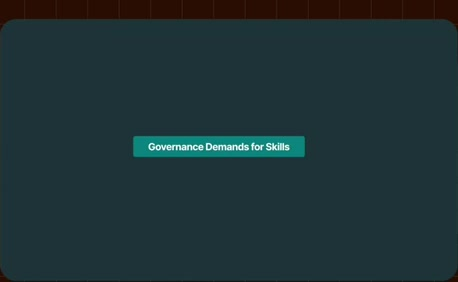 | 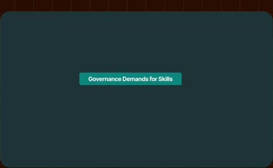 | 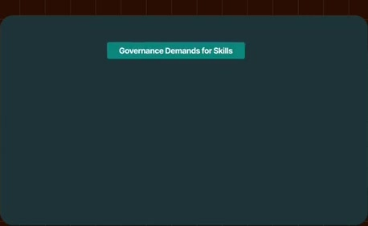 |

> >> Yeah, I think we see demand for for a couple things. Um first is, you know, you want everyone to start with a baseline level of skills or

### Estimated anchor 23:50.53

| Before | Near transition | After |
| --- | --- | --- |
|  | 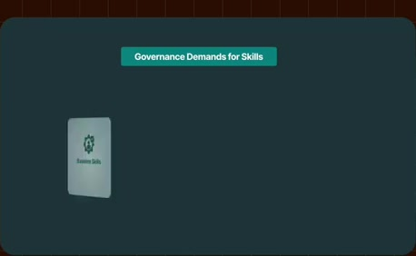 |  |

> >> Yeah, I think we see demand for for a couple things. Um first is, you know, you want everyone to start with a baseline level of skills or everyone within a group to start with a

### Estimated anchor 23:51.43

| Before | Near transition | After |
| --- | --- | --- |
| 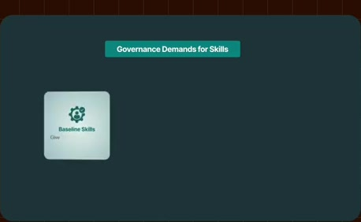 |  | 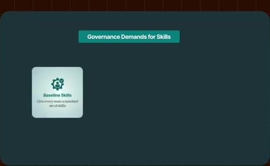 |

> for a couple things. Um first is, you know, you want everyone to start with a baseline level of skills or everyone within a group to start with a baseline level of skills. Administrators

### Estimated anchor 24:04.00

| Before | Near transition | After |
| --- | --- | --- |
|  | 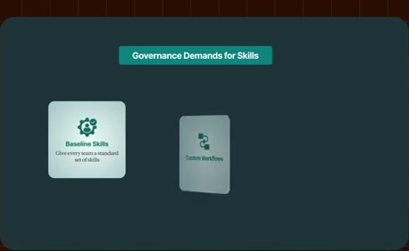 |  |

> Genie want to ensure that they're set up for success. And part of that includes, if you've got, you know, company-specific workflows, making sure that Genie is set up with those

### Estimated anchor 24:12.00

| Before | Near transition | After |
| --- | --- | --- |
| 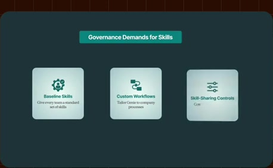 | 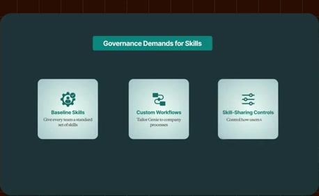 |  |

> that Genie is set up with those workflows. We also see some demand for, you know, limiting or or controlling how people can share skills. So, for that,

</details>
