# Context learned from existing work

**Source:** [05:33.50–05:53.00](https://www.youtube.com/watch?v=HtR5m5VjaDQ) · **Template:** learned-signals · **Type:** explanatory-graphic-or-overlay

**Teaching purpose:** Introduce the evidence sources that supply inferred contextual signals.
**Relationship:** work evidence → contextual signals

## Original transcript

> are kind of experts in. So, we supplement the modeled ontology with what we call learned knowledge. Specifically, we extract ontology snippets from your dashboards, your SQL queries, your Genie agents, notebooks, all the work that people are doing day in and and day out within and outside of Databricks. So, for example, you know, the fact that someone joins table A and

Rolling transcript, approximate times and original transcription errors preserved.

## Parameterized teaching pattern

- `When people {{work_action}}, they leave {{signal}} that helps {{system}} infer {{context}}.`
- `{{example_a}} and {{example_b}} provide clues about {{business_relationship}}.`

**Use when:** Use when the lesson is how evidence contributes contextual clues.
**Choose another approach when:** Do not represent learned signals as certified definitions or guaranteed truth.

**Proposed adaptation motion:** Accumulate labeled source examples, show the new signal, and retain the distinction between evidence and authority.

## Source-specific reveal evidence

```json
{
  "status": "Sequence-level source observations are attached in prior_source_observations. The family motion grammar is a proposed reusable pattern, not a frame-exact claim about this instance."
}
```

## Original source states

### 05:34.00 — earlier observed state
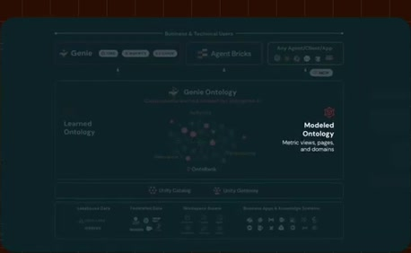
[Full source frame](../frames/full/0010020.jpg)
> concepts that every individual team are are kind of experts in. So, we supplement the modeled ontology with what we call learned knowledge.

### 05:40.00 — intermediate observed state
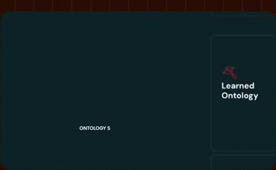
[Full source frame](../frames/full/0010200.jpg)
> with what we call learned knowledge. Specifically, we extract ontology snippets from your dashboards, your SQL

### 05:44.00 — intermediate observed state
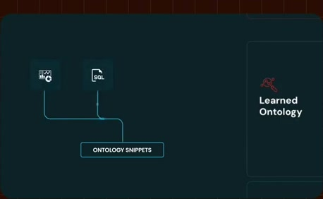
[Full source frame](../frames/full/0010320.jpg)
> Specifically, we extract ontology snippets from your dashboards, your SQL queries, your Genie agents, notebooks,

### 05:48.00 — intermediate observed state
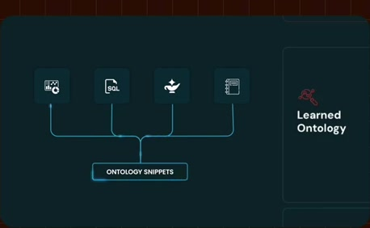
[Full source frame](../frames/full/0010440.jpg)
> snippets from your dashboards, your SQL queries, your Genie agents, notebooks, all the work that people are doing day in and and day out within and outside of

### 05:52.00 — later observed state
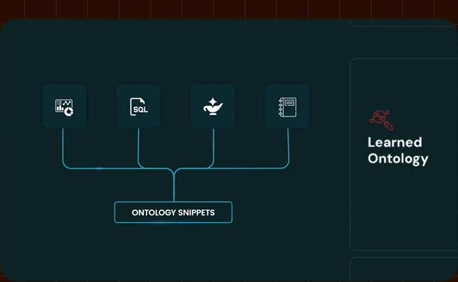
[Full source frame](../frames/full/0010560.jpg)
> all the work that people are doing day in and and day out within and outside of Databricks. So, for example, you know, the fact that someone joins table A and

<details>
<summary>3 original change windows: before / near transition / after</summary>

### Estimated anchor 05:34.00

| Before | Near transition | After |
| --- | --- | --- |
| 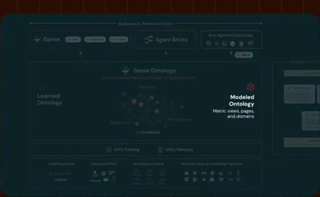 | 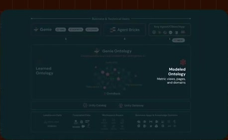 |  |

> concepts that every individual team are are kind of experts in. So, we supplement the modeled ontology with what we call learned knowledge.

### Estimated anchor 05:40.00

| Before | Near transition | After |
| --- | --- | --- |
| 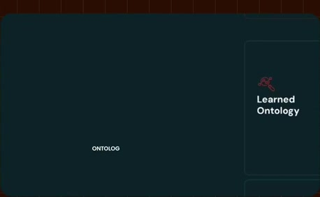 | 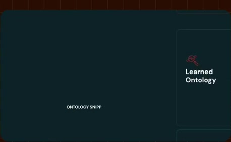 | 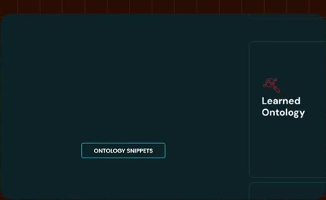 |

> with what we call learned knowledge. Specifically, we extract ontology snippets from your dashboards, your SQL

### Estimated anchor 05:47.00

| Before | Near transition | After |
| --- | --- | --- |
|  | 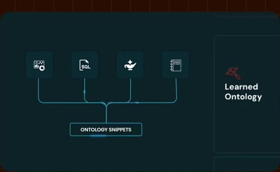 |  |

> snippets from your dashboards, your SQL queries, your Genie agents, notebooks, all the work that people are doing day in and and day out within and outside of

</details>
