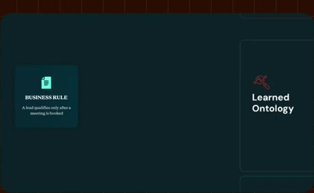
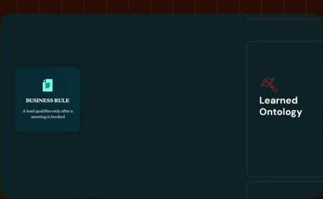
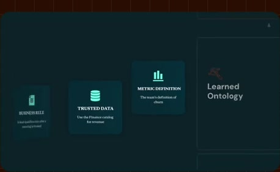
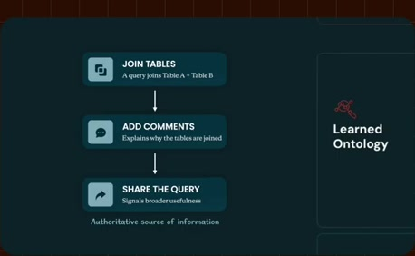
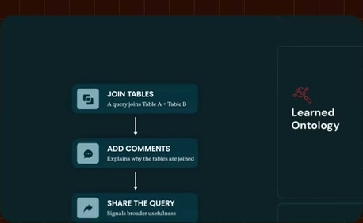
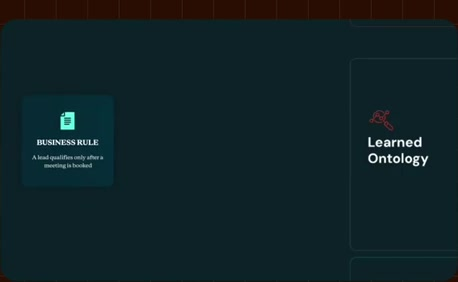
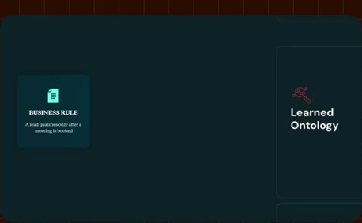
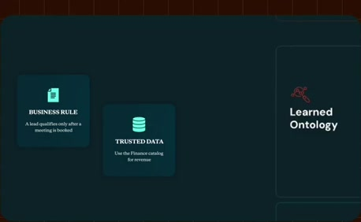

# Concrete learned business snippets

**Source:** [06:19.00–06:42.00](https://www.youtube.com/watch?v=HtR5m5VjaDQ) · **Template:** learned-signals · **Type:** explanatory-graphic-or-overlay

**Teaching purpose:** Turn inferred context into specific business-knowledge examples.
**Relationship:** work evidence → contextual signals

## Original transcript

> source of information. So, a snippet could be a join hint, but it could also be things like a business rule. So, for example, a lead is only qualified once a meeting is booked, and all that information lives in Salesforce. Or it could be information about, you know, which data is most authoritative. So, for example, you must pull revenue from this finance catalog. Or it could be a metric definition. So, for example, like how might we define churn for our team? And as Genie is amassing all this

Rolling transcript, approximate times and original transcription errors preserved.

## Parameterized teaching pattern

- `When people {{work_action}}, they leave {{signal}} that helps {{system}} infer {{context}}.`
- `{{example_a}} and {{example_b}} provide clues about {{business_relationship}}.`

**Use when:** Use when the lesson is how evidence contributes contextual clues.
**Choose another approach when:** Do not represent learned signals as certified definitions or guaranteed truth.

**Proposed adaptation motion:** Accumulate labeled source examples, show the new signal, and retain the distinction between evidence and authority.

## Source-specific reveal evidence

```json
{
  "status": "Sequence-level source observations are attached in prior_source_observations. The family motion grammar is a proposed reusable pattern, not a frame-exact claim about this instance."
}
```

## Original source states

### 06:19.30 — earlier observed state

[Full source frame](../frames/full/0011379.jpg)
> source of information. So, a snippet could be a join hint, but it could also be things like a business rule. So, for

### 06:23.00 — intermediate observed state

[Full source frame](../frames/full/0011490.jpg)
> could be a join hint, but it could also be things like a business rule. So, for example, a lead is only qualified once a meeting is booked, and all that

### 06:28.00 — intermediate observed state

[Full source frame](../frames/full/0011640.jpg)
> meeting is booked, and all that information lives in Salesforce. Or it could be information about, you know, which data is most authoritative. So,

### 06:35.00 — intermediate observed state

[Full source frame](../frames/full/0011850.jpg)
> which data is most authoritative. So, for example, you must pull revenue from this finance catalog. Or it could be a metric definition. So, for example, like

### 06:41.00 — later observed state

[Full source frame](../frames/full/0012030.jpg)
> metric definition. So, for example, like how might we define churn for our team? And as Genie is amassing all this

<details>
<summary>3 original change windows: before / near transition / after</summary>

### Estimated anchor 06:19.00

| Before | Near transition | After |
| --- | --- | --- |
|  |  |  |

> it's probably a pretty authoritative source of information. So, a snippet could be a join hint, but it could also be things like a business rule. So, for

### Estimated anchor 06:26.00

| Before | Near transition | After |
| --- | --- | --- |
|  |  |  |

> be things like a business rule. So, for example, a lead is only qualified once a meeting is booked, and all that information lives in Salesforce. Or it could be information about, you know,

### Estimated anchor 06:34.00

| Before | Near transition | After |
| --- | --- | --- |
|  |  |  |

> which data is most authoritative. So, for example, you must pull revenue from this finance catalog. Or it could be a

</details>
