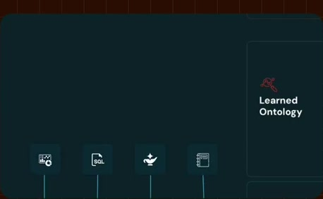
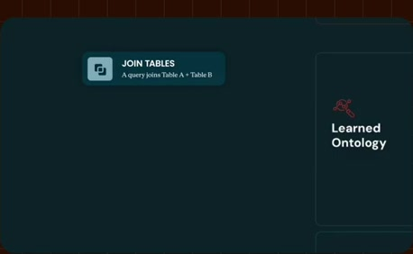
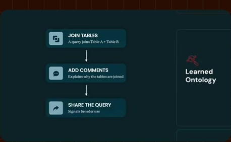
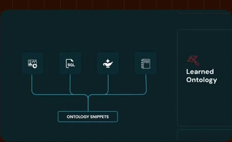
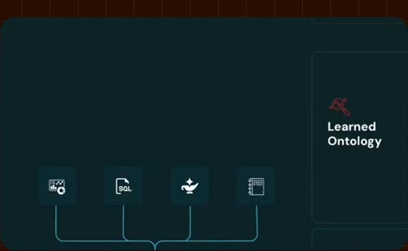
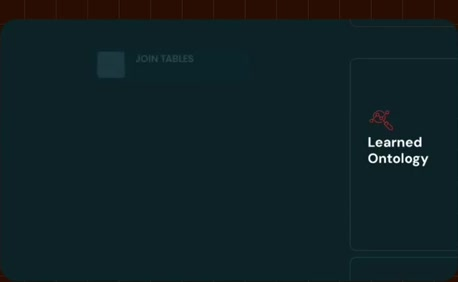
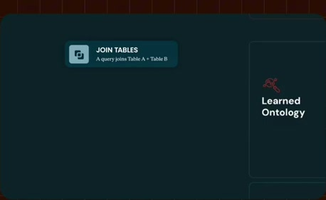
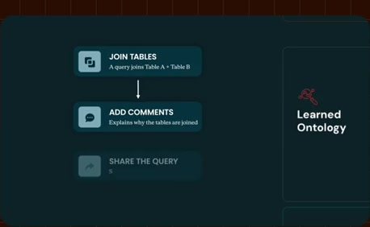
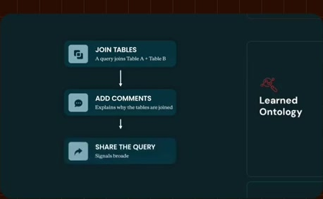

# Joins, comments, sharing and popular queries

**Source:** [05:53.00–06:19.00](https://www.youtube.com/watch?v=HtR5m5VjaDQ) · **Template:** learned-signals · **Type:** explanatory-graphic-or-overlay

**Teaching purpose:** Explain useful signals through recognizable work actions.
**Relationship:** work evidence → contextual signals

## Original transcript

> Databricks. So, for example, you know, the fact that someone joins table A and table B is very valuable information for a Genie. And then if they add maybe a comment, that's probably making it even more valuable. And then if they share that with other people, we know it's probably valuable for those other people. And then if that query becomes very, very popular, we can surmise that it's probably a pretty authoritative source of information. So, a snippet could be a join hint, but it could also

Rolling transcript, approximate times and original transcription errors preserved.

## Parameterized teaching pattern

- `When people {{work_action}}, they leave {{signal}} that helps {{system}} infer {{context}}.`
- `{{example_a}} and {{example_b}} provide clues about {{business_relationship}}.`

**Use when:** Use when the lesson is how evidence contributes contextual clues.
**Choose another approach when:** Do not represent learned signals as certified definitions or guaranteed truth.

**Proposed adaptation motion:** Accumulate labeled source examples, show the new signal, and retain the distinction between evidence and authority.

## Source-specific reveal evidence

```json
{
  "status": "Sequence-level source observations are attached in prior_source_observations. The family motion grammar is a proposed reusable pattern, not a frame-exact claim about this instance."
}
```

## Original source states

### 05:53.30 — earlier observed state

[Full source frame](../frames/full/0010599.jpg)
> in and and day out within and outside of Databricks. So, for example, you know, the fact that someone joins table A and

### 05:59.50 — intermediate observed state

[Full source frame](../frames/full/0010785.jpg)
> the fact that someone joins table A and table B is very valuable information for a Genie. And then if they add maybe a comment, that's probably making it even

### 06:05.50 — intermediate observed state

[Full source frame](../frames/full/0010965.jpg)
> comment, that's probably making it even more valuable. And then if they share that with other people, we know it's probably valuable for those other

### 06:12.00 — intermediate observed state

[Full source frame](../frames/full/0011160.jpg)
> probably valuable for those other people. And then if that query becomes very, very popular, we can surmise that it's probably a pretty authoritative

### 06:18.00 — later observed state

[Full source frame](../frames/full/0011340.jpg)
> it's probably a pretty authoritative source of information. So, a snippet could be a join hint, but it could also be things like a business rule. So, for

<details>
<summary>4 original change windows: before / near transition / after</summary>

### Estimated anchor 05:53.00

| Before | Near transition | After |
| --- | --- | --- |
|  |  |  |

> in and and day out within and outside of Databricks. So, for example, you know, the fact that someone joins table A and

### Estimated anchor 05:59.00

| Before | Near transition | After |
| --- | --- | --- |
|  |  |  |

> the fact that someone joins table A and table B is very valuable information for a Genie. And then if they add maybe a comment, that's probably making it even

### Estimated anchor 06:05.00

| Before | Near transition | After |
| --- | --- | --- |
|  |  |  |

> comment, that's probably making it even more valuable. And then if they share that with other people, we know it's probably valuable for those other

### Estimated anchor 06:11.00

| Before | Near transition | After |
| --- | --- | --- |
|  |  |  |

> probably valuable for those other people. And then if that query becomes very, very popular, we can surmise that

</details>
