# Metric Views, Pages, Domains and governing layer

**Source:** [04:09.00–05:33.50](https://www.youtube.com/watch?v=HtR5m5VjaDQ) · **Template:** governed-hierarchy · **Type:** explanatory-graphic-or-overlay

**Teaching purpose:** Build a concrete hierarchy of curated semantic objects rather than decorative graph nodes.
**Relationship:** governing parent → peers → logical groups

## Original transcript

> definition for your key business metrics stored as open format Unity Catalog objects. So, for example, you know, this is how we slice and dice revenue. And and metric views are fully GA'd. Pages are a bit newer. Uh it's the it's the qualitative equivalent of a metric view. I think of them as wiki pages in in Unity Catalog. So, if a metric view defines how we slice and dice revenue, a page might tell you, say, the difference between incremental and attributed revenue. Uh and these are in beta and it is actually super easy to get started. You can use Genie code to actually get started on creating your pages. And then finally, domains uh allow you to do tag-based logical collections of assets, uh both Unity Catalog and workspace assets by things like business unit or geo or function. So, you might have a finance domain or you might have a product team domain. And an asset can live in multiple domains. And it's really helpful for reducing the agent's search space. So, if someone asks a question about finance, you know, we can start from from the finance domain. So, together, metric views, pages, and domains form this certified authoritative baseline. But it's hard, if not impossible, to try to codify the entire organization's knowledge that way, to have a centralized data team responsible for codifying the the concepts that every individual team are are kind of experts in. So, we supplement the modeled ontology

Rolling transcript, approximate times and original transcription errors preserved.

## Parameterized teaching pattern

- `{{governance_parent}} manages {{object_a}} and {{object_b}}; {{group}} organizes them by {{business_scope}}.`
- `Start with {{definition_object}}, add {{context_object}}, then organize them into {{domain}}.`

**Use when:** Use for a real parent, containment or grouping relationship.
**Choose another approach when:** Use equal peer cards when no parent-child relationship exists; do not invent permission inheritance.

**Proposed adaptation motion:** Introduce one object, its governing parent, peer objects, grouping and supported consumers in sequence.

## Source-specific reveal evidence

```json
{
  "status": "Sequence-level source observations are attached in prior_source_observations. The family motion grammar is a proposed reusable pattern, not a frame-exact claim about this instance."
}
```

## Original source states

### 04:09.30 — earlier observed state

[Full source frame](../frames/full/0007479.jpg)
> certified single source of truth definition for your key business metrics stored as open format Unity Catalog objects. So, for example, you know, this

### 04:17.00 — intermediate observed state
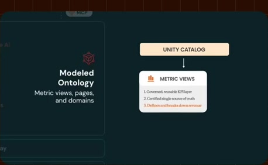
[Full source frame](../frames/full/0007710.jpg)
> is how we slice and dice revenue. And and metric views are fully GA'd. Pages are a bit newer. Uh it's the it's

### 04:24.00 — intermediate observed state
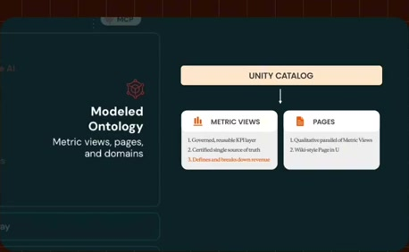
[Full source frame](../frames/full/0007920.jpg)
> the qualitative equivalent of a metric view. I think of them as wiki pages in in Unity Catalog. So, if a metric view

### 04:43.00 — intermediate observed state
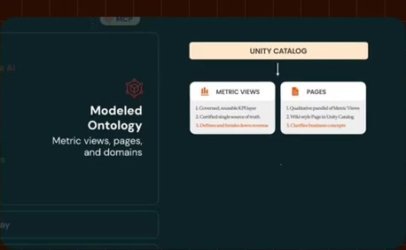
[Full source frame](../frames/full/0008490.jpg)
> You can use Genie code to actually get started on creating your pages. And then finally, domains uh allow you to do

### 05:09.00 — intermediate observed state

[Full source frame](../frames/full/0009270.jpg)
> question about finance, you know, we can start from from the finance domain. So, together, metric views, pages, and

### 05:24.00 — later observed state

[Full source frame](../frames/full/0009720.jpg)
> if not impossible, to try to codify the entire organization's knowledge that way, to have a centralized data team responsible for codifying the the

<details>
<summary>8 original change windows: before / near transition / after</summary>

### Estimated anchor 04:09.00

| Before | Near transition | After |
| --- | --- | --- |
| 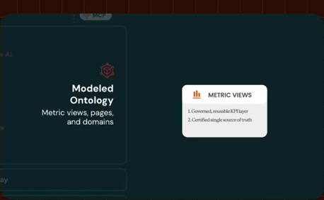 |  | 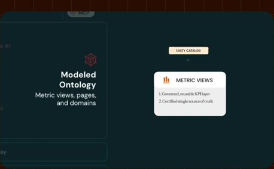 |

> certified single source of truth definition for your key business metrics stored as open format Unity Catalog objects. So, for example, you know, this

### Estimated anchor 04:16.00

| Before | Near transition | After |
| --- | --- | --- |
| 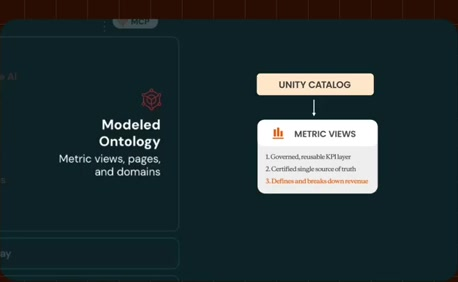 |  |  |

> objects. So, for example, you know, this is how we slice and dice revenue. And and metric views are fully GA'd. Pages are a bit newer. Uh it's the it's

### Estimated anchor 04:23.00

| Before | Near transition | After |
| --- | --- | --- |
| 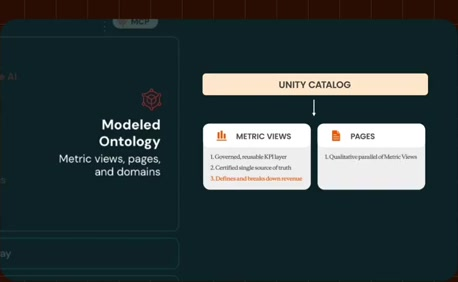 |  |  |

> Pages are a bit newer. Uh it's the it's the qualitative equivalent of a metric view. I think of them as wiki pages in in Unity Catalog. So, if a metric view

### Estimated anchor 04:41.00

| Before | Near transition | After |
| --- | --- | --- |
|  |  | 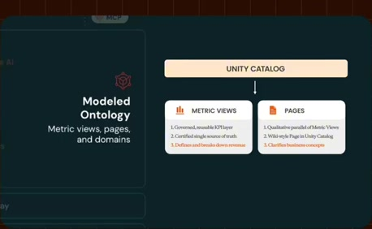 |

> is actually super easy to get started. You can use Genie code to actually get started on creating your pages. And then finally, domains uh allow you to do

### Estimated anchor 04:52.00

| Before | Near transition | After |
| --- | --- | --- |
| 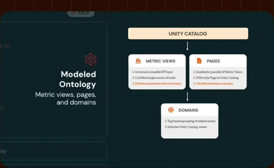 |  |  |

> tag-based logical collections of assets, uh both Unity Catalog and workspace assets by things like business unit or geo or function. So, you might have a

### Estimated anchor 05:07.00

| Before | Near transition | After |
| --- | --- | --- |
|  | 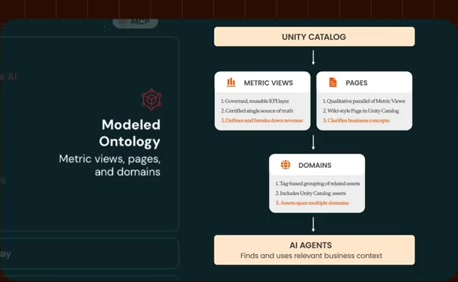 |  |

> search space. So, if someone asks a question about finance, you know, we can start from from the finance domain. So,

### Estimated anchor 05:15.00

| Before | Near transition | After |
| --- | --- | --- |
| 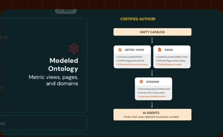 | 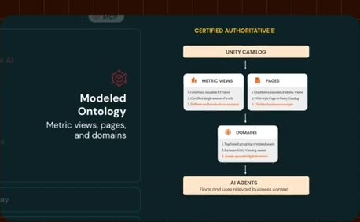 | 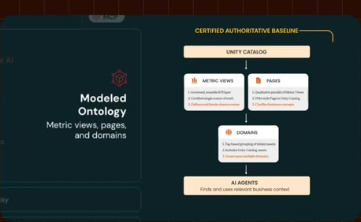 |

> together, metric views, pages, and domains form this certified authoritative baseline. But it's hard,

### Estimated anchor 05:22.00

| Before | Near transition | After |
| --- | --- | --- |
|  | 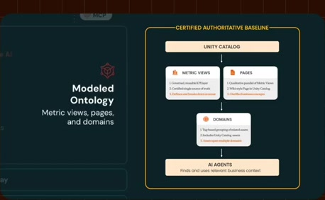 |  |

> authoritative baseline. But it's hard, if not impossible, to try to codify the entire organization's knowledge that way, to have a centralized data team

</details>
