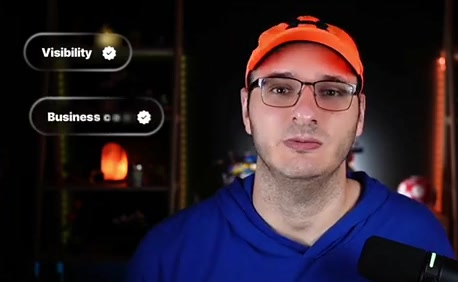
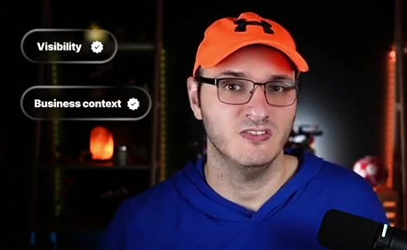
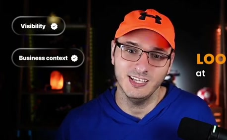
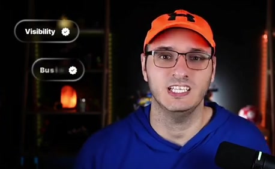
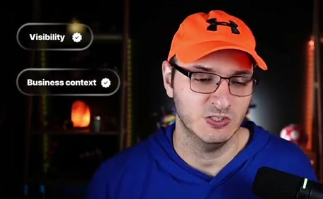
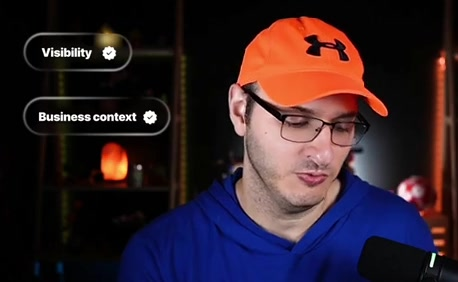
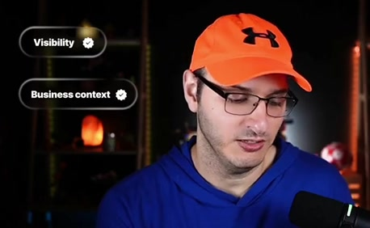

# Visibility and business-context callouts

**Source:** [20:29.00–20:48.00](https://www.youtube.com/watch?v=HtR5m5VjaDQ) · **Template:** callout · **Type:** explanatory-graphic-or-overlay

**Teaching purpose:** Highlight the host’s named concerns without inventing a mechanism.
**Relationship:** spoken concept → concise emphasis

## Original transcript

> visibility perspective, from an understanding the business perspective, all of that descriptive analytics, if you will, in a much more tailored way. But what happens when you want to go from just looking at data and you actually want to do something with the data?

Rolling transcript, approximate times and original transcription errors preserved.

## Parameterized teaching pattern

- `The key idea is {{concept}}.`
- `We need both {{concern_a}} and {{concern_b}}.`

**Use when:** Use for a short framing or recap phrase.
**Choose another approach when:** Use a diagram when the mechanism needs explanation; a floating word is insufficient.

**Proposed adaptation motion:** Reveal the named phrase or pill at the speech cue, retain it only while it supports the point.

## Source-specific reveal evidence

```json
{
  "status": "Sequence-level source observations are attached in prior_source_observations. The family motion grammar is a proposed reusable pattern, not a frame-exact claim about this instance."
}
```

## Original source states

### 20:29.30 — earlier observed state

[Full source frame](../frames/full/0036879.jpg)
> >> That's great from a visibility perspective, from an understanding the business perspective, all of that

### 20:33.00 — intermediate observed state

[Full source frame](../frames/full/0036990.jpg)
> understanding the business perspective, all of that descriptive analytics, if you will, in a much more tailored

### 20:38.30 — intermediate observed state

[Full source frame](../frames/full/0037149.jpg)
> descriptive analytics, if you will, in a much more tailored way. But what happens when you want to

### 20:44.00 — later observed state

[Full source frame](../frames/full/0037320.jpg)
> way. But what happens when you want to go from just looking at data and you actually want to do

<details>
<summary>2 original change windows: before / near transition / after</summary>

### Estimated anchor 20:29.00

| Before | Near transition | After |
| --- | --- | --- |
|  |  |  |

> >> That's great from a visibility perspective, from an understanding the business perspective, all of that

### Estimated anchor 20:38.00

| Before | Near transition | After |
| --- | --- | --- |
|  |  |  |

> descriptive analytics, if you will, in a much more tailored way. But what happens when you want to

</details>
