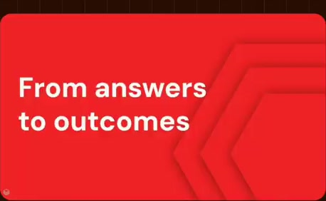
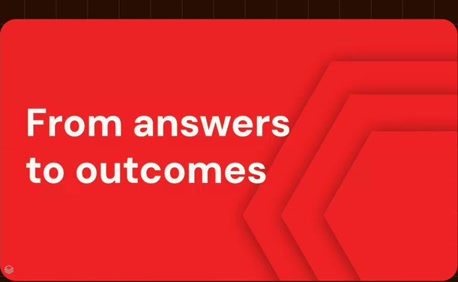
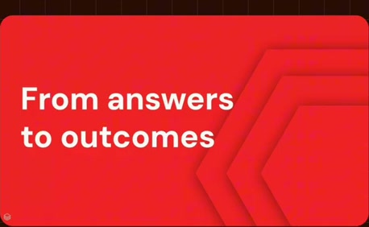
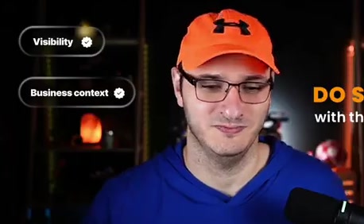
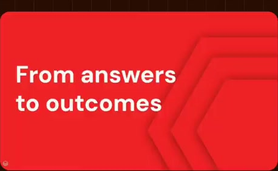

# From answers to outcomes

**Source:** [20:48.00–21:06.00](https://www.youtube.com/watch?v=HtR5m5VjaDQ) · **Template:** chapter · **Type:** chapter-navigation

**Teaching purpose:** Mark the move from answering to acting.
**Relationship:** chapter transition

## Original transcript

> want to do something with the data? >> Yeah, I think that's a good point. It's important that Genie evolve from just doing Q&A into actually becoming a co-worker. So, we're building out a lot in this space. I think we started with the ontology because, frankly, I think that's where the differentiation comes from, but we are also trying to build as much as possible on this co-working side

Rolling transcript, approximate times and original transcription errors preserved.

## Parameterized teaching pattern

- `Now let’s look at {{next_section}}.`
- `We have covered {{previous_topic}}; next is {{next_topic}}.`

**Use when:** Use for a real structural transition.
**Choose another approach when:** A chapter title is navigation, not an explanatory mechanism.

**Proposed adaptation motion:** Brief clear title hold, then transition to the next teaching surface.

## Source-specific reveal evidence

```json
{
  "status": "Sequence-level source observations are attached in prior_source_observations. The family motion grammar is a proposed reusable pattern, not a frame-exact claim about this instance."
}
```

## Original source states

### 20:48.30 — earlier observed state

[Full source frame](../frames/full/0037449.jpg)
> want to do something with the data? >> Yeah, I think that's a good point. It's

### 20:53.00 — intermediate observed state

[Full source frame](../frames/full/0037590.jpg)
> >> Yeah, I think that's a good point. It's important that Genie evolve from just doing Q&A into actually becoming a

### 21:00.00 — intermediate observed state

[Full source frame](../frames/full/0037800.jpg)
> co-worker. So, we're building out a lot in this space. I think we started with the ontology because, frankly, I think that's where the differentiation comes

### 21:05.00 — later observed state

[Full source frame](../frames/full/0037950.jpg)
> that's where the differentiation comes from, but we are also trying to build as much as possible on this co-working side as well.

<details>
<summary>1 original change windows: before / near transition / after</summary>

### Estimated anchor 20:48.00

| Before | Near transition | After |
| --- | --- | --- |
|  |  |  |

> just looking at data and you actually want to do something with the data? >> Yeah, I think that's a good point. It's

</details>
