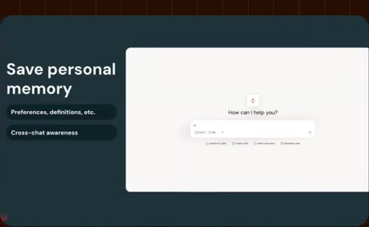
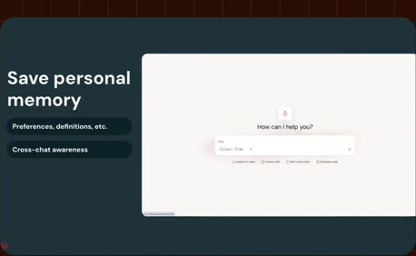
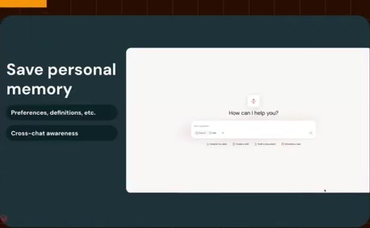
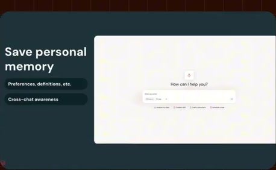
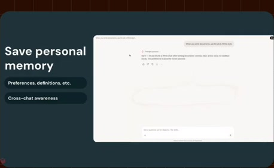
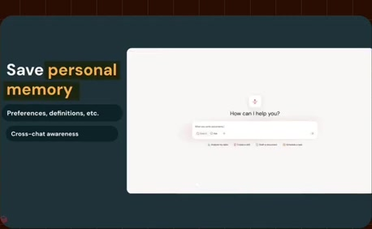
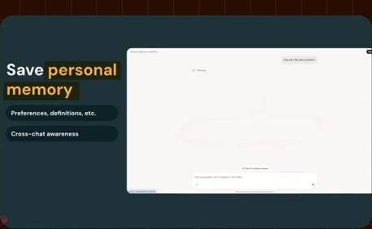
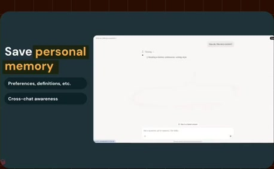

# Personal memory and visible interface

**Source:** [11:19.00–11:54.50](https://www.youtube.com/watch?v=HtR5m5VjaDQ) · **Template:** feature-evidence · **Type:** explanatory-graphic-or-overlay

**Teaching purpose:** Use actual interface evidence to support a named memory capability.
**Relationship:** stable capability → supporting product evidence

## Original transcript

> source permissions in Unity Catalog is a is a pretty hard problem. So, that's organization's context. There's one last thing I want to mention before we actually see this in the product, and that is your personal context. And you can actually ask Genie to preserve things like your preferences, your definitions, and so on through personal memory. And that also allows Genie to, you know, search across chats, things like that. I personally like to save things like style preferences in writing. And And just like all data in the ontology, it's not like this is being shared with people who who shouldn't have access to it. You know, when you steer Genie for yourself, you are impacting only your experience. >> For clarity on this, this means that if

Rolling transcript, approximate times and original transcription errors preserved.

## Parameterized teaching pattern

- `To {{user_job}}, use {{feature}}: {{specific_interaction}}.`
- `Here {{system}} lets {{actor}} {{action}}, with {{constraint}}.`

**Use when:** Use when the actual visible product interaction supports the claim.
**Choose another approach when:** Do not fabricate UI or infer availability beyond the visible source version.

**Proposed adaptation motion:** Hold the heading; update one supporting point as the real interface demonstrates it.

## Source-specific reveal evidence

```json
{
  "status": "Sequence-level source observations are attached in prior_source_observations. The family motion grammar is a proposed reusable pattern, not a frame-exact claim about this instance."
}
```

## Original source states

### 11:19.30 — earlier observed state

[Full source frame](../frames/full/0020379.jpg)
> source permissions in Unity Catalog is a is a pretty hard problem. So, that's organization's context.

### 11:27.00 — intermediate observed state

[Full source frame](../frames/full/0020610.jpg)
> before we actually see this in the product, and that is your personal context. And you can actually ask Genie to preserve things like your

### 11:36.00 — intermediate observed state

[Full source frame](../frames/full/0020880.jpg)
> preferences, your definitions, and so on through personal memory. And that also allows Genie to, you know, search across chats, things like that. I personally

### 11:45.00 — intermediate observed state

[Full source frame](../frames/full/0021150.jpg)
> preferences in writing. And And just like all data in the ontology, it's not like this is being shared with people who who shouldn't have access to it. You

### 11:53.00 — later observed state

[Full source frame](../frames/full/0021390.jpg)
> know, when you steer Genie for yourself, you are impacting only your experience. >> For clarity on this, this means that if

<details>
<summary>5 original change windows: before / near transition / after</summary>

### Estimated anchor 11:19.00

| Before | Near transition | After |
| --- | --- | --- |
|  |  |  |

> source permissions in Unity Catalog is a is a pretty hard problem. So, that's organization's context.

### Estimated anchor 11:26.00

| Before | Near transition | After |
| --- | --- | --- |
|  |  |  |

> before we actually see this in the product, and that is your personal context. And you can actually ask Genie

### Estimated anchor 11:35.00

| Before | Near transition | After |
| --- | --- | --- |
|  |  |  |

> preferences, your definitions, and so on through personal memory. And that also allows Genie to, you know, search across chats, things like that. I personally

### Estimated anchor 11:44.00

| Before | Near transition | After |
| --- | --- | --- |
|  |  |  |

> like to save things like style preferences in writing. And And just like all data in the ontology, it's not like this is being shared with people who who shouldn't have access to it. You

### Estimated anchor 11:50.00

| Before | Near transition | After |
| --- | --- | --- |
|  |  |  |

> who who shouldn't have access to it. You know, when you steer Genie for yourself, you are impacting only your experience.

</details>
