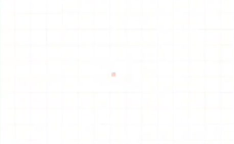
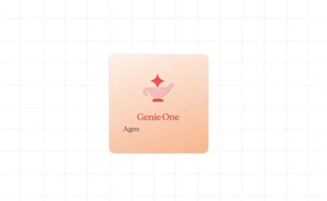
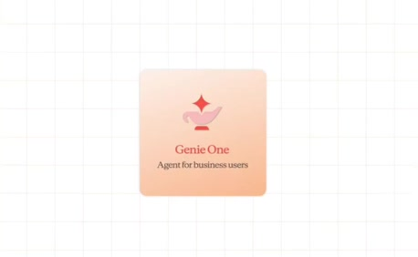
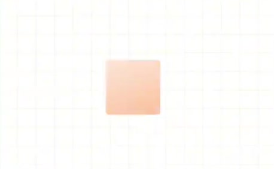
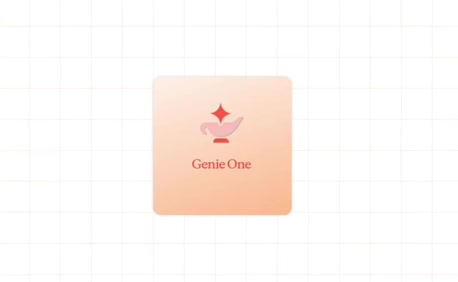

# Define the agentic assistant

**Source:** [00:38.00–00:43.35](https://www.youtube.com/watch?v=HtR5m5VjaDQ) · **Template:** product-definition · **Type:** explanatory-graphic-or-overlay

**Teaching purpose:** Introduce the product role before concrete mechanisms.
**Relationship:** name → role → concrete capability

## Original transcript

> is. >> Yeah, absolutely. So, I come from the Genie 1 world. Genie 1 is our AI co-worker for business users. It It

Rolling transcript, approximate times and original transcription errors preserved.

## Parameterized teaching pattern

- `{{concept}} is {{category}} that {{capability}}.`
- `You give {{system}} {{input}}; it helps you {{specific_job}}.`

**Use when:** Use when the viewer needs a definition before a mechanism or example.
**Choose another approach when:** Do not use a logo reveal to explain an internal architecture.

**Proposed adaptation motion:** Introduce the name and role; settle before expanding the surrounding context.

## Source-specific reveal evidence

```json
{
  "status": "Sequence-level source observations are attached in prior_source_observations. The family motion grammar is a proposed reusable pattern, not a frame-exact claim about this instance."
}
```

## Original source states

### 00:38.30 — earlier observed state

[Full source frame](../frames/full/0001149.jpg)
> is. >> Yeah, absolutely. So, I come from the Genie 1 world. Genie 1 is our AI

### 00:39.80 — intermediate observed state

[Full source frame](../frames/full/0001194.jpg)
> is. >> Yeah, absolutely. So, I come from the Genie 1 world. Genie 1 is our AI co-worker for business users. It It

### 00:41.50 — intermediate observed state

[Full source frame](../frames/full/0001245.jpg)
> >> Yeah, absolutely. So, I come from the Genie 1 world. Genie 1 is our AI co-worker for business users. It It

### 00:43.10 — later observed state

[Full source frame](../frames/full/0001293.jpg)
> >> Yeah, absolutely. So, I come from the Genie 1 world. Genie 1 is our AI co-worker for business users. It It connects to your data and tools. It

<details>
<summary>1 original change windows: before / near transition / after</summary>

### Estimated anchor 00:39.80

| Before | Near transition | After |
| --- | --- | --- |
|  |  |  |

> is. >> Yeah, absolutely. So, I come from the Genie 1 world. Genie 1 is our AI co-worker for business users. It It

</details>
