# Question, answer and suggested action

**Source:** [00:46.50–00:50.80](https://www.youtube.com/watch?v=HtR5m5VjaDQ) · **Template:** worked-example · **Type:** explanatory-graphic-or-overlay

**Teaching purpose:** Make the abstract capability concrete with a chat-style example.
**Relationship:** question → reasoning/result → action

## Original transcript

> connects to your data and tools. It answers questions about your business. It acts on the answers that it gives you, all within the governance framework

Rolling transcript, approximate times and original transcription errors preserved.

## Parameterized teaching pattern

- `Suppose you ask {{concrete_question}}. {{system}} uses {{evidence}} to {{result}}.`
- `From that answer, you can {{next_action}}, subject to {{constraint}}.`

**Use when:** Use after a capability needs a tangible demonstration.
**Choose another approach when:** Use genuine product footage for actual execution; label invented chat examples as illustrative.

**Proposed adaptation motion:** Establish the prompt, reveal its response, then add the next action; keep the question visible.

## Source-specific reveal evidence

```json
{
  "status": "Sequence-level source observations are attached in prior_source_observations. The family motion grammar is a proposed reusable pattern, not a frame-exact claim about this instance."
}
```

## Original source states

### 00:46.60 — earlier observed state

[Full source frame](../frames/full/0001398.jpg)
> co-worker for business users. It It connects to your data and tools. It answers questions about your business. It acts on the answers that it gives

### 00:47.60 — intermediate observed state
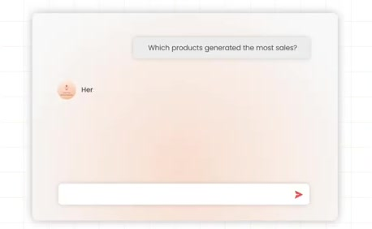
[Full source frame](../frames/full/0001428.jpg)
> co-worker for business users. It It connects to your data and tools. It answers questions about your business. It acts on the answers that it gives

### 00:48.90 — intermediate observed state
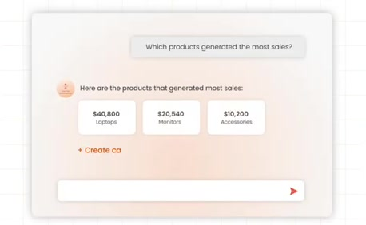
[Full source frame](../frames/full/0001467.jpg)
> connects to your data and tools. It answers questions about your business. It acts on the answers that it gives you, all within the governance framework

### 00:50.60 — later observed state
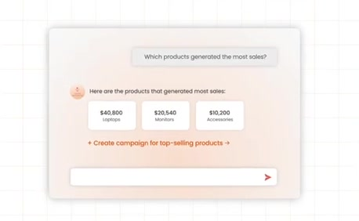
[Full source frame](../frames/full/0001518.jpg)
> answers questions about your business. It acts on the answers that it gives you, all within the governance framework that you already have. But, Genie 1 sits

<details>
<summary>3 original change windows: before / near transition / after</summary>

### Estimated anchor 00:47.65

| Before | Near transition | After |
| --- | --- | --- |
| 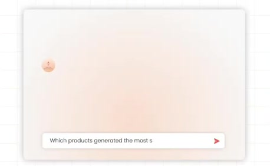 | 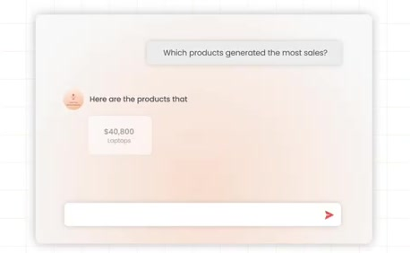 | 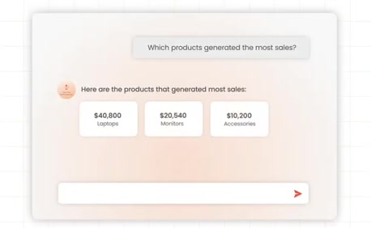 |

> co-worker for business users. It It connects to your data and tools. It answers questions about your business. It acts on the answers that it gives

### Estimated anchor 00:48.85

| Before | Near transition | After |
| --- | --- | --- |
| 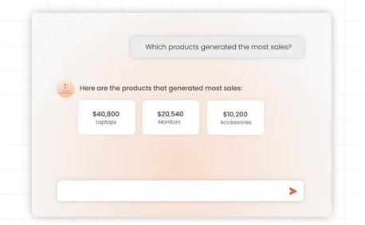 | 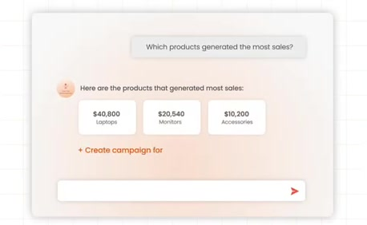 | 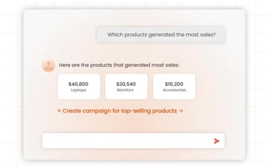 |

> connects to your data and tools. It answers questions about your business. It acts on the answers that it gives you, all within the governance framework

### Estimated anchor 00:50.60

| Before | Near transition | After |
| --- | --- | --- |
| 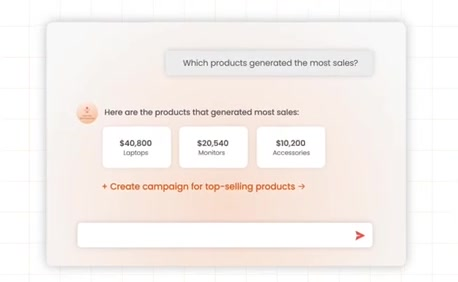 | 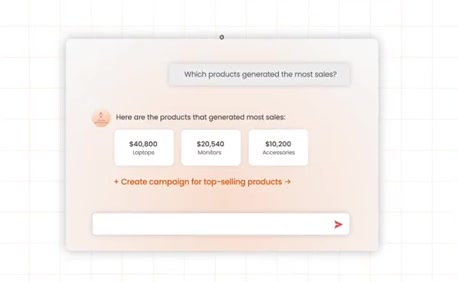 |  |

> answers questions about your business. It acts on the answers that it gives you, all within the governance framework that you already have. But, Genie 1 sits

</details>
