# Baseline, experts, sources and rollout rail

**Source:** [30:48.00–32:37.00](https://www.youtube.com/watch?v=HtR5m5VjaDQ) · **Template:** rollout · **Type:** explanatory-graphic-or-overlay

**Teaching purpose:** Retain ordered progress while replacing details beneath the current step.
**Relationship:** ordered milestones → current step → details

## Original transcript

> Uh you'll also probably want to record today's baseline, you know, pre pre-Genie. You know, how accurate is the existing process? How long does it take? Where do people get stuck? Include both straightforward questions and ambiguous questions and then cases where maybe like permissions should produce different answers for different users based on what different people have access to. And then from there, I would recommend bringing in domain experts. Maybe they also help you write the benchmarking questions. But you're going to want someone who actually understands that team and their workflows and their data. So taking the the finance example, that might be something like an FP&A lead who owns the monthly reporting and knows exactly how the company defines things like budgets and and actuals. And they might also be interested in the user feedback that you're getting as part of this pilot. So it's good to keep them in loop with the end users and make sure that they're available um and they're able to see to see those those results. Then you're going to want to connect all your sources that that that are needed for this workflow. So do you need, you know, SharePoint, Gmail, Jira, Slack? You need to make sure that people can read from and optionally write to their third-party tools. And then you can also choose to do things like add instructions where helpful. That'll that'll further steer Genie with whatever prompts you provide. Uh but you probably won't need all that many to start. If the underlying semantics and source materials are really strong, I think you'll find that Genie can do a lot with out really needing a long list of rules. And finally, put that into the the team's hands. See where it succeeds, see it where it gets confused, uh where the ontology needs more context. Iterate on the semantics and optionally the instructions as you need. And then once it's working well, go to the next workflow, the next line of business, and so on. On our end, we are building more and more monitoring tools to make this easier and easier to do. So you're going to start to see more detailed Genie 1 monitoring rolling out as well as ontology monitoring. Now as you expand

Rolling transcript, approximate times and original transcription errors preserved.

## Parameterized teaching pattern

- `Start with {{team_and_workflow}}, define {{benchmark}}, measure {{baseline}}, then connect {{sources}} and iterate.`
- `At {{current_step}}, do {{task}} so that {{next_step}} has {{required_input}}.`

**Use when:** Use for a real ordered process with useful current-step context.
**Choose another approach when:** Use peer cards for unordered considerations; a rail is not a promise about calendar duration.

**Proposed adaptation motion:** Retain earlier milestones, activate the next marker, update details below and pan only when space is exhausted.

## Source-specific reveal evidence

```json
{
  "status": "Sequence-level source observations are attached in prior_source_observations. The family motion grammar is a proposed reusable pattern, not a frame-exact claim about this instance."
}
```

## Original source states

### 30:49.00 — earlier observed state
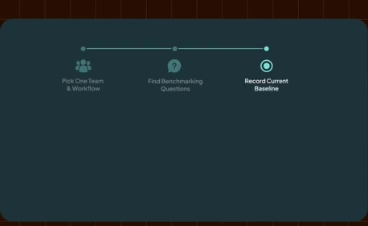
[Full source frame](../frames/full/0055470.jpg)
> you continue to invest in your ontology. Uh you'll also probably want to record today's baseline, you know, pre pre-Genie. You know, how accurate is the existing process? How long does it take?

### 31:01.00 — intermediate observed state
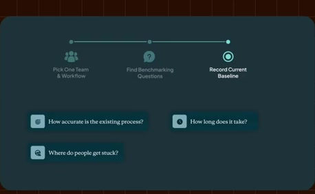
[Full source frame](../frames/full/0055830.jpg)
> and ambiguous questions and then cases where maybe like permissions should produce different answers for different users based on what different people

### 31:13.00 — intermediate observed state
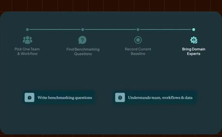
[Full source frame](../frames/full/0056190.jpg)
> also help you write the benchmarking questions. But you're going to want someone who actually understands that team and their workflows and their data.

### 31:32.00 — intermediate observed state
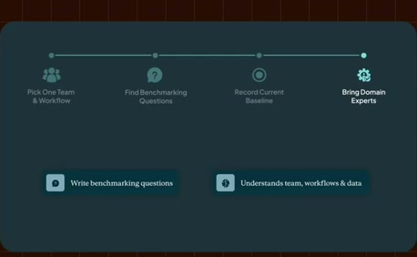
[Full source frame](../frames/full/0056760.jpg)
> feedback that you're getting as part of this pilot. So it's good to keep them in loop with the end users and make sure that they're available um and they're

### 31:54.00 — intermediate observed state
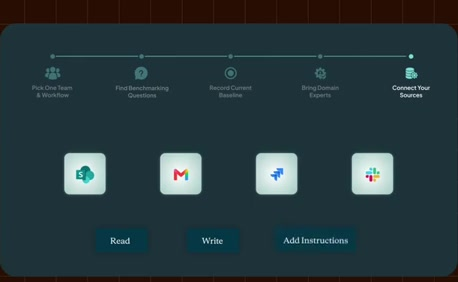
[Full source frame](../frames/full/0057420.jpg)
> read from and optionally write to their third-party tools. And then you can also choose to do things like add instructions where helpful. That'll that'll further steer Genie with

### 32:14.00 — intermediate observed state
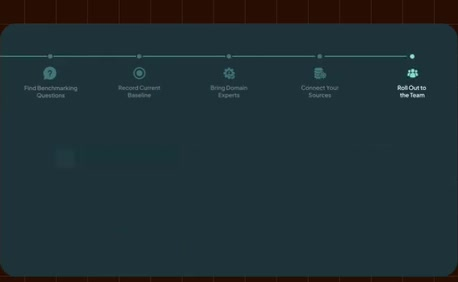
[Full source frame](../frames/full/0058020.jpg)
> lot with out really needing a long list of rules. And finally, put that into the the team's hands. See where it succeeds, see it where it gets confused, uh where

### 32:34.00 — later observed state

[Full source frame](../frames/full/0058620.jpg)
> and more monitoring tools to make this easier and easier to do. So you're going to start to see more detailed Genie 1 monitoring rolling out as well as ontology monitoring. Now as you expand

<details>
<summary>11 original change windows: before / near transition / after</summary>

### Estimated anchor 30:50.00

| Before | Near transition | After |
| --- | --- | --- |
|  | 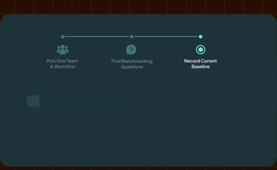 | 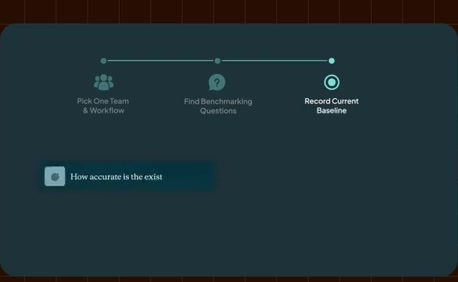 |

> Uh you'll also probably want to record today's baseline, you know, pre pre-Genie. You know, how accurate is the existing process? How long does it take?

### Estimated anchor 31:00.00

| Before | Near transition | After |
| --- | --- | --- |
|  |  |  |

> Include both straightforward questions and ambiguous questions and then cases where maybe like permissions should produce different answers for different users based on what different people

### Estimated anchor 31:11.00

| Before | Near transition | After |
| --- | --- | --- |
|  | 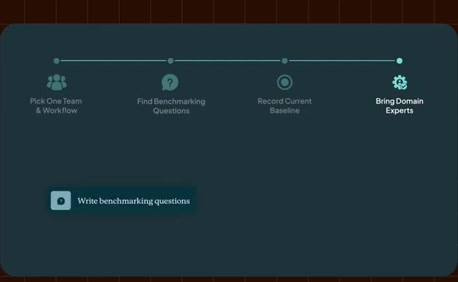 | 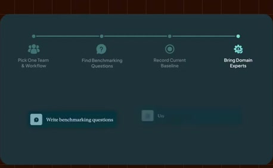 |

> bringing in domain experts. Maybe they also help you write the benchmarking questions. But you're going to want someone who actually understands that team and their workflows and their data.

### Estimated anchor 31:20.00

| Before | Near transition | After |
| --- | --- | --- |
|  |  |  |

> So taking the the finance example, that might be something like an FP&A lead who owns the monthly reporting and knows exactly how the company defines things

### Estimated anchor 31:30.00

| Before | Near transition | After |
| --- | --- | --- |
| 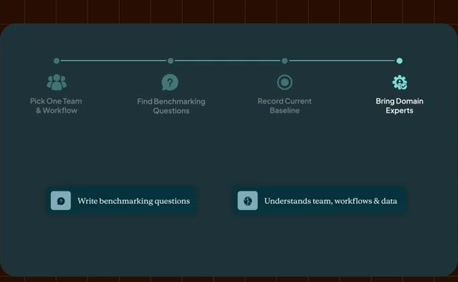 |  |  |

> might also be interested in the user feedback that you're getting as part of this pilot. So it's good to keep them in loop with the end users and make sure

### Estimated anchor 31:41.00

| Before | Near transition | After |
| --- | --- | --- |
| 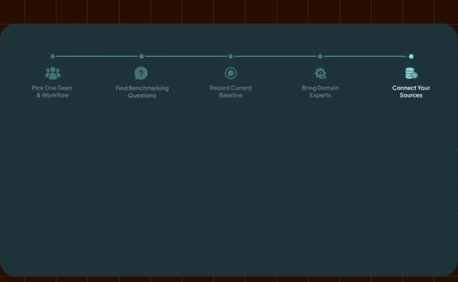 | 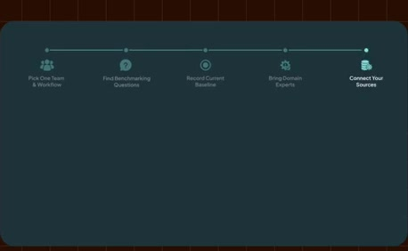 |  |

> able to see to see those those results. Then you're going to want to connect all your sources that that that are needed for this workflow. So do you need, you

### Estimated anchor 31:51.00

| Before | Near transition | After |
| --- | --- | --- |
| 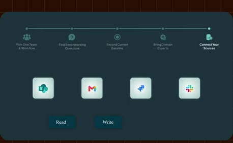 |  |  |

> You need to make sure that people can read from and optionally write to their third-party tools. And then you can also choose to do things like add

### Estimated anchor 32:00.00

| Before | Near transition | After |
| --- | --- | --- |
|  |  | 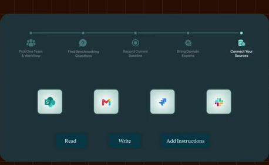 |

> that'll further steer Genie with whatever prompts you provide. Uh but you probably won't need all that many to start. If the underlying semantics and

### Estimated anchor 32:12.00

| Before | Near transition | After |
| --- | --- | --- |
| 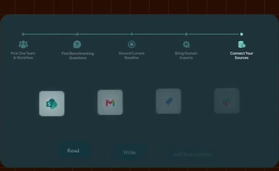 | 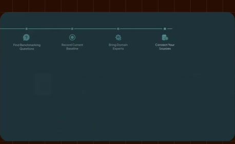 | 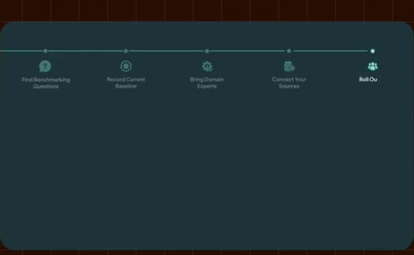 |

> think you'll find that Genie can do a lot with out really needing a long list of rules. And finally, put that into the the team's hands. See where it succeeds,

### Estimated anchor 32:24.00

| Before | Near transition | After |
| --- | --- | --- |
| 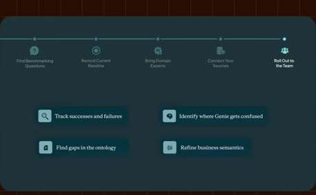 |  | 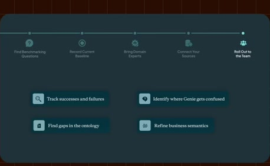 |

> on the semantics and optionally the instructions as you need. And then once it's working well, go to the next workflow, the next line of business, and

### Estimated anchor 32:32.00

| Before | Near transition | After |
| --- | --- | --- |
| 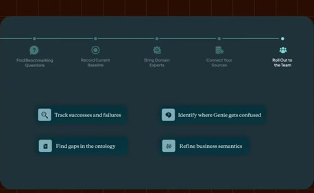 |  |  |

> so on. On our end, we are building more and more monitoring tools to make this easier and easier to do. So you're going to start to see more detailed Genie 1

</details>
