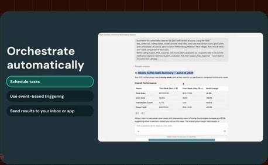
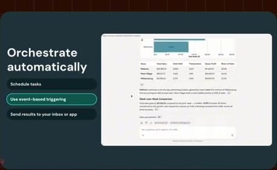
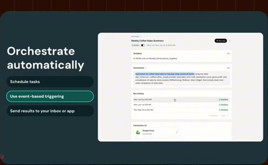
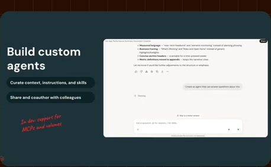
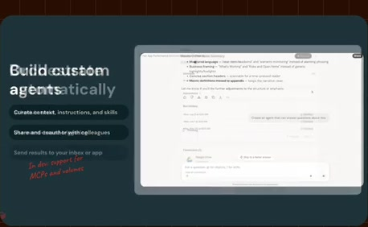
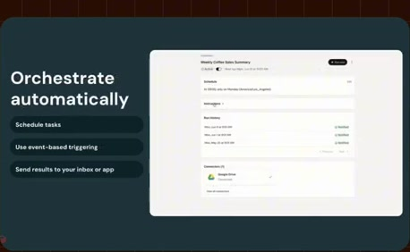
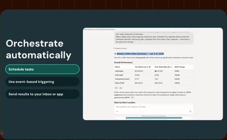
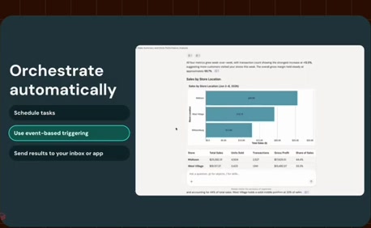
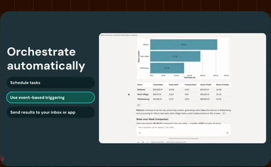

# Scheduling, triggers and monitoring

**Source:** [25:23.00–25:53.00](https://www.youtube.com/watch?v=HtR5m5VjaDQ) · **Template:** feature-evidence · **Type:** explanatory-graphic-or-overlay

**Teaching purpose:** Show the supported orchestration surfaces with a stable feature heading.
**Relationship:** stable capability → supporting product evidence

## Original transcript

> connectors. And we are also adding uh sub-agent support. Now, once a task works the way you want, you can set it and forget it, right? You can put it on a cadence, daily, weekly, whatever you pick, and deliver the results to your inbox. You can also trigger based on specific conditions. So, for example, you know, I only want to know if a metric drops or or grows by a certain percentage amount. So, I've I've instructed Genie to do that. Behind the scenes, this is just based on the the tried and tested LinkFlow Jobs platform, so it is highly reliable. And going forward, we are continuing to invest in more orchestration features such as sending to larger groups of

Rolling transcript, approximate times and original transcription errors preserved.

## Parameterized teaching pattern

- `To {{user_job}}, use {{feature}}: {{specific_interaction}}.`
- `Here {{system}} lets {{actor}} {{action}}, with {{constraint}}.`

**Use when:** Use when the actual visible product interaction supports the claim.
**Choose another approach when:** Do not fabricate UI or infer availability beyond the visible source version.

**Proposed adaptation motion:** Hold the heading; update one supporting point as the real interface demonstrates it.

## Source-specific reveal evidence

```json
{
  "status": "Sequence-level source observations are attached in prior_source_observations. The family motion grammar is a proposed reusable pattern, not a frame-exact claim about this instance."
}
```

## Original source states

### 25:23.30 — earlier observed state

[Full source frame](../frames/full/0045699.jpg)
> connectors. And we are also adding uh sub-agent support. Now, once a task works the way you want,

### 25:33.50 — intermediate observed state

[Full source frame](../frames/full/0046005.jpg)
> whatever you pick, and deliver the results to your inbox. You can also trigger based on specific conditions. So, for example, you know, I only want

### 25:44.00 — intermediate observed state

[Full source frame](../frames/full/0046320.jpg)
> a certain percentage amount. So, I've I've instructed Genie to do that. Behind the scenes, this is just based on the the tried and tested LinkFlow Jobs

### 25:52.00 — later observed state

[Full source frame](../frames/full/0046560.jpg)
> platform, so it is highly reliable. And going forward, we are continuing to invest in more orchestration features such as sending to larger groups of

<details>
<summary>3 original change windows: before / near transition / after</summary>

### Estimated anchor 25:23.00

| Before | Near transition | After |
| --- | --- | --- |
|  |  |  |

> connectors. And we are also adding uh sub-agent support.

### Estimated anchor 25:33.00

| Before | Near transition | After |
| --- | --- | --- |
|  |  |  |

> can put it on a cadence, daily, weekly, whatever you pick, and deliver the results to your inbox. You can also trigger based on specific conditions.

### Estimated anchor 25:43.00

| Before | Near transition | After |
| --- | --- | --- |
|  |  |  |

> to know if a metric drops or or grows by a certain percentage amount. So, I've I've instructed Genie to do that. Behind the scenes, this is just based on the

</details>
